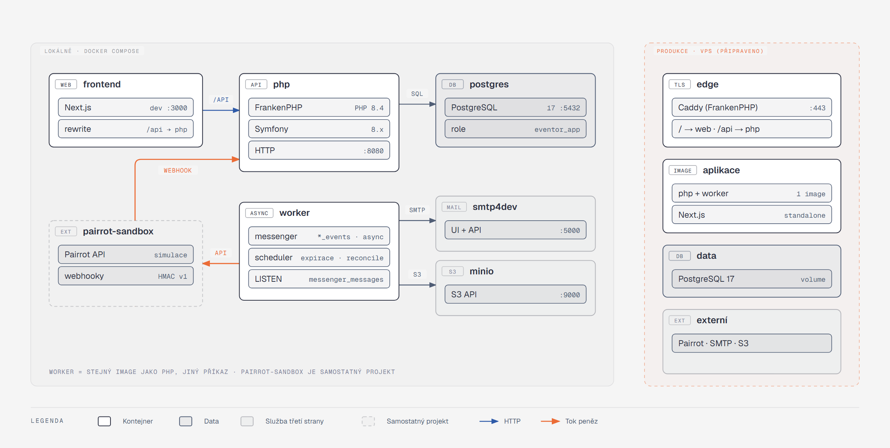

[Architektura](../README.md) · [← 00 Slovník](../00-slovnik.md) · **01 Kontext a nasazení** · [02 Moduly a hranice →](../02-moduly-a-hranice/README.md)

# 01 · Kontext a nasazení

## Co si odnést

Eventor má tři lidské aktéry a tři externí služby. Lidé (pořadatel s týmem, účastník a obsluha odbavení) chodí výhradně přes Next.js frontend a ten volá Symfony API na stejné doméně. Externí služby jsou Pairrot (platby převodem), SMTP (e-mail) a S3 (soubory). Mluví s nimi jen backend a worker, nikdy frontend.

Lokálně všechno běží v Docker Compose, takže na Windows není potřeba PHP ani Postgres. Produkční image a compose pro VPS za Caddy jsou připravené a liší se jen konfigurací, ne kódem. Tajemství nikdy nejsou v repozitáři: lokálně leží v `.env.local`, produkčně v Symfony secrets vaultu a v proměnných prostředí.


**Jak to číst.**
- **Lidé** vlevo přicházejí přes HTTPS do Next.js. Frontend posílá všechno pod `/api/*` do Symfony API.
- **API a worker** sdílejí jeden Postgres. API zapisuje stav a do outboxu, worker z outboxu čte.
- **Oranžové šipky** jsou tok peněz: worker vytváří platební požadavky v Pairrotu a Pairrot vrací změny stavu podepsaným webhookem do API.
- **E-maily a soubory** obsluhuje backend přes standardní protokoly (SMTP, S3 API). Konkrétního providera lze vyměnit konfigurací.

## Aktéři

| Aktér | Vstup | Autentizace | Co dělá |
|---|---|---|---|
| Vlastník organizace, správce akce, finance | Next.js admin `/admin/{orgSlug}/…` → `/api/admin/org/{orgSlug}/*` | session cookie (`json_login`) | konfigurace, registrace, platby, komunikace, reporty ([kap. 3 zadání](../../initial-idea/zadani-event-platforma.md)) |
| Účastník / objednávající | veřejná stránka `/{orgSlug}/{eventSlug}` → `/api/public/*`, samoobsluha `/s/{token}` → `/api/self-service/*` | žádná, resp. token samoobsluhy `ss1_…` | registrace (REG-01), samoobsluha (REG-08), odvolání souhlasu (LEG-09) |
| Obsluha odbavení | odbavovací obrazovka `/check-in` → `/api/check-in/*` | session člena týmu nebo token zařízení `dev1_…` | vyhledání, QR, odbavení, hotovost (CHK-01–10) |
| Pairrot | `POST /api/webhooks/pairrot` | HMAC podpis (`Pairrot-Webhook-Signature`) | změny stavu platebních požadavků a transakcí |
| Plánovač (Scheduler) | v procesu workeru | — | expirace rezervací, upomínky, reconcile, retence |

Autentizaci podrobně popisuje [kapitola 08](../08-prurezove-koncepty/README.md) a [ADR 006](../../adr/006-authentication-session-tokens-no-jwt.md).

## Externí systémy

| Systém | Směr | Protokol | Kdo volá | Selhání | Detail |
|---|---|---|---|---|---|
| **Pairrot** | obousměrně | REST + Bearer `prt_…` (ven), webhook HMAC (dovnitř), event log (reconcile) | worker (požadavky, alokace, reconcile), API (webhook, ruční přiřazení) | registrace se uloží, požadavek se vytváří s retry (PAY-03, S08) | [07](../07-integrace/README.md), [ADR 004](../../adr/004-pairrot-integration-contract.md) |
| **SMTP** | ven | SMTP přes Symfony Mailer DSN | jen worker (odběratel outboxu) | zprávy čekají ve frontě doručení (COM-07, S09) | [07](../07-integrace/README.md) |
| **S3** | ven | S3 API přes Flysystem | API (upload, presigned URL), worker (náhledy, snímky dokumentů) | upload selže srozumitelnou chybou, nic se nezapíše | [07](../07-integrace/README.md) |
| **Mapy** | odkaz | URL | — | — | jen odkaz, žádné API v P0 |

Eventor nevolá žádnou další službu. Antispam je honeypot s časovou pastí a RateLimiter. Captcha by šla doplnit jako adaptér za portem `HumanVerifier` bez zásahu do domény.

## Kontejnery a procesy



**Jak to číst.**
- **Levá zóna** je lokální Docker Compose. Každý box je jedna služba z `compose.yaml` a čipy uvnitř ukazují technologii a port.
- **`pairrot-sandbox`** je samostatný projekt autora, který napodobuje skutečné API Pairrotu včetně podepsaných webhooků. Proto je čárkovaný.
- **Pravá zóna** je připravená produkce na VPS. Používá stejné image a jako jediný vstup TLS terminující FrankenPHP/Caddy.

| Služba | Image | Příkaz | Odpovědnost |
|---|---|---|---|
| `frontend` | `node:22` (dev), `frontend` image (prod, `output: standalone`) | `next dev` / `node server.js` | UI v Next.js 16 (App Router). Rewrite `/api/:path*` → `http://php:8080/api/:path*`, takže prohlížeč vidí jednu doménu a session cookie zůstává first-party. |
| `php` | `backend` image (FrankenPHP + PHP 8.4, worker mode) | `frankenphp run` | HTTP API, Symfony kernel v FrankenPHP worker režimu (kernel zůstává v paměti mezi požadavky) |
| `worker` | stejný `backend` image | `bin/console messenger:consume scheduler_default pairrot_inbox payments_events registration_events … async async_mail --time-limit=3600 --keepalive` | integrační události (transport na modul), inbox, asynchronní práce, Scheduler. Restart po hodině kvůli úniku paměti a nasazení nové verze. |
| `postgres` | `postgres:17` | — | jediná databáze. Dvě role: `eventor_owner` (migrace) a `eventor_app` (aplikace, bez `UPDATE`/`DELETE` na append-only tabulkách, viz [03](../03-data/README.md)). |
| `smtp4dev` | `rnwood/smtp4dev` | — | zachytává e-maily. UI a REST API slouží i testům doručení. Zastavení kontejneru simuluje výpadek (S09). |
| `minio` | `minio/minio` | — | S3 úložiště, bucket `eventor-media` (fotky, PDF, snímky dokumentů) |
| `pairrot-sandbox` | samostatný projekt | — | simulace Pairrotu. Eventor ho volá na `PAIRROT_API_URL` a sandbox posílá webhooky na `http://php:8080/api/webhooks/pairrot`. |

Proč worker jako samostatný proces, a ne „dispatcher přes HTTP“ jako v main-panelu: Messenger worker je v Symfony standard a drží spojení s Postgresem. Implementace W0 `LISTEN/NOTIFY` nepoužívá (`use_notify` není nastaveno), proto si worker frontu zjišťuje běžným pollingem. Plánovač je součást workeru (`symfony/scheduler`), takže odpadá systémový cron i „fire and forget“ HTTP volání bez zpětné vazby. To je jedna z bolestí main-panelu (`main-panel/docs/architecture/09-kde-to-boli`).

## Prostředí

| Prostředí | Kde | Pairrot | E-mail | Soubory | Data |
|---|---|---|---|---|---|
| `dev` | lokální Docker Compose | `pairrot-sandbox` | smtp4dev | MinIO | fixtures: demo událost „Borský podzimní víkend 2026“ (kap. 13 zadání) |
| `test` | Docker Compose v CI i lokálně, vlastní DB `eventor_test` | in-memory `FakePaymentGateway` (unit, integrační), `pairrot-sandbox` (kontraktní testy) | `null://null` a assert přes Mailer test helpers, smtp4dev v E2E | MinIO / in-memory Flysystem adapter | každý test v transakci (`dama/doctrine-test-bundle`), souběhové testy bez ní |
| `prod` | VPS, Docker Compose za FrankenPHP/Caddy | skutečný Pairrot (`https://api.pairrot.chytre.digital`) | SMTP provider podle DSN | S3 kompatibilní úložiště | — |

Rozdíl mezi prostředími je **jen v konfiguraci**: DSN, URL a klíče, popř. alias služby (`PaymentGateway` → fake v `test`). Nikde v kódu není `if ($env === 'prod')`. Přepínání implementací řeší DI kontejner, viz [09](../09-symfony-v-architekture/README.md).

## Síť a směrování

**Lokálně:**

```
prohlížeč ──► http://localhost:3000            (frontend, Next.js)
                 └─ /api/*  ──rewrite──►  http://php:8080/api/*   (Symfony)
smtp4dev UI ──► http://localhost:5000
MinIO console ► http://localhost:9001
pairrot-sandbox ──webhook──► http://php:8080/api/webhooks/pairrot
```

**Produkčně:**

```
https://eventor.chytre.digital
  ├─ /api/*      → php:8080      (FrankenPHP, stejný proces jako edge)
  ├─ /media/*    → 302 na presigned S3 URL (vydává API po kontrole oprávnění)
  └─ /*          → frontend:3000 (Next.js standalone)
```

Pravidla:

- **Jedna doména.** Session cookie je `HttpOnly; Secure; SameSite=Lax` a nikdy necestuje cross-site. CORS je vypnutý, protože ho jedna doména nepotřebuje.
- **Next.js server components volají API interně** (`http://php:8080`) a předávají cookie a `X-Forwarded-*` hlavičky. Symfony má `trusted_proxies` nastavené na síť compose.
- **Webhook Pairrotu je jediný vstup, který nechodí přes frontend.** V produkci jde přímo přes edge na `/api/webhooks/pairrot`.
- **Rate limiting** dělá aplikace (Symfony RateLimiter, úložiště v Postgresu přes cache pool), ne edge. Klíčem je IP z důvěryhodné proxy a e-mail nebo token.

## Konfigurace a tajemství

| Druh | Příklad | Kde žije | Jak se načte |
|---|---|---|---|
| Neutajená konfigurace | `PAIRROT_API_URL`, `DEFAULT_TIMEZONE=Europe/Prague`, `MAILER_FROM=noreply@eventor…` | `.env` (commitnutý, výchozí hodnoty) | `%env(...)%` |
| Lokální tajemství | `PAIRROT_MANAGEMENT_KEY` pro sandbox | `.env.local` (necommitnutý) | `%env(...)%` |
| Produkční tajemství | `APP_SECRET`, `PAIRROT_MANAGEMENT_KEY`, `PAIRROT_WEBHOOK_SECRETS`, `QR_SIGNING_KEYS`, `DATA_ENCRYPTION_KEY`, `DATABASE_URL`, `MAILER_DSN` | Symfony secrets vault `config/secrets/prod/` (šifrovaný, commitnutý). Dešifrovací klíč je jen na serveru (`SYMFONY_DECRYPTION_SECRET`). | `%env(...)%` (vault má přednost) |
| Tajemství organizátora | Pairrot subtenant ID, bankovní spojení | DB, citlivé sloupce šifrované (vlastní DBAL typ `encrypted_string`, klíč `DATA_ENCRYPTION_KEY`) | Doctrine |

Tajemství s rotací (`PAIRROT_WEBHOOK_SECRETS`, `QR_SIGNING_KEYS`) jsou **seznamy klíčů s ID**. Podepisuje se prvním klíčem a ověřuje se kterýmkoli ze seznamu. Rotace je tedy přidání klíče, nasazení a odebrání starého po uplynutí platnosti. Fallback na jiné tajemství neexistuje. Main-panel naopak tajemství pro hosty odvozoval od service-role klíče.

Vazbu tajemství na služby řeší `services.yaml` přes `bind` (`$pairrotWebhookSecrets: '%env(csv:PAIRROT_WEBHOOK_SECRETS)%'`) a vlastní env var processor pro dekódování seznamu klíčů. Podrobnosti jsou v [09](../09-symfony-v-architekture/README.md).

## Struktura repozitáře

```
eventor/
├─ compose.yaml              # dev služby (+ compose.override.yaml lokálně)
├─ compose.prod.yaml         # produkční varianta pro VPS
├─ Makefile                  # make up / test / qa / migrate / openapi
├─ backend/                  # Symfony 8 (viz kap. 02 pro src/)
│  ├─ src/<Modul>/…
│  ├─ config/ migrations/ tests/ deptrac.yaml phpstan.neon
│  └─ Dockerfile             # FrankenPHP, multi-stage (dev / prod)
├─ frontend/                 # Next.js App Router
│  ├─ src/app/ src/lib/api/  # generovaný klient z OpenAPI (openapi-typescript)
│  └─ Dockerfile
└─ docs/                     # zadání, tato kniha, ADR
```

Proč monorepo a jak vzniká TS klient, popisuje [ADR 010](../../adr/010-monorepo-nextjs-frontend.md). OpenAPI dokument vygeneruje NelmioApiDocBundle (`make openapi` → `backend/openapi.json`) a z něj `openapi-typescript` vyrobí typy. CI selže, pokud vygenerovaný soubor neodpovídá commitnutému.
