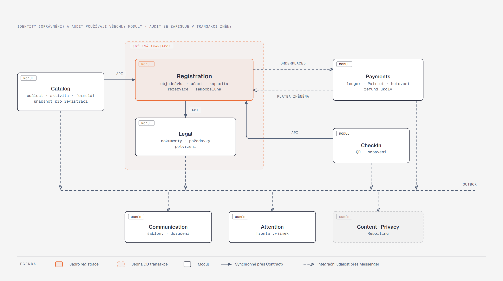
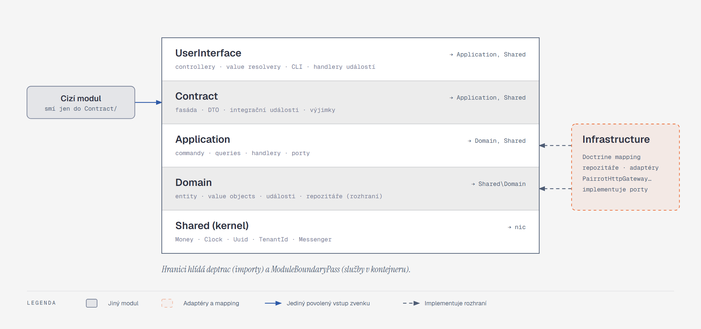

[Architektura](../README.md) · [← 01 Kontext a nasazení](../01-kontext-a-nasazeni/README.md) · **02 Moduly a hranice** · [03 Data →](../03-data/README.md)

# 02 · Moduly a hranice

> **Stav W1–W2 (25. 10. 2026).** deptrac povoluje Domain → vlastní Contract. Registration vlastní capacity buckety a Catalog je při publikaci či změně kapacity provisionuje přes `CapacityProvisioner`. `OrderFinanceInitializer` běží synchronně v `PlaceOrder`; novou veřejnou fasádou Payments je `PairrotOnboarding`. Praktická omezení DI hranice popisuje [kapitola 11](../11-rizika-a-kompromisy/README.md).

## Co si odnést

Backend je jedna Symfony aplikace rozdělená na dvanáct modulů (bounded contextů) a sdílený kernel `Shared`. Každý modul má stejné vnitřní vrstvy. Jiný modul do něj smí jen přes jeho `Contract/`: fasádu, DTO a výjimky. Entity hranici modulu nikdy nepřekračují.

V jedné databázové transakci spolupracují jen **Registration** a **Legal**, a to synchronním voláním přes `Contract/`, kvůli atomicitě registrace (S02, S13). Ostatní moduly na sebe reagují doménovými událostmi přes transakční outbox. Hranice hlídají dvě nezávislé kontroly: **deptrac** (importy ve zdrojovém kódu) a **`ModuleBoundaryPass`** (závislosti služeb v DI kontejneru). Obě běží v CI a obě končí chybou, ne varováním.

## Proč modulární monolit

Rozhodnutí a zvažované alternativy jsou v [ADR 001](../../adr/001-modular-monolith-with-event-sourced-ledger.md) a v [podkladech B vs. C](../navrhy/01-smer-b-vs-c.md). Pro tuto kapitolu z nich plynou tři důsledky:

1. **Hranice modulu není hranice procesu.** Moduly spouští stejný kernel a sdílejí stejnou DB. Hranice je logická a vynucená nástroji. Díky tomu může registrace atomicky zapsat objednávku, kapacitu i potvrzení.
2. **Hranice modulu je hranice vlastnictví dat.** Co modul, to Postgres schéma (`registration`, `payments`, …). Tabulka patří modulu, jehož schéma ji obsahuje, a zapisuje do ní jen on ([03](../03-data/README.md), [ADR 013](../../adr/013-postgres-schema-per-module.md)). Čtení cizích dat jde přes `Contract/` (query), nikoli přes SQL join do cizích tabulek. Výjimkou je modul `Reporting`, který čte přes pohledy ve vlastním schématu `reporting`.
3. **Modul lze vyjmout.** `Payments` mluví s ostatními jen přes outbox a svůj port na Pairrot, takže ho jde přesunout do samostatné služby bez zásahu do domény ostatních. Je to vědomá příprava, ne plán.

## Mapa modulů



**Jak to číst.**
- **Oranžová zóna** je jedna databázová transakce: registrace volá Legal synchronně přes jeho `Contract/` a oba zapisují ve stejném `EntityManager` flushi.
- **Plné šipky** jsou synchronní volání přes `Contract/` (čtení snapshotu katalogu, dotaz odbavení na účast).
- **Čárkované šipky** jsou integrační události. Modul je zapíše do fronty ve stejné transakci a odebírající moduly je čtou ze svých transportů.
- Mezi Registration a Payments vedou události oběma směry: `OrderPlaced` tam, `OrderPaymentChanged` zpět. Proto žádný z nich nemusí znát interní model druhého.

## Moduly v detailu

| Modul | Odpovídá za | Vlastní tabulky (výběr) | Veřejné `Contract/` | Emituje | Konzumuje |
|---|---|---|---|---|---|
| **Identity** | organizátor, účty, členství, role, pozvánky, tokeny zařízení | `organizer`, `user_account`, `membership`, `membership_event_scope`, `invitation`, `device_token` | `OrganizerDirectory`, `AccessPolicy` (role × událost), `OrganizerSettings` | `MemberInvited`, `MembershipChanged`, `OrganizerPaymentSettingsChanged` | — |
| **Catalog** | událost, aktivita, varianta, vlna, kategorie, doplňky, program, aktuality, formulář | `event`, `venue`, `activity`, `variant`, `wave`, `category_rule`, `add_on`, `program_item`, `news_post`, `form_version` | `EventCatalog::registrationSnapshot()`, `FormSchemaProvider`, `ProgramReader` | `EventPublished`, `EventCancellationRequested`, `ActivityRescheduled`, `ProgramChanged`, `NewsPublished`, `FormVersionPublished` | — |
| **Legal** | dokumenty, verze, požadavky, potvrzení, odvolání | `legal_document`, `document_version`, `legal_requirement`, `confirmation` | `RequirementResolver::forRegistration()`, `ConfirmationRecorder`, `ConsentQuery` | `DocumentVersionPublished`, `ConsentWithdrawn`, `ReconfirmationRequested` | `ParticipationTransferred` (P1) |
| **Registration** | objednávka, osoba, účast, odpovědi, kapacity, rezervace, čekací listina, slevy, samoobsluha | `order`, `person`, `participation`, `participation_group`, `answer_set`, `order_item`, `capacity_bucket`, `capacity_claim`, `waitlist_entry`, `promo_code`, `self_service_token` | `ParticipationQuery`, `OrderQuery`, `RecipientQuery` (cílení zpráv), `CapacityQuery` | `OrderPlaced`, `OrderAmountChanged`, `ParticipationConfirmed`, `ParticipationExpired`, `ParticipationCancelled`, `ParticipationRequiresAttention`, `LatePaymentReceived`, `WaitlistOfferMade` | `OrderPaymentChanged`, `DocumentVersionPublished`, `FormVersionPublished`, `EventCancellationRequested` |
| **Payments** | ledger, platební požadavky, Pairrot, hotovost, refund úkoly, rekonciliace | `payment_request`, `ledger_entry`, `order_finance`, `refund_task`, `unmatched_transaction`, `inbox_message` | `FinanceQuery`, `CashDesk` (hotovost z odbavení) | `PaymentRequestIssued`, `PaymentRequestFailed`, `OrderPaymentChanged`, `OverpaymentDetected`, `RefundTaskOpened`, `UnmatchedTransactionReceived` | `OrderPlaced`, `OrderAmountChanged`, `ParticipationCancelled`, `EventCancellationRequested` |
| **CheckIn** | odbavovací seznamy, stanoviště, QR tokeny, odbavení | `check_in_list`, `check_in_station`, `check_in` | `CheckInQuery` (provozní přehled) | `ParticipationCheckedIn`, `CheckInCorrected` | `ParticipationCancelled` (zneplatnění QR) |
| **Communication** | šablony, transakční zprávy, kampaně, doručení | `message_template`, `campaign`, `delivery`, `unsubscribe` | `CampaignComposer` (náhled, počet příjemců) | `DeliveryFailed` | téměř vše, co má zprávu (viz [katalog](../06-asynchronni-svet/katalog-udalosti.md)) |
| **Content** | galerie, fotky, externí kolekce, materiály | `collection`, `photo`, `material` | `PublicContentReader` | `CollectionPublished` | `ConsentWithdrawn` (úkol prověřit fotky, POST-06) |
| **Privacy** | retenční třídy, žádosti subjektů, anonymizace | `retention_policy`, `data_subject_request` | `PersonDataLocator` | `PersonAnonymized` | `EventCompleted` (start retenční lhůty) |
| **Audit** | append-only auditní záznamy | `audit_entry` | `AuditTrail` (čtení historie entity) | — | — (zapisuje se v transakci změny, ne přes outbox) |
| **Attention** | fronta „vyžaduje pozornost“ | `attention_item` | `AttentionQueue` | `AttentionItemResolved` | `LatePaymentReceived`, `OverpaymentDetected`, `UnmatchedTransactionReceived`, `DeliveryFailed`, `ConsentWithdrawn`, `ParticipationRequiresAttention`, dead-letter outboxu |
| **Reporting** | dashboardy, přehledy, exporty, report po akci | jen pohledy ve schématu `reporting` (read-only) | `ReportQuery`, `CsvExporter` | — | — |

**Shared (kernel)** obsahuje jen to, co potřebují všichni a co nemá doménového vlastníka: `Money`, `Clock` (adaptér na `symfony/clock`), typované identifikátory (`OrganizerId`, …), `TenantContext` v `Shared\Application`, `AuditActor`, Messenger infrastrukturu (middleware, retry strategie, `#[IntegrationEvent]`) a základní doménovou výjimku. Kernel nesmí obsahovat doménová pravidla. Když se nějaký koncept do kernelu „hodí“, je to signál, že mu chybí vlastník.

## Kdo sdílí transakci

| Spolupráce | Druh | Důvod |
|---|---|---|
| Registration → Catalog | synchronní čtení (`registrationSnapshot`) | registrace potřebuje publikovaný snapshot, ne živá data. Snapshot je neměnný pro danou `form_version` a verzi ceníku. |
| Registration → Legal | **synchronní zápis, stejná transakce** | potvrzení vznikají spolu s účastí (LEG-07, S13). Bez potvrzení nesmí účast vzniknout. |
| Registration ↔ Capacity | uvnitř modulu Registration | kapacita je součást agregátu registrace ([ADR 002](../../adr/002-capacity-buckets-conditional-update.md)) |
| CheckIn → Registration | synchronní čtení (`ParticipationQuery`) | detail před odbavením (CHK-04) potřebuje čerstvý stav účasti a financí |
| CheckIn → Payments | **synchronní zápis** (`CashDesk::recordCash`) v transakci odbavení | „hotovost při odbavení s okamžitou změnou finančního stavu“ (CHK-08). Ledger zapisuje Payments, CheckIn ho jen volá. |
| vše → Audit | zápis v transakci změny přes `AuditMiddleware` / `AuditWriter` | audit nesmí chybět ani se zpozdit (AUD-01) |
| ostatní | outbox | reakce, ne invariant |

Pravidlo pro rozhodování: **synchronně jen tehdy, když by bez toho šlo porušit invariant ze zadání.** Všechno ostatní je reakce a jde přes integrační události (outbox nad Messengerem).

## Vrstvy uvnitř modulu



**Jak to číst.**
- **Řádky** jsou vrstvy jednoho modulu, závislosti vedou jen dolů.
- **Infrastructure** stojí stranou, protože implementuje rozhraní z `Domain` (repozitáře) a `Application` (porty jako `PaymentGateway`). Nikdo nad ní na ni nezávisí přímo, dostane ji až DI kontejner.
- **Cizí modul** vstupuje jedinou modrou šipkou, do `Contract/`.

| Vrstva | Obsah | Smí záviset na | Nesmí |
|---|---|---|---|
| `Domain` | agregáty a entity s chováním, value objects, doménové události, rozhraní repozitářů, doménové služby (`CapacityAllocator`, `PriceCalculator`, `FinancialState`) | `Shared\Domain`, atributy `Doctrine\ORM\Mapping` | `EntityManager`, Messenger, HTTP, Symfony služby, jiný modul |
| `Application` | složka na use case (`PlaceOrder/`: command + handler), query služby pro čtení (DBAL), porty (`PaymentGateway`, `MessageSender`), implementace vlastního `Contract/` | `Domain`, `Contract` vlastního modulu, `Contract` cizích modulů, `Shared` | `Infrastructure`, HTTP, `EntityManager` |
| `Infrastructure` | Doctrine repozitáře, adaptéry (`PairrotHttpGateway`), DBAL typy, registrace služeb modulu (`Infrastructure/Symfony/services.php`) | `Domain`, `Application`, `Shared`, knihovny | `UserInterface` |
| `UserInterface` | controllery, request DTO, value resolvery, CLI příkazy, handlery integračních událostí (vstup asynchronního světa) | `Application`, `Contract`, `Shared` | `Domain` přímo (kromě typů výjimek), `Infrastructure` |
| `Contract` | rozhraní fasád, výstupní DTO, integrační události, veřejné výjimky | `Shared` | vracet entity, obsahovat implementaci |

**Doctrine atributy na agregátech.** Eventor mapuje entity atributy `#[ORM\Entity]` přímo v `Domain`, tedy tak, jak to Symfony a Doctrine doporučují. Oddělený persistence model nebo XML mapping by přinesl čistotu, kterou tu nikdo nepotřebuje, a dvojí údržbu. Hranici drží jiná pravidla: atributy jsou jen metadata, doména nikdy nevolá `EntityManager`, repozitář je rozhraní v `Domain` s implementací v `Infrastructure` a mezi moduly nejsou žádné ORM asociace. Doménové testy přesto nepotřebují kernel ani databázi.

## Use case jako jednotka aplikační vrstvy

`Application/` se člení podle use casů, ne podle technických typů. Jeden use case je složka s commandem a handlerem a případně výsledkem:

```
Registration/Application/
├─ PlaceOrder/           PlaceOrder.php, PlaceOrderHandler.php, PlacedOrder.php
├─ CancelParticipation/  CancelParticipation.php, CancelParticipationHandler.php
├─ TransferParticipation/
└─ Query/                OrderDetailQuery.php (DBAL), RegistrationListQuery.php
```

```php
#[AsMessageHandler(bus: 'command.bus')]
final readonly class CancelParticipationHandler
{
    public function __construct(private OrderRepository $orders, private ClockInterface $clock) {}

    public function __invoke(CancelParticipation $command): void
    {
        $order = $this->orders->get($command->orderId);
        $order->cancelParticipation($command->participationId, $command->actor, $this->clock->now());
    }   // flush, události a commit obstará middleware command.bus
}
```

Pravidla proti „service spaghetti“:

1. **Handler orchestruje, agregát rozhoduje.** Zda je storno povolené, jaké přechody stavů platí a jaké události vzniknou, ví `Order`, ne handler. Handler načte, zavolá jednu doménovou metodu a skončí.
2. **Žádné `RegistrationService` ani `*Manager`.** Třída, která má deset veřejných metod pro deset use casů, je přesně cesta ke spaghetti. Každý use case má vlastní handler.
3. **Doménová služba jen pro pravidlo napříč agregáty** (`CapacityAllocator`, `PriceCalculator`), ne jako odkladiště pro složitější metody.
4. **Zápis přes `command.bus`, čtení napřímo.** Commandy jdou přes Messenger, protože jeho middleware dávají skutečnou hodnotu: transakci, audit, idempotenci a publikaci událostí. Čtení nejde přes žádný bus. Controller i cizí modul volají query službu, která vrací DTO, typicky z DBAL dotazu.

## Konvence `Contract/` modulu

```php
namespace Eventor\Registration\Contract;

interface ParticipationQuery
{
    /** @throws ParticipationNotFound */
    public function forCheckIn(ParticipationId $id, OrganizerId $organizer): ParticipationCheckInView;

    /** @return list<RecipientRef> */
    public function recipientsOf(RecipientCriteria $criteria): array;
}

final readonly class ParticipationCheckInView   // DTO, žádná entita
{
    public function __construct(
        public ParticipationId $id,
        public string $displayName,
        public string $activityName,
        public ParticipationState $state,
        public FinancialStateView $finance,
        public array $missingConfirmations,
        public ?string $checkInNote,
    ) {}
}
```

Pravidla:

1. **Žádné entity přes hranici.** `Contract/` vrací `readonly` DTO a přijímá typované identifikátory. Doctrine proxy nikdy neopustí modul, takže nehrozí lazy-load z cizího kontextu ani nechtěný zápis přes flush.
2. **Žádné asociace přes hranici.** `participation.activity_id` je jen UUID s DB FK (integrita), ne Doctrine `ManyToOne`. Navigace mezi moduly jde přes `Contract/`.
3. **Fasádu implementuje aplikační vrstva.** `ParticipationQuery` implementuje `Application/Query/ParticipationCheckInQuery` (DBAL dotaz → DTO). Zapisující fasáda (`Legal\Contract\ConfirmationRecorder`, `Payments\Contract\CashDesk`) volá doménu ve **stávající** transakci volajícího. Proto smí volat jen handler, který už běží na `command.bus`.
4. **Veřejné jsou jen integrační události.** Leží v `Contract/Event/`, jsou verzované a bez osobních údajů ([katalog](../06-asynchronni-svet/katalog-udalosti.md)). Doménové události zůstávají v `Domain/Event` a jiný modul je nevidí.
5. **Výjimky jsou součást kontraktu.** `Contract/Exception/*` jsou jediné výjimky, které smí jiný modul chytat.

## Strom zdrojů

```
backend/src/
├─ Shared/
│  ├─ Domain/            Money, Currency, Clock (rozhraní), Id typy, DomainException, RecordsEvents
│  └─ Infrastructure/    Messenger (DomainEventsMiddleware, TenantContextMiddleware, ScheduleRetryStrategy,
│                        DeadLetterListener), Doctrine typy (money, uuid), TenantFilter,
│                        DependencyInjection\Compiler\* (compiler passy)
├─ Registration/
│  ├─ Domain/
│  │  ├─ Order/          Order, Person, Participation, Group, AnswerSet, OrderItem, OrderNumber
│  │  ├─ Capacity/       CapacityBucket, CapacityClaim, CapacityAllocator, CapacityExhausted
│  │  ├─ Pricing/        PriceCalculator, PriceModifier (rozhraní), Quote
│  │  ├─ Waitlist/       WaitlistEntry, WaitlistOffer
│  │  └─ Event/          OrderWasPlaced, ParticipationWasCancelled… (interní)
│  ├─ Application/
│  │  ├─ PlaceOrder/     PlaceOrder, PlaceOrderHandler, PlacedOrder
│  │  ├─ CancelParticipation/ …
│  │  ├─ Query/          ParticipationCheckInQuery, OrderDetailQuery (DBAL → DTO)
│  │  ├─ EventPublisher/ PublishOrderPlaced… (doménová → integrační událost)
│  │  └─ Port/           HumanVerifier, SelfServiceLinkSender
│  ├─ Infrastructure/
│  │  ├─ Doctrine/       DoctrineOrderRepository, CapacitySql
│  │  └─ Symfony/        services.php (služby modulu), RegistrationModule.php
│  ├─ UserInterface/
│  │  ├─ Http/Public/    PlaceOrderController, PlaceOrderRequest
│  │  ├─ Http/SelfService/ …
│  │  ├─ Http/Admin/     …
│  │  ├─ ValueResolver/  SelfServiceOrderResolver
│  │  └─ EventHandler/   ConfirmParticipationsOnPayment (#[AsMessageHandler(fromTransport: 'registration_events')])
│  └─ Contract/          ParticipationQuery, OrderQuery, Event/*, Exception/*
├─ Payments/ … (stejné členění)
└─ Kernel.php
```

Namespace je `Eventor\<Modul>\<Vrstva>\…`. **Moduly nejsou bundly.** Každý má jednu třídu `<Modul>Module` (compiler passy modulu a Doctrine mapping cesta `src/<Modul>/Domain`) a vlastní `src/<Modul>/Infrastructure/Symfony/services.php`, který načítá `Kernel`. Bundle by sliboval znovupoužitelnost mimo aplikaci, kterou moduly nemají. Podrobně v [09](../09-symfony-v-architekture/README.md). Testy zrcadlí strukturu v `tests/Unit`, `tests/Integration` a `tests/Scenario` ([10](../10-kvalita-a-testovani/README.md)).

## Hranice jako kód: deptrac

```yaml
# backend/deptrac.yaml (výřez)
deptrac:
  paths: [./src]
  layers:
    - { name: Shared,                collectors: [{ type: classLike, value: '^Eventor\\Shared\\.*' }] }
    - { name: Registration.Domain,   collectors: [{ type: classLike, value: '^Eventor\\Registration\\Domain\\.*' }] }
    - { name: Registration.App,      collectors: [{ type: classLike, value: '^Eventor\\Registration\\Application\\.*' }] }
    - { name: Registration.Infra,    collectors: [{ type: classLike, value: '^Eventor\\Registration\\Infrastructure\\.*' }] }
    - { name: Registration.UI,       collectors: [{ type: classLike, value: '^Eventor\\Registration\\UserInterface\\.*' }] }
    - { name: Registration.Contract, collectors: [{ type: classLike, value: '^Eventor\\Registration\\Contract\\.*' }] }
    - { name: DoctrineMapping,       collectors: [{ type: classLike, value: '^Doctrine\\ORM\\Mapping\\.*' }] }
    # … totéž pro každý modul (generuje se skriptem bin/deptrac-layers)
  ruleset:
    Registration.Domain: [Shared, DoctrineMapping]   # jen atributy Doctrine\ORM\Mapping
    Registration.App:    [Registration.Domain, Registration.Contract, Shared, Catalog.Contract, Legal.Contract]
    Registration.Infra:  [Registration.Domain, Registration.App, Shared]
    Registration.UI:     [Registration.App, Registration.Contract, Shared]
    Registration.Contract: [Shared]
    Payments.App:        [Payments.Domain, Payments.Contract, Shared, Registration.Contract, Identity.Contract]
    Payments.UI:         [Payments.App, Payments.Contract, Shared, Registration.Contract]
    # cizí modul vždy jen přes *.Contract
```

- **Baseline je prázdná a zůstane prázdná.** Nová výjimka vyžaduje ADR. Main-panel měl 27 vyjmenovaných výjimek a „strop“, a to je přesně stav, kterému se eventor vyhýbá.
- **Cykly mezi moduly jsou zakázané** (`deptrac` s pravidlem bez cyklů na úrovni `*.Contract`). Obousměrná spolupráce Registration ↔ Payments je proto asynchronní přes události, ne přes vzájemné volání `Contract/`.

## Hranice jako kód: `ModuleBoundaryPass`

Deptrac vidí importy, ale nevidí, co DI kontejner skutečně injektuje. Ten lze obejít konfigurací v YAML, aliasem nebo `service_locator`. `ModuleBoundaryPass` (compiler pass v `Shared\Infrastructure\DependencyInjection\Compiler`) proto po sestavení kontejneru projde definice služeb `Eventor\*`:

1. Pro každou službu zjistí modul z namespace třídy.
2. Pro každý argument (reference, iterator, locator) zjistí modul cílové služby.
3. Pokud se moduly liší a cílová třída není v `Eventor\<Cíl>\Contract\` ani v `Shared`, vyhodí `LogicException` s cestou závislosti. Kontejner se nezkompiluje a `cache:warmup` v CI spadne.

Implementaci a další compiler passy popisuje [kapitola 09](../09-symfony-v-architekture/README.md).

## Pravidla, která drží hranice zdravé

| Pravidlo | Kontrola |
|---|---|
| Do tabulky zapisuje jen vlastnící modul | Doctrine mapping existuje jen ve vlastním modulu a míří do jeho schématu (`TableOwnershipTest`). SQL modulu nesmí jmenovat cizí schéma (`CrossSchemaSqlTest`). |
| Command handler zapisuje jen agregáty vlastního modulu | code review + deptrac (handler nevidí cizí repozitáře) |
| Každý command emituje alespoň jednu událost, nebo je označen `#[ReadOnlyCommand]` | integrační test nad všemi handlery ([ADR 001](../../adr/001-modular-monolith-with-event-sourced-ledger.md), Ověření) |
| Odběratel nikdy nezapisuje do cizího modulu | odběratel je v `UserInterface/EventHandler` vlastního modulu a dispatchuje vlastní command |
| Odběratel nikdy nehýbe penězi jiného modulu | peníze mění jen commandy `Payments` |
| Nový modul = nová složka + deptrac vrstvy + ADR, pokud mění mapu | review |
