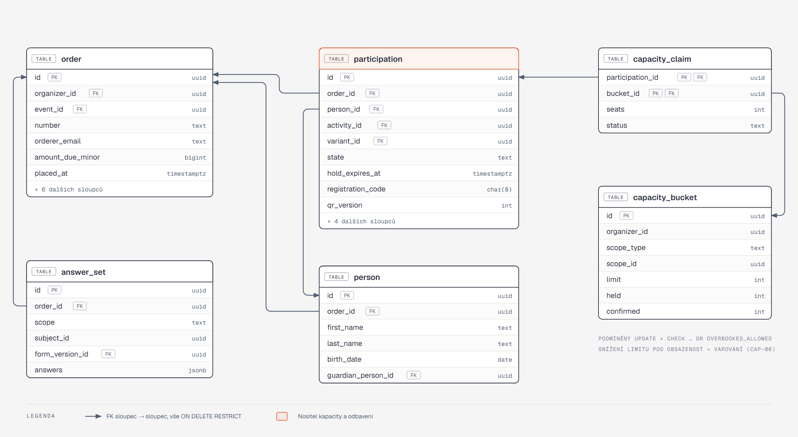
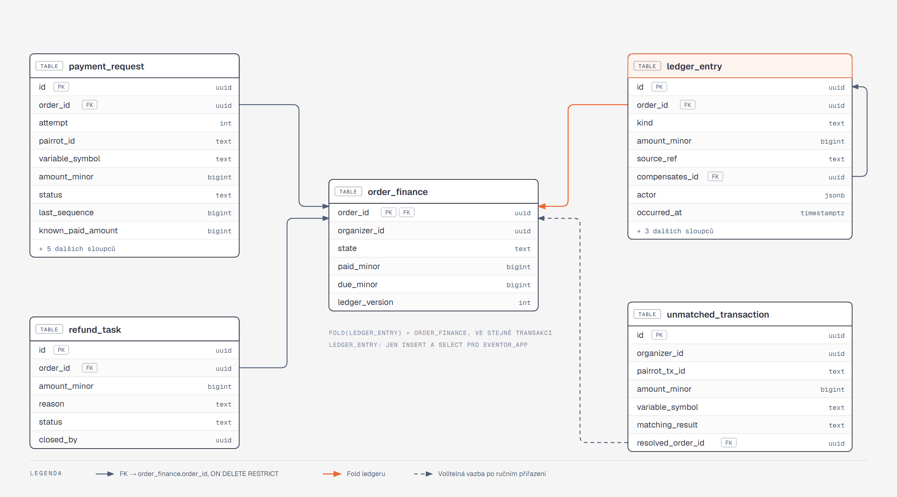
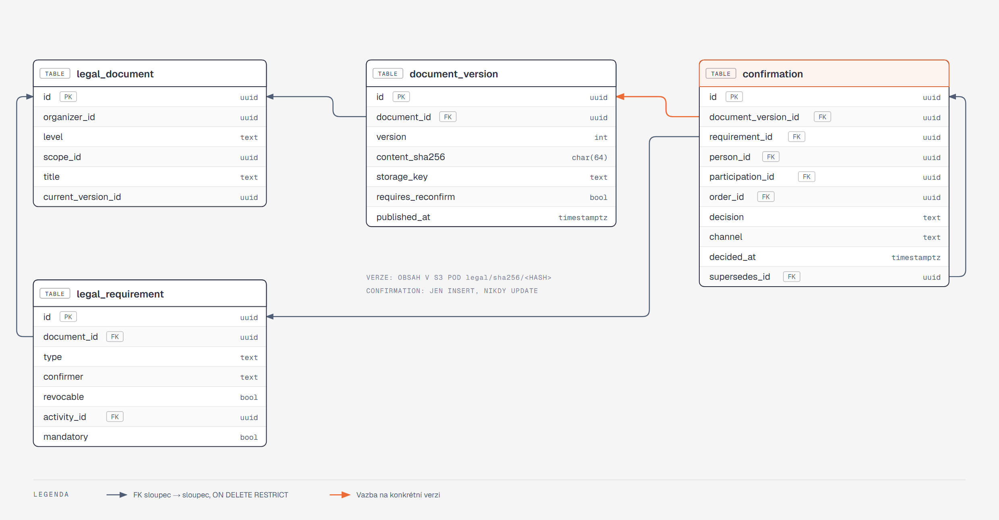

[Architektura](../README.md) · [← 02 Moduly a hranice](../02-moduly-a-hranice/README.md) · **03 Data** · [04 Klíčové cesty →](../04-klicove-cesty/README.md)

# 03 · Data

## Co si odnést

Eventor má jednu databázi PostgreSQL 17 a **co modul, to schéma** (`registration`, `payments`, `legal`, …), plus `shared` pro technické tabulky ([ADR 013](../../adr/013-postgres-schema-per-module.md)). Každá tabulka má právě jednoho vlastníka a je jím modul, jehož schéma ji obsahuje. Každá tenant-scoped tabulka nese `organizer_id`.

Invarianty, které nesmí porušit ani chyba v aplikaci, žijí v databázi: kapacitní `CHECK`, partial unique index „právě jedno platné odbavení“, unikátnost externích ID kvůli idempotenci a `ON DELETE RESTRICT` u všeho, co souvisí s penězi.

Append-only tabulky (`ledger_entry`, `audit_entry`, `confirmation`) jsou chráněné na úrovni grantů: aplikační role `eventor_app` na nich nemá `UPDATE`, `DELETE` ani `TRUNCATE`. U `check_in` smí měnit jen sloupce zneplatnění. Hlídá to test. Odpovědi dynamického formuláře jsou JSONB s verzí formuláře. Sémantická pole (jméno, datum narození, e-mail) jsou navíc typované sloupce, protože se nad nimi počítá.

## Zásady

| Zásada | Konkrétně |
|---|---|
| Schémata | jedno na modul, jméno = modul v `snake_case` (`checkin`, `communication`). `shared`: `messenger_messages`, `scheduled_run`, `idempotency_record`, `doctrine_migration_versions`. `public` je prázdné. Aplikační role mají `search_path = shared`, takže každý SQL dotaz na modulovou tabulku musí schéma uvést (`FROM registration.participation`). |
| Identifikátory | UUIDv7 (`uuid`), generuje aplikace (`symfony/uid`). Časově řazené, takže B-tree indexy zůstávají kompaktní. |
| Peníze | `bigint` v haléřích (`*_minor`) + `currency char(3)` tam, kde se mění. Nikdy `numeric` ani `float`. Mapuje se na embeddable `Money`. |
| Čas | `timestamptz` (UTC). Kalendářní data bez času (`birth_date`) jako `date`. Časové pásmo události je sloupec `event.timezone` (výchozí `Europe/Prague`). |
| Stavy | `text` + `CHECK (state IN (…))`. Postgres enumy ne, protože jejich změna je migrační bolest. Každá stavová dimenze má vlastní sloupec ([05](../05-stavove-automaty/README.md)). |
| Cizí klíče | vždy existují, i mezi moduly a schématy (integrita). Výchozí `ON DELETE RESTRICT`. `CASCADE` jen uvnitř agregátu, který nemá finanční ani právní historii (např. `program_item` → `event`). |
| Mazání | doménová data se nemažou. Zrušení je stav, výmaz osobních údajů je anonymizace ([08](../08-prurezove-koncepty/README.md)). Fyzicky se mažou jen technická data po retenci (`inbox_message`, `scheduled_run`; `messenger_messages` maže transport sám po zpracování). |
| Optimistický zámek | `version int` na agregátech editovaných v adminu (`event`, `activity`, `variant`, `order`). Konflikt vede na 409 s nabídkou obnovit. |
| Tenancy | `organizer_id uuid NOT NULL` na každé tenant-scoped tabulce, i tam, kde by šel odvodit joinem, protože na něm stojí Doctrine filtr a indexy ([ADR 005](../../adr/005-tenant-from-url-doctrine-filter-voters.md)) |
| Retence | každá tabulka s osobními údaji má v manifestu retenční třídu (níže). `Privacy` podle ní anonymizuje. |

## Registrace a kapacity



**Jak to číst.**
- **Objednávka** je kořen agregátu. Osoby, účasti a sady odpovědí na ni odkazují přes `order_id`.
- **Účast** (oranžová) je jediný nositel kapacity. Přes `capacity_claim` obsazuje dva až čtyři řádky `capacity_bucket`: událost, aktivitu, variantu a (P1) vlnu.
- **`person.guardian_person_id`** váže nezletilého na zákonného zástupce ve stejné objednávce. Právní potvrzení dítěte pak podepisuje zástupce (LEG-11, S13).

| Tabulka | Klíčové sloupce | Poznámka |
|---|---|---|
| `order` | `id`, `organizer_id`, `event_id`, `number` (`EV-2026-000123`), `orderer_*` (embeddable kontakt), `payment_method` (`TRANSFER`/`CASH`/`FREE`), `amount_due_minor`, `currency`, `origin` (`PUBLIC`/`ORGANIZER`, REG-13), `form_version_id`, `placed_at`, `version` | `UNIQUE (organizer_id, number)`. `amount_due_minor` je aktuální dlužná částka po stornech a změnách. Historii změn drží audit a `OrderAmountChanged`. |
| `person` | `id`, `order_id`, `first_name`, `last_name`, `birth_date`, `email`, `phone`, `guardian_person_id`, `anonymized_at` | sémantická pole formuláře (FRM-04) jako typované sloupce. `CHECK (guardian_person_id <> id)`. |
| `participation` | `id`, `organizer_id`, `order_id`, `person_id`, `activity_id`, `variant_id`, `wave_id`, `group_id`, `state`, `legal_state`, `answers_state`, `hold_expires_at`, `registration_code`, `qr_version`, `category_code`, `transferred_to_id` | QR token účasti je HMAC podpis nad `participation_id` + `qr_version`. Zvýšení `qr_version` (storno, převod, ruční reset) zneplatní všechny dříve vydané QR (CHK-03). `CHECK (state <> 'pending' OR hold_expires_at IS NOT NULL)`, protože čekající účast u převodu vždy drží rezervaci. `UNIQUE (organizer_id, registration_code)`. `legal_state` (`COMPLETE`/`RECONFIRMATION_REQUIRED`) a `answers_state` (`COMPLETE`/`COMPLETION_REQUIRED`) jsou samostatné dimenze vedle `state` (S15, S17, [05](../05-stavove-automaty/README.md)). Index `(state, hold_expires_at) WHERE state = 'pending'` pro sweeper expirací. |
| `participation_group` | `id`, `order_id`, `variant_id`, `name`, `contact_person_id` | tým / dvojice (REG-04) |
| `answer_set` | `id`, `organizer_id`, `order_id`, `scope` (`ORDER`/`PERSON`/`PARTICIPATION`/`GROUP`), `subject_id`, `form_version_id`, `answers jsonb`, `superseded_by_id` | `UNIQUE (scope, subject_id) WHERE superseded_by_id IS NULL`. Oprava údajů vytvoří novou sadu a starou označí jako nahrazenou, takže historie odpovědí zůstává. |
| `order_item` | `id`, `order_id`, `add_on_id`, `person_id`, `quantity`, `unit_price_minor`, `options jsonb` | snapshot ceny v okamžiku objednávky |
| `capacity_bucket` | `id`, `organizer_id`, `scope_type` (`EVENT`/`ACTIVITY`/`VARIANT`/`WAVE`), `scope_id`, `"limit"` (NULL = bez limitu), `held`, `confirmed`, `overbooked_allowed`, `unit` (`SEAT`/`TEAM`) | `UNIQUE (scope_type, scope_id)`, `CHECK (held >= 0 AND confirmed >= 0)`, `CHECK ("limit" IS NULL OR held + confirmed <= "limit" OR overbooked_allowed)`. Viz níže. |
| `capacity_claim` | `participation_id`, `bucket_id`, `seats`, `status` (`HELD`/`CONFIRMED`/`RELEASED`) | PK `(participation_id, bucket_id)`. Podle claimů se uvolňuje přesně to, co bylo obsazeno, i když se mezitím změnila konfigurace. |
| `waitlist_entry`, `waitlist_offer` | `activity_id`, `variant_id`, `position`, `contact`, `offer_expires_at`, `state` | P1 (REG-12). `UNIQUE (variant_id, position)`. |
| `promo_code`, `discount` | `code`, `kind`, `value`, `valid_from/to`, `max_uses`, `used` | P1 (EVT-15). `used` se zvyšuje podmíněným `UPDATE` stejně jako kapacita. |
| `self_service_token` | `id`, `order_id`, `secret_sha256`, `scope`, `expires_at`, `revoked_at`, `last_used_at` | v DB jen hash. Odvolatelnost = `revoked_at`. |

### Kapacitní invariant v SQL

```sql
-- obsazení (v transakci PlaceOrder, buckety seřazené podle id kvůli deadlockům)
UPDATE capacity_bucket
   SET held = held + :seats
 WHERE id = :bucket
   AND held + confirmed + :seats <= "limit";
-- 0 řádků → CapacityExhausted → rollback celé objednávky (S01, S02)

-- potvrzení po platbě: přesun held → confirmed, limit se znovu nekontroluje
UPDATE capacity_bucket SET held = held - :seats, confirmed = confirmed + :seats WHERE id = :bucket;
```

**Primární stráž je podmíněný `UPDATE`.** Dává srozumitelnou doménovou chybu a nikdy nečeká na výjimku z constraintu. **Tabulkový `CHECK` je poslední pojistka:** `"limit" IS NULL OR held + confirmed <= "limit" OR overbooked_allowed`. Sloupec `overbooked_allowed` nastavuje výhradně cesta snížení kapacity (CAP-06, `ChangeCapacityHandler`), když nový limit klesne pod aktuální obsazenost. Taková změna se povolí s varováním a auditem. Jakmile obsazenost klesne zpět pod limit (storno, expirace), stejný handler, resp. uvolnění kapacity, příznak zase vynuluje. Žádná jiná cesta ho nastavit nesmí. Pravdivost counterů hlídá rekonciliační dotaz: součet aktivních `capacity_claim` proti `held`/`confirmed`. Běží jako integrační test i jako noční kontrola, která při rozdílu založí `AttentionItem`. Rozhodnutí je v [ADR 002](../../adr/002-capacity-buckets-conditional-update.md).

## Platby



**Jak to číst.**
- **Ledger** (oranžový) je append-only a jeho fold dává `order_finance`. `order_finance` je jen cache přepočtená ve stejné transakci jako zápis do ledgeru.
- **`payment_request`** je zrcadlo požadavku v Pairrotu: zdroj pravdy je Pairrot, eventor si drží poslední známý stav a `last_sequence`.
- **`unmatched_transaction`** se k objednávce váže jen volitelně (čárkovaně), až po ručním přiřazení.

| Tabulka | Klíčové sloupce | Poznámka |
|---|---|---|
| `payment_request` | `id`, `organizer_id`, `order_id`, `attempt`, `purpose` (`PRIMARY`/`SUPPLEMENTARY`), `external_id` (`order_<uuid>_<attempt>`), `pairrot_id`, `variable_symbol`, `iban`, `spayd`, `amount_minor`, `due_at`, `status`, `last_sequence`, `known_paid_amount`, `creation_state` (`PENDING`/`CREATED`/`FAILED`) | `UNIQUE (external_id)`, `UNIQUE (order_id, attempt)`. `creation_state = PENDING` znamená, že Pairrot ještě nepotvrdil vytvoření (PAY-03, S08). `status` zrcadlí stav v Pairrotu (`open`/`partially_paid`/`paid`/`overpaid`/`cancelled`). `SUPPLEMENTARY` je doplatkový požadavek na rozdíl po zvýšení ceny, když původní požadavek už má alokace a nejde zrušit. |
| `ledger_entry` | `id`, `organizer_id`, `order_id`, `kind`, `amount_minor` (se znaménkem), `currency`, `source` (`PAIRROT`/`CASH`/`MANUAL`), `source_ref`, `compensates_id`, `actor jsonb`, `reason`, `occurred_at`, `recorded_at` | `UNIQUE (source, source_ref) WHERE source_ref IS NOT NULL`: idempotence zápisu (S03). `CHECK (kind IN ('pairrot_allocation','pairrot_revocation','cash','cash_correction','manual_correction','refund_settled'))`. `CHECK ((kind IN ('cash_correction','pairrot_revocation')) = (compensates_id IS NOT NULL))`. |
| `order_finance` | `order_id` (PK, FK), `organizer_id`, `state`, `paid_minor`, `due_minor`, `ledger_version` (+ rozpad `received_transfer_minor`, `received_cash_minor`, `refunded_minor` pro PAY-13) | `state` ∈ `unpaid`, `partially_paid`, `paid`, `overpaid`, `disputed`, `refund_pending`, `refunded` (kap. 5.4 zadání). Přepočet foldem při každém zápisu ledgeru nebo změně dlužné částky, s optimistickou kontrolou `ledger_version`. |
| `refund_task` | `id`, `organizer_id`, `order_id`, `amount_minor`, `reason` (`CANCELLATION`/`OVERPAYMENT`/`EVENT_CANCELLED`/`LATE_PAYMENT`), `status` (`OPEN`/`SETTLED`), `settled_by`, `settled_at`, `note` | uzavření úkolu zapíše `ledger_entry` druhu `refund_settled` (PAY-11) |
| `unmatched_transaction` | `id`, `organizer_id`, `pairrot_tx_id`, `amount_minor`, `variable_symbol`, `booked_on`, `matching_result`, `last_sequence`, `resolved_order_id`, `resolved_by` | `UNIQUE (pairrot_tx_id)`. Rekonciliační fronta (PAY-06). |
| `inbox_message` | `id`, `provider`, `message_id`, `received_at`, `payload jsonb`, `processed_at`, `error` | `UNIQUE (provider, message_id)`: deduplikace webhooků. Retence 90 dní. |

`ON DELETE RESTRICT` platí na všech FK do `order` a z `ledger_entry`. Smazat objednávku, na které visí peníze, nejde ani omylem. Main-panel tu měl kaskádu, která mazala historii plateb (main-panel 09).

## Právní dokumenty a potvrzení



**Jak to číst.**
- **Dokument** má neměnné verze. Obsah verze leží v S3 pod klíčem odvozeným z hashe (`legal/sha256/<hash>`), v DB je jen hash a klíč.
- **Potvrzení** (oranžové) míří na konkrétní verzi, ne na dokument. Proto stará registrace zůstane vázaná na starou verzi (S14).
- **`supersedes_id`** tvoří řetěz rozhodnutí jedné osoby k jednomu požadavku: udělení → odvolání → nové udělení. Nic se nepřepisuje (LEG-07, kap. 5.7 zadání).

| Tabulka | Klíčové sloupce | Poznámka |
|---|---|---|
| `legal_document` | `id`, `organizer_id`, `level` (`ORGANIZER`/`EVENT`/`ACTIVITY`), `scope_id`, `title`, `replaces_document_id`, `current_version_id` | `replaces_document_id` je náhrada dokumentu vyšší úrovně na nižší (LEG-02) |
| `document_version` | `id`, `document_id`, `version`, `source_kind` (`TEXT`/`PDF`/`EXTERNAL_SNAPSHOT`), `source_url`, `content_sha256`, `storage_key`, `requires_reconfirmation`, `published_at`, `published_by` | `UNIQUE (document_id, version)`. Řádek se po publikaci nemění. Konceptem je verze s `published_at IS NULL`, publikace nastaví čas a hash. ([ADR 012](../../adr/012-legal-documents-content-addressed-versions.md)) |
| `legal_requirement` | `id`, `organizer_id`, `document_id`, `type`, `purpose`, `confirmer` (`ORDERER`/`EACH_PARTICIPANT`/`GUARDIAN`), `revocable`, `mandatory`, `activity_id`, `variant_id`, `validity` | `CHECK (NOT (type = 'CONSENT' AND mandatory))`: databáze sama odmítne povinný dobrovolný souhlas (LEG-06) |
| `confirmation` | `id`, `organizer_id`, `requirement_id`, `document_version_id`, `person_id`, `participation_id`, `order_id`, `decided_by_person_id`, `decision` (`GRANTED`/`DECLINED`/`WITHDRAWN`), `channel` (`WEB`/`STAFF`), `note`, `decided_at`, `supersedes_id` | append-only. `CHECK (participation_id IS NOT NULL OR order_id IS NOT NULL)`. `decided_by_person_id` je zákonný zástupce u dítěte. `UNIQUE (supersedes_id)` znamená, že rozhodnutí nemůže mít dva následníky. |

Aktuální stav souhlasu je „poslední rozhodnutí v řetězu“. Čte se přes pohled `confirmation_current` (`DISTINCT ON (requirement_id, person_id, coalesce(participation_id, order_id)) … ORDER BY decided_at DESC`). Nad ním stojí přehled souhlasů LEG-10.

## Katalog, formulář a ostatní moduly

| Modul | Tabulky (klíčové sloupce) |
|---|---|
| Identity | `organizer_policy` (1:1 s organizátorem: `check_in_may_record_cash`, `event_manager_may_resolve_payments`, `auto_restore_late_payment` (výchozí pro nové události), `overpayment_handling` `REFUND`/`DONATION`/`ASK`, `default_due_days`, `default_hold_ttl_hours`; čtou ho voters a pravidla plateb), `organizer` (`slug` UNIQUE, `name`, `contact_email`, `pairrot_subtenant_id`, `pairrot_bank_connection_id`, `settings jsonb`), `user_account` (`email` UNIQUE, `password_hash`), `membership` (`user_account_id`, `organizer_id`, `role`, UNIQUE pár), `membership_event_scope` (omezení na události), `invitation` (`token_sha256`, `expires_at`), `device_token` (`organizer_id`, `check_in_list_id`, `secret_sha256`, `revoked_at`) |
| Catalog | `event` (`organizer_id`, `slug`, UNIQUE `(organizer_id, slug)`, `publication_state`, `registration_state`, `visibility`, `timezone`, `starts_at`, `ends_at`, `payment_rules jsonb`, `version`), `venue`, `activity` (`event_id`, `implicit`, `registration_state`, `starts_at`, `capacity`), `variant` (`activity_id`, `price_minor`, `seats`, `conditions jsonb`), `wave`, `category_rule`, `add_on`, `program_item` (`activity_id` nullable, `visibility`), `news_post`, `form_version` (`event_id`, `version`, `schema jsonb`, `schema_sha256`, `published_at`, UNIQUE `(event_id, version)`) |
| CheckIn | `check_in_list` (`activity_id`), `check_in_station` (P1), `check_in` (`participation_id`, `list_id`, `station_id`, `checked_in_at`, `checked_in_by`, `idempotency_key`, `voided_at`, `voided_by`, `void_reason`). Oprava = zneplatnění starého záznamu + nový záznam (CHK-07). |
| Communication | `message_template` (`kind`, `locale`, `subject`, `body`), `campaign` (`event_id`, `audience jsonb`, `purpose` `OPERATIONAL`/`MARKETING`, `state`, `scheduled_at`), `delivery` (`campaign_id` nebo `trigger_event_id`, `recipient_ref`, `email`, `state`, `attempts`, `idempotency_key` UNIQUE, `provider_message_id`, `last_error`), `unsubscribe` (`email_sha256`, `organizer_id`) |
| Content | `collection` (`kind` `INTERNAL`/`EXTERNAL`, `visibility`, `url`), `photo` (`storage_key`, `thumbnail_key`, `author`, `position`, `removed_at`), `material` |
| Privacy | `retention_policy` (`organizer_id`, `class`, `months_after_event`), `data_subject_request` (`kind`, `state`, `deadline_at`, `resolution`) |
| Attention | `attention_item` (`organizer_id`, `event_id`, `type` — `CHECK` výčet: `unmatched_payment`, `late_payment`, `overpayment`, `payment_revoked`, `pairrot_review`, `integration_degraded`, `integration_inconsistency`, `payment_request_issue_failed`, `delivery_failed`, `consent_withdrawn`, `missing_confirmation`, `outbox_dead_letter`, `capacity_drift`, `refund_task`, …, `subject_type`, `subject_id`, `state` `OPEN`/`ASSIGNED`/`RESOLVED`, `assignee_id`, `dedupe_key` UNIQUE, `payload jsonb`, `resolved_by`, `resolution`) |
| Audit | `audit_entry` (`organizer_id`, `actor_type` `USER`/`SYSTEM`/`PARTICIPANT_TOKEN`/`PAIRROT`, `actor_id`, `entity_type`, `entity_id`, `action`, `before jsonb`, `after jsonb`, `reason`, `correlation_id`, `occurred_at`), `audit_pii` (osobní diffy s kratší retencí) |
| Shared (schéma `shared`) | `messenger_messages` (Doctrine transport Messengeru = outbox i fronta; `queue_name` na transport, migrací, `auto_setup: false`), `scheduled_run` (log běhů Scheduleru: `task`, `started_at`, `finished_at`, `outcome`, `processed`, `error`; selhání nebo nespuštění v očekávaném okně založí `AttentionItem`), `idempotency_record` (`scope`, `key`, `request_sha256`, `response jsonb`, UNIQUE `(scope, key)`) |

## Invarianty v databázi

Databáze je poslední linie. Každý z těchto invariantů má v aplikaci i hezčí chybovou hlášku, ale chyba v aplikaci ho nedokáže obejít.

| Invariant | Mechanismus | Scénář |
|---|---|---|
| Kapacitu nelze překročit souběžnými objednávkami | podmíněný `UPDATE capacity_bucket` v transakci objednávky | S01, S02 |
| Právě jedno platné odbavení účasti | `CREATE UNIQUE INDEX check_in_one_valid ON check_in (participation_id) WHERE voided_at IS NULL` | S10, CHK-06 |
| Platba z Pairrotu se zaúčtuje jednou | `UNIQUE (provider, message_id)` na `inbox_message` + `UNIQUE (source, source_ref)` na `ledger_entry` | S03 |
| Platební požadavek se nevytvoří dvakrát | `UNIQUE (external_id)` + idempotence Pairrotu podle `external_id` | S08 |
| Zpráva se příjemci neodešle dvakrát | `UNIQUE (idempotency_key)` na `delivery` | S09, COM-06 |
| Kompenzace odkazuje na kompenzovaný zápis | `CHECK` na `ledger_entry` (viz výše) + FK `compensates_id` | S11, PAY-08 |
| Povinný marketingový souhlas nejde nastavit | `CHECK (NOT (type = 'CONSENT' AND mandatory))` | LEG-06 |
| Čekající účast má expiraci | `CHECK (state <> 'pending' OR hold_expires_at IS NOT NULL)` | CAP-04 |
| Jedno aktivní členství na pár účet × organizátor | `UNIQUE (user_account_id, organizer_id)` | ORG-03 |
| Slug události je unikátní v rámci organizátora | `UNIQUE (organizer_id, slug)` | PUB-01 |
| Výjimka se nezaloží dvakrát pro stejnou příčinu | `UNIQUE (dedupe_key)` na `attention_item` (`late_payment:<order>:<ledger_entry>`) | ADM-03 |
| Zneplatněné odbavení nelze „odzneplatnit“ | trigger `check_in_no_unvoid` odmítne změnu `voided_at` z hodnoty na `NULL` | CHK-07 |
| Peníze nelze smazat | FK `ON DELETE RESTRICT` + granty (níže) | AUD, PAY |

## Append-only a granty

```sql
-- migrace běží jako eventor_owner; aplikace se připojuje jako eventor_app (search_path = shared)
-- pro každé modulové schéma (identity, catalog, legal, registration, payments, checkin, …) a shared:
CREATE SCHEMA payments AUTHORIZATION eventor_owner;
GRANT USAGE ON SCHEMA payments TO eventor_app;
GRANT SELECT, INSERT, UPDATE, DELETE ON ALL TABLES IN SCHEMA payments TO eventor_app;
ALTER DEFAULT PRIVILEGES IN SCHEMA payments GRANT SELECT, INSERT, UPDATE, DELETE ON TABLES TO eventor_app;

-- reporting obsahuje jen pohledy a aplikace z nich smí jen číst
GRANT USAGE ON SCHEMA reporting TO eventor_app;
ALTER DEFAULT PRIVILEGES IN SCHEMA reporting GRANT SELECT ON TABLES TO eventor_app;

-- append-only
REVOKE UPDATE, DELETE, TRUNCATE ON payments.ledger_entry, audit.audit_entry, legal.confirmation FROM eventor_app;

-- check_in: append-only kromě zneplatnění
REVOKE UPDATE, DELETE, TRUNCATE ON checkin.check_in FROM eventor_app;
GRANT UPDATE (voided_at, voided_by, void_reason) ON checkin.check_in TO eventor_app;
```

V celé databázi jsou jen dva triggery a oba jen hlídají, nic nepočítají:

- `check_in_no_unvoid` odmítne vrácení zneplatněného odbavení,
- `document_version_immutable` odmítne změnu publikované verze dokumentu ([ADR 012](../../adr/012-legal-documents-content-addressed-versions.md)).

Logika zůstává v PHP. Triggery jen hlídají to, co granty vyjádřit neumějí.

- **`document_version`:** řádek se jednou publikuje a pak nemění. Hlídá to trigger `document_version_immutable` (`BEFORE UPDATE OR DELETE`), který odmítne změnu řádku s `published_at IS NOT NULL`. Grant tu nestačí, protože koncept verze se upravovat smí.
- **Anonymizace** (`Privacy`) potřebuje měnit osobní údaje i v append-only světě. Proto `audit_entry` ani `ledger_entry` osobní údaje **nenesou**. Osobní diffy auditu jdou do `audit_pii`, která má vlastní, kratší retenční třídu. Po retenci se maže jako celek procedurou `privacy_purge_audit_pii(before)` (`SECURITY DEFINER`, vlastník `eventor_owner`), kterou volá plánovaná úloha. `confirmation` odkazuje na `person_id` a osoba se anonymizuje v `person`.
- **Test** `AppendOnlyGrantsTest` se připojí jako `eventor_app` a ověří, že `UPDATE`, `DELETE` i `TRUNCATE` na `ledger_entry`, `audit_entry` a `confirmation` selžou a že na `check_in` projde jen `UPDATE` sloupců zneplatnění. Main-panel měl append-only hlídané jen triggerem na `UPDATE` (main-panel 09), tady se tomu předchází.

## Dynamický formulář v datech

Rozhodnutí je v [ADR 007](../../adr/007-dynamic-form-schema-jsonb-snapshots.md). Datově:

- `form_version.schema` je neměnný JSON snapshot `FormSchema`: pole, typy, scope, podmínky, vazby na aktivity a varianty, sémantika. Nová publikace vytvoří novou verzi (FRM-08).
- `answer_set.answers` je JSONB `{ "<field_key>": { "t": "<type>", "v": <value> } }`. Typ je uložený s hodnotou, takže starou odpověď lze interpretovat i po změně typu pole v nové verzi. Prázdná nevyplněná pole se neukládají, takže nikdy nevznikne zdánlivě vyplněná odpověď (FRM-09, S17).
- Sémantická pole (`first_name`, `last_name`, `birth_date`, `email`, `phone`, zákonný zástupce) se při uložení **projektují do typovaných sloupců `person`**. JSONB zůstává zdrojem pro zobrazení v kontextu verze, typované sloupce jsou zdrojem pro výpočty (věk, kategorie, adresování zpráv).
- Filtrování podle vlastních polí (ADM-04/05, COM-04 P1) používá `CREATE INDEX answer_set_answers_gin ON answer_set USING gin (answers jsonb_path_ops)` a dotazy `answers @> '{"dog_name": {"v": "Rex"}}'`. Pro číselné a datové rozsahy se v P1 přidají výrazové indexy na konkrétní klíče podle potřeby.

## Tenancy v datech

- **Každá tenant-scoped tabulka má `organizer_id`** a složené indexy začínají `organizer_id` (`(organizer_id, event_id, state)`, …).
- **Doctrine SQL filtr `organizer`** přidá `organizer_id = :current` ke každému dotazu na entitu s rozhraním `TenantScoped`. Zapíná ho value resolver tenanta (`/api/admin/org/{orgSlug}`) a pro asynchronní zpracování `TenantContextMiddleware` podle `organizer_id` v obálce zprávy ([ADR 005](../../adr/005-tenant-from-url-doctrine-filter-voters.md)).
- **Globální tabulky bez `organizer_id`:** `identity.user_account`, `payments.inbox_message` a technické tabulky ve `shared`. Přístup k nim je jen v kódu kernelu, Identity a Payments.
- **Druhá linie (P1):** Postgres RLS (`USING (organizer_id = current_setting('app.organizer_id')::uuid)`) se `SET LOCAL app.organizer_id` na začátku transakce, pod rolí `eventor_app`. Workery a plánované úlohy, které zpracovávají data napříč organizátory (Messenger worker, sweeper expirací, reconcile Pairrotu, retence), se připojují jako role `eventor_system` s `BYPASSRLS`. Mají stejné granty jako `eventor_app`, takže append-only omezení platí i pro ně. RLS je navržená až za P0, protože s Doctrine filtrem a voters přidává hlavně provozní složitost (migrace, role, ladění). Rozhodnutí je v [ADR 005](../../adr/005-tenant-from-url-doctrine-filter-voters.md).

## Manifest vlastnictví a retence

Vlastníka tabulky určuje schéma, takže ho manifest neopakuje. `TableOwnershipTest` ověří, že entita z `Eventor\<Modul>\` má `#[ORM\Table(schema: '<modul>')]`, a `CrossSchemaSqlTest` projde SQL v `src/<Modul>/` a selže na schématu cizího modulu (výjimkou jsou pohledy v `reporting`, které vznikají v migracích). Manifest `backend/config/data-retention.yaml` drží jen retenční třídy tabulek s osobními údaji. Čte ho `Privacy` (co anonymizovat).

| Tabulka | Vlastník | Retenční třída | Co se stane po retenci |
|---|---|---|---|
| `person`, `answer_set`, `order.orderer_*`, `participation_group.name` | Registration | `REGISTRATION` | anonymizace (jméno → „Anonymizováno“, datum narození → rok, kontakt → null, JSONB odpovědi → `{}`) |
| `ledger_entry`, `order_finance`, `refund_task`, `payment_request` | Payments | `FINANCIAL` | ponechat (zákonná povinnost). Osobní údaje neobsahuje. |
| `confirmation` | Legal | `CONFIRMATION` | ponechat po dobu prokazatelnosti. Osoba v `person` je anonymizovaná. |
| `photo`, `material` | Content | `MEDIA` | smazat objekt v S3, řádek označit `removed_at` |
| `delivery` | Communication | `REGISTRATION` | e-mail → hash |
| `audit_pii` | Audit | `REGISTRATION` | smazat (procedura `privacy_purge_audit_pii`) |
| `check_in` | CheckIn | `REGISTRATION` | ponechat (bez osobních údajů, `checked_in_by` je člen týmu) |
| `payments.inbox_message`, `shared.scheduled_run` | Payments / Shared | technická | smazat po 90 dnech |

Retenční lhůty nastavuje organizátor (PRV-05, P1). Automatická anonymizace po lhůtě s upozorněním je P2 (PRV-06), ruční výmaz na žádost je P1 (PRV-04).

## Migrace

- **Doctrine Migrations**, jeden adresář `backend/migrations/`, tabulka verzí v `shared`. Mapping nese schéma (`#[ORM\Table(schema: …)]`), takže generátor diffuje všechna modulová schémata. Známý artefakt `CREATE SCHEMA public` v `down()` odstraní listener `postGenerateSchema`. Migrace běží jako `eventor_owner` (`DATABASE_MIGRATIONS_URL`), aplikace jako `eventor_app`.
- **Postgres má transakční DDL.** Každá migrace běží v transakci a při chybě se vrátí celá, včetně grantů a triggerů. Výjimkou jsou `CREATE INDEX CONCURRENTLY` a ty jsou ve vlastní migraci s `isTransactional(): false`.
- **Ruční SQL je legitimní** (CHECK, partial indexy, granty, triggery, pohledy). `doctrine:schema:validate` proto běží s ignorováním těchto objektů (`schema_filter`) a jejich existenci ověřuje vlastní test `DatabaseInvariantsTest` dotazem do `pg_catalog`.
- **Zero-downtime (expand → migrate → contract):**
  1. přidat nový sloupec nebo tabulku jako nullable nebo s defaultem a aplikace zapisuje do obou,
  2. backfill v dávkách přes Messenger command (ne v migraci),
  3. přepnout čtení,
  4. v další verzi odstranit starý sloupec.

  Žádná migrace nedrží zámek `ACCESS EXCLUSIVE` déle než pár set milisekund. Velké tabulky (`audit_entry`, `ledger_entry`) nedostávají `ALTER … SET NOT NULL` bez předchozího `CHECK … NOT VALID` + `VALIDATE`.
- **Žádné zbytky.** Po contract fázi se starý sloupec skutečně odstraní. Main-panel měl ve schématu pozůstatky starého outboxu, které mátly čtenáře.
- **Fixtures** (`doctrine/doctrine-fixtures-bundle` + Foundry) obsahují demo událost ze zadání (kap. 13) a scénářové sady pro testy.
