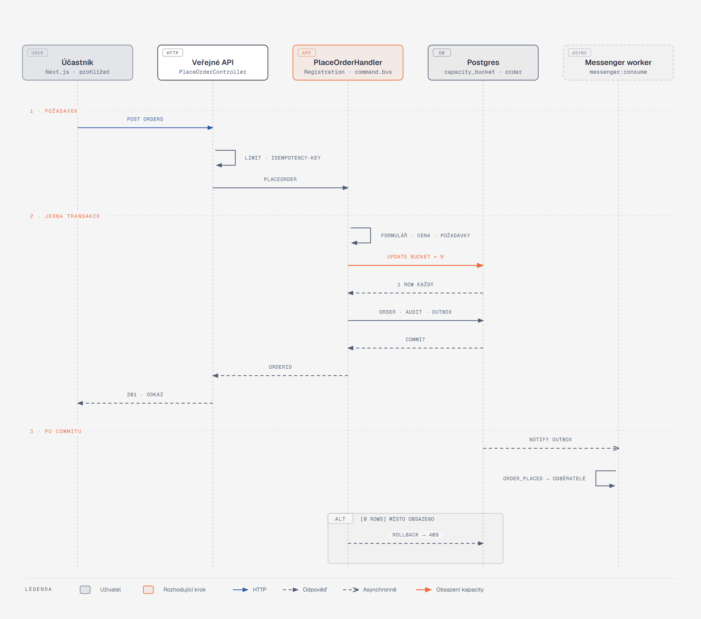
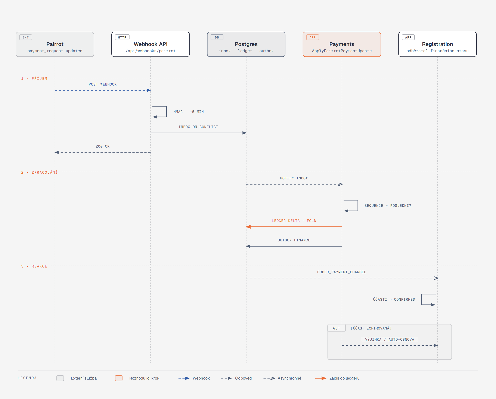

[Architektura](../README.md) · [← 03 Data](../03-data/README.md) · **04 Klíčové cesty** · [05 Stavové automaty →](../05-stavove-automaty/README.md)

# 04 · Klíčové cesty

## Co si odnést

Systém nese jedenáct cest. Každá z nich je **jeden příkaz v jedné transakci**, ke kterému se asynchronně, přes outbox, přidávají reakce ostatních modulů.

Jen registrace (cesta 2) a změna varianty (cesta 7) zasahují do tří modulů v jedné transakci: Registration, kapacity a Legal. Všechno ostatní, tedy platby, zprávy, výjimky a audit mimo vlastní modul, se děje až po commitu.

Pro každou cestu kapitola uvádí, kde transakce začíná a končí, co se stane při selhání, které akceptační scénáře cesta dokazuje a kterou třídou začít číst.

Stavy, které cesty mění, popisuje [05 · Stavové automaty](../05-stavove-automaty/README.md). Doručování událostí popisuje [06 · Asynchronní svět](../06-asynchronni-svet/README.md).

## Přehled

| # | Cesta | Vstup | Transakce (moduly) | Scénáře |
|---|---|---|---|---|
| 1 | Založení a publikace události | `/api/admin/org/{orgSlug}/events` | Catalog, Legal | — |
| 2 | Registrace (`PlaceOrder`) | `/api/public/orgs/{orgSlug}/events/{eventSlug}/orders` | Registration + Legal | S01, S02, S13 |
| 3 | Vytvoření platebního požadavku | outbox `registration.order_placed` | Payments | S08 |
| 4 | Příchozí platba | `/api/webhooks/pairrot` | Payments → Registration (async) | S03–S07 |
| 5 | Odbavení | `/api/check-in/scan`, `/api/check-in/check-ins` | CheckIn (+ Payments při hotovosti) | S10, S11 |
| 6 | Storno účasti a zrušení akce | admin / samoobsluha | Registration, Catalog | REG-14, EVT-12 |
| 7 | Změna varianty | admin / samoobsluha (P1) | Registration + Legal | S18 |
| 8 | Nová verze dokumentu, odvolání souhlasu | admin / samoobsluha | Legal | S14, S15, S16 |
| 9 | Nové pole po registracích | admin | Catalog | S17 |
| 10 | Cílená zpráva a změna programu | admin | Catalog / Communication | S12 |
| 11 | Čekací listina (P1) | outbox `registration.capacity_released` | Registration | REG-12 |

Společná kostra všech zápisových cest:

```
HTTP → firewall (autentizace) → value resolvery (tenant, token, DTO) → voter
     → command.bus [tenant · idempotency · audit · doctrine_transaction]
        → Handler: načti agregát → doménová metoda → workflow přechod
                   → AuditEntry + OutboxEvent ve stejné transakci
     ← COMMIT ← 2xx / 4xx s kódem chyby (problem+json)
```

---

## 1. Založení a publikace události

**Vstup:** průvodce v administraci (EVT-02). Režim „jednoduchá akce“ vytvoří jednu implicitní `Activity` a jednu `Variant`. Režim „více aktivit“ ukáže strukturu celou.

| Krok | Příkaz | Co se děje |
|---|---|---|
| 1 | `CreateEvent` | `Event` ve stavu zveřejnění `draft` a registrace `not_open`. Vytvoří se implicitní aktivita a varianta. Kapacitní buckety se zatím nezakládají. |
| 2 | `ConfigureActivity`, `ConfigureVariant`, `ConfigureAddOn` | struktura, ceny (`Money`), kapacity, pravidla účasti (min. věk) |
| 3 | `EditDraftForm` | koncept `FormSchema` (JSONB, editovatelný jen v konceptu) |
| 4 | `AttachLegalDocument` | dokumenty události a aktivity. Výchozí dokumenty organizátora se **dědí automaticky** (ORG-06). Resolver je počítá za běhu, nekopírují se. |
| 5 | `PublishEvent` | jedna transakce: ověření úplnosti (`EventPublishabilityChecker`), `FormVersion v1` (neměnný snapshot), založení `capacity_bucket` pro událost, aktivity a varianty, přechod `publish`, outbox `catalog.event_published` |

**Pravidla publikace** (`EventPublishabilityChecker`, tagované `PublishRule`):

- aspoň jedna aktivita s variantou,
- placená varianta vyžaduje platební metodu,
- převod vyžaduje napojený Pairrot (`OrganizerPaymentSettings.pairrotSubtenantId` a bankovní spojení),
- dobrovolný souhlas nesmí být povinný (LEG-06),
- nezletilá aktivita vyžaduje pole zákonného zástupce.

Selhání pravidla vrátí `422` se seznamem porušení, aby UI mohlo navést k opravě.

**Po publikaci** vytvoří každá změna formuláře novou `FormVersion` (cesta 9). Změna dokumentu vytvoří novou `DocumentVersion` (cesta 8). Změna kapacity upraví `capacity_bucket.limit` (CAP-06, cesta níže).

**Úprava kapacity (CAP-06).** `ChangeCapacity` nastaví `limit` bez kontroly vůči obsazenosti. Pokud je nový limit pod `held + confirmed`, odpověď nese varování `capacity_below_occupancy` a nic se automaticky neruší. Auditní záznam obsahuje před/po a povinný důvod. Primární ochranou je podmíněný `UPDATE` při každém obsazování. Bucket nese navíc `CHECK (held >= 0 AND confirmed >= 0)` a poslední pojistku `CHECK ("limit" IS NULL OR held + confirmed <= "limit" OR overbooked_allowed)`. Příznak `overbooked_allowed` nastavuje jen tato cesta snížení kapacity. Bucket s ním dál nepřijme žádné nové obsazení, protože ho podmíněný `UPDATE` odmítne (viz [ADR 002](../../adr/002-capacity-buckets-conditional-update.md)).

**Vstupní body:** `Catalog\Application\PublishEvent\PublishEventHandler`, `Catalog\Domain\Publishing\EventPublishabilityChecker`, `Legal\Contract\ApplicableRequirementsResolver`.

---

## 2. Registrace (`PlaceOrder`)



**Jak to číst.** Zleva doprava je vidět účastník, veřejné API, handler v modulu Registration, databáze a worker.

- Pásmo 2 je jedna databázová transakce. Oranžová šipka znamená podmíněné obsazení kapacitních bucketů.
- Rámec `ALT` ukazuje případ, kdy některý bucket vrátí 0 řádků: celá transakce se vrátí a klient dostane `409`.
- Pásmo 3 běží až po commitu a nemá vliv na odpověď účastníkovi.

**Požadavek** (`PlaceOrderRequest`, REG-01):

- výběr položek `[{activityId, variantId, waveId?, personRef}]`,
- osoby a jejich odpovědi podle scope,
- odpovědi objednávky a skupin,
- doplňky,
- rozhodnutí k právním požadavkům `[{requirementId, documentVersionId, personRef, participationRef?, decision}]`,
- platební metoda, promo kód (P1) a kontakt objednávajícího.

Hlavička `Idempotency-Key` je povinná: Next.js ji generuje jednou na odeslání formuláře.

**Před handlerem** (mimo transakci):

1. `RateLimiter` `public_order` (10 objednávek na IP za 10 minut, sliding window) a kontrola honeypotu a časové pasti (API-03).
2. `IdempotencyMiddleware`: klíč a hash kanonického těla. Stejný klíč a stejné tělo vrátí uloženou odpověď. Stejný klíč a jiné tělo vrátí `422 idempotency_key_reused`.
3. Value resolver načte `PublishedEventSnapshot` (cachovaný read model katalogu) a ověří, že registrace události i všech zvolených aktivit jsou `open`.

**Handler** (`Registration\Application\PlaceOrder\PlaceOrderHandler`, jedna transakce přes `doctrine_transaction` middleware):

| # | Krok | Třída | Selhání → odpověď |
|---|---|---|---|
| 1 | Validace odpovědí proti `FormVersion` aktuální při načtení, ve správném scope a s podmíněnými poli vyhodnocenými na serveru (FRM-05, FRM-07) | `Catalog\Contract\FormValidator` | `422` s cestami k polím |
| 2 | Podmínky účasti: věk k referenčnímu datu, kategorie, počet osob ve variantě | `ParticipationEligibilityPolicy` | `422 not_eligible` |
| 3 | Cena: řetězec tagovaných `PriceModifier` (varianta, doplňky, early bird, vícenásobná sleva, promo kód P1) → `PriceBreakdown` | `PriceCalculator` | `422 promo_invalid` |
| 4 | Právní požadavky: co se pro tuto kombinaci vyžaduje, kdo potvrzuje (objednávající / účastník / **zákonný zástupce konkrétního dítěte**), zda jsou rozhodnutí úplná | `Legal\Contract\ApplicableRequirementsResolver`, `ConfirmationSetValidator` | `422 missing_confirmation` |
| 5 | Obsazení kapacity: všechny buckety všech účastí, seřazené podle `id`, každý podmíněným `UPDATE … SET held = held + :n WHERE … held + confirmed + :n <= "limit"` | `CapacityAllocator` | 0 řádků → `CapacityExhausted` → rollback → `409 capacity_exhausted` + `waitlistAvailable` |
| 6 | Agregát: `Order::place()` vytvoří `Person`, `Participation` (převod → `pending` + `hold_expires_at`; hotovost/zdarma → `confirmed`, `held` se ve stejném kroku přesune do `confirmed`), `AnswerSet` s `form_version_id`, `OrderItem`, `Group` | `Order` | — |
| 7 | Potvrzení: `Confirmation` pro každé rozhodnutí (verze dokumentu, osoba, účast nebo objednávka, kanál `web`) | `Legal\Contract\ConfirmationRecorder` | — |
| 8 | Finance: `order_finance` s `amount_due` z `PriceBreakdown`, stav `unpaid`, popř. `not_required` | `Payments\Contract\OrderFinanceInitializer` | — |
| 9 | Token samoobsluhy `ss1_…` (v DB jen SHA-256 hash), registrační kódy účastí | `SelfServiceTokenIssuer` | — |
| 10 | Audit (`actor = participant_token` / `anonymous_public`) a integrační událost `registration.order_placed` do `messenger_messages` | `AuditContextMiddleware` + `DomainEventsMiddleware` | — |

**Proč je S02 splněno.** Kroky 5–9 běží v jedné transakci a buckety se obsazují všechny, nebo žádný. Objednávka s účastí v plné a ve volné aktivitě skončí rollbackem, takže nikde nezůstane `held` navýšené.

**Proč je S01 splněno.** Dva souběžné `UPDATE` na tentýž řádek bucketu Postgres serializuje řádkovým zámkem. Druhý vidí už navýšené `held` a podmínka mu vrátí 0 řádků. Deterministické pořadí podle `id` brání deadlocku mezi objednávkami, které sdílejí víc bucketů.

**S13 (rodič a dvě děti).** Vznikne jedna objednávka, tři `Person`, tři `Participation` (sobota a dvakrát neděle) a jeden `PaymentRequest` (cesta 3). `ApplicableRequirementsResolver` vrací požadavky **pro každou účast**. U dětské aktivity je potvrzující stranou `LEGAL_GUARDIAN` a `Confirmation` nese `subject_person_id` dítěte a `confirming_person_id` rodiče (REG-06, LEG-11).

**Odpověď:** `201 {orderId, orderNumber, selfServiceUrl, payment: {status: "instructions_pending" | "not_required" | "cash_on_site"}}`. Platební údaje v odpovědi **nejsou**. Přijdou asynchronně (cesta 3) a samoobsluha je zobrazí, jakmile existují (PAY-03).

---

## 3. Vytvoření platebního požadavku (PAY-02, PAY-03, S08)

| Krok | Kde | Co |
|---|---|---|
| 1 | odběratel `Payments\…\CreatePaymentRequestOnOrderPlaced` | jen pro `paymentMethod = bank_transfer` a `amount_due > 0` |
| 2 | `PaymentRequest` (zrcadlo) ve stavu `requested`, `attempt = 1` | lokální řádek vzniká **před** voláním Pairrotu, aby šlo bezpečně opakovat |
| 3 | `PaymentGateway::createRequest()` | `POST /v1/subtenants/{sid}/payment-requests`: `external_id = order_<uuid>_<attempt>`, `amount`, `currency = CZK`, `bank_connection_id`, `due_at = hold_expires_at` (nejpozději uzávěrka registrací), `message = orderNumber` |
| 4 | odpověď `201` nebo `200 replayed` | uloží se `pairrot_id`, `variable_symbol`, `iban`, `account_number`, `spayd`, `due_at`, přechod `issue`. Outbox `payments.payment_request_issued` spustí odběratele Communication (e-mail s QR) a Registration (samoobsluha). |

**Výpadek Pairrotu (S08).** Gateway je dekorovaná `RetryingGateway` (3 rychlé pokusy, 200/800/2000 ms) a `CircuitBreakerGateway`. Když selže i to, odběratel vyhodí výjimku a outbox doručení přejde na backoff 1 m, 5 m, 30 m, 2 h, 12 h.

- **Objednávka a účasti zůstávají uložené.** Účastník už dostal e-mail „registrace přijata, platební údaje pošleme“ (odběratel Communication reaguje přímo na `order_placed`).
- **Opakování je bezpečné díky `external_id`.** Pokud Pairrot požadavek vytvořil a jen se ztratila odpověď, další pokus vrátí `200 replayed` se stejným VS.
- **Po šestém selhání** vznikne `AttentionItem` typu `payment_request_failed` s akcí „zkusit znovu“.

**`409 external_id_conflict`** znamená, že se tělo liší od již vytvořeného požadavku (typicky změnila se částka mezi pokusy). Handler zvedne `attempt` a pokus zopakuje s novým `external_id`. Starý požadavek bez alokací zruší (`POST …/cancel`).

**Rezervace a splatnost.** TTL rezervace drží eventor (`hold_expires_at`, CAP-04), protože `due_at` v Pairrotu nic neexpiruje. Pokud se požadavek podaří vytvořit až po významné části TTL (výpadek přes noc), `hold_expires_at` se **prodlouží** tak, aby účastník měl od doručení platebních údajů aspoň 48 hodin (`issued_at + 48 h`), nejvýše do uzávěrky registrací. Účastník tak nepřijde o místo kvůli výpadku, který nezavinil.

---

## 4. Příchozí platba (PAY-04 až PAY-06, S03–S07)



**Jak to číst.** Pásmo 1 je synchronní příjem: podpis, uložení do inboxu a okamžité `200`. Pásmo 2 je zpracování workerem v modulu Payments. Oranžová šipka je jediný zápis peněz, tedy záznam do ledgeru. Pásmo 3 je reakce modulu Registration na změnu finančního stavu. Rámec `ALT` ukazuje platbu na expirovanou účast.

Webhook endpoint eventoru odebírá `payment_request.updated`, `transaction.recorded`, `transaction.updated`, `review_case.*` a `inbound_address.paused/resumed`. Platební požadavek se při expiraci rezervace **neruší**, aby pozdní platba v Pairrotu stále automaticky spárovala a vyvolala S05 nebo S06.

**Příjem** (`/api/webhooks/pairrot`, firewall `webhook`, stateless):

1. `PairrotSignatureAuthenticator` ověří `Pairrot-Webhook-Signature`: HMAC-SHA256 nad `"<id>.<timestamp>." + raw body`, klíč z `pwhsec_…` (během rotace dva klíče přes `bind: $pairrotWebhookSecrets`), časové okno ±5 minut a `hash_equals`.
2. `INSERT INTO inbox_message (provider, external_event_id, type, payload) ON CONFLICT DO NOTHING`. Duplicitní doručení (S03) skončí tady.
3. `200` se vrací **vždy, když je podpis platný**, i u duplicity a u neznámého typu události. Pairrot jinak opakuje.

**Zpracování** (`ApplyPairrotPaymentUpdateHandler`, jedna transakce, řádek `payment_request` zamčený `FOR UPDATE`):

```
if data.sequence <= payment_request.last_sequence → ignoruj (mimo pořadí / už aplikováno)
delta = current.paid_amount − payment_request.known_paid_amount
delta > 0 → LedgerEntry(kind=pairrot_allocation, amount=delta, external_ref=event.id)
delta < 0 → LedgerEntry(kind=pairrot_revocation, amount=delta)        (allocation_revoked)
payment_request.mirror(current, sequence)
FinancialState::fold(entries, amount_due) → order_finance (cache, ledger_version++)
outbox payments.order_payment_changed {orderId, previous, current, delta}
```

Ledger má unikátní index `(source, external_ref)`, takže stejnou událost nelze zaúčtovat dvakrát ani při chybě v kontrole sekvence.

**Reakce Registration** (odběratel `ConfirmParticipationsOnPaymentChanged`):

| Finanční stav | Stav účastí | Chování | Scénář |
|---|---|---|---|
| `paid` | `pending` | přechod `confirm`, bucket `held → confirmed`, outbox `registration.participations_confirmed` → e-mail | — |
| `partially_paid` | `pending` | žádná změna stavu. Účasti dál drží rezervaci. Odejde e-mail o částečné úhradě a upomínky pokračují na zbývající částku (PAY-05). | S04 |
| `overpaid` | libovolný | účasti se potvrdí jako u `paid`. Payments navíc otevře `AttentionItem overpayment` a podle nastavení akce `RefundTask` (vrácení / dar). | S07 |
| `paid` / `partially_paid` | `expired` | **bez automatické obnovy**: Registration emituje `registration.late_payment_received`, přechod `flag_late_payment` → `requires_attention` + `AttentionItem late_payment` (akce „obnovit“ / „refund“) | S05 |
| `paid` | `expired`, akce má `auto_restore_on_late_payment` | `CapacityAllocator::reclaim()` → úspěch: přechod `restore` (actor = system, audit), potvrzovací e-mail. Neúspěch (plno): jako S05 + `RefundTask`. | S06 |
| cokoli | `cancelled` | `AttentionItem payment_on_cancelled` + `RefundTask` | PAY-05 |

**Nespárované platby (PAY-06).** Pairrot páruje automaticky jen přesnou částku se správným VS. Ostatní transakce (chybějící VS, jiná částka, druhá platba po úhradě) přicházejí jako `transaction.recorded` s `matching.result` a ukládají se do zrcadla `unmatched_transaction`.

Fronta rekonciliace v Attention nabízí kandidáty: objednávky se shodným VS, částkou nebo jménem v poznámce a výsledek `GET …/transactions/{id}/matching-candidates`. Akce „přiřadit“ zavolá `POST …/transactions/{id}/allocations` s `Idempotency-Key = alloc_<transactionId>_<paymentRequestId>`. Výsledná změna přijde zpátky běžným webhookem `payment_request.updated` (nebo přes reconcile job). Peníze z Pairrotu tak vstupují do ledgeru **výhradně přes inbox** a UI eventoru nikdy nezapisuje ledger přímo. Částečné úhrady a přeplatky (S04, S07) v praxi vznikají právě touto cestou.

**Ztracené webhooky.** Pairrot opakuje doručení jen asi hodinu. Plánovaný příkaz `ReconcilePairrotEvents` (každých 15 minut, [06](../06-asynchronni-svet/README.md)) projde `GET /v1/management/webhook-events` za posledních 48 hodin a vloží chybějící události do inboxu. Deduplikace je stejná jako u webhooku.

---

## 5. Odbavení (CHK-01 až CHK-10, S10, S11)

**Vstup:** odbavovací obrazovka v Next.js (mobil/tablet). Obsluha je přihlášená session (`CHECK_IN` role) nebo zařízení tokenem `dev1_…`. Vybere `CheckInList` (výchozí = aktivita).

1. **Vyhledání:** QR (`POST /api/check-in/scan` s `qr1.<payload>.<sig>` a `listId`), nebo registrační kód či jméno (`GET /api/check-in/lists/{listId}/search`).
   - QR ověří `ParticipationQrTokenVerifier`: HMAC podpis, verze tokenu v payloadu se musí rovnat `participation.qr_version` a účast nesmí být `cancelled`, `transferred` ani `expired` (CHK-03). Storno a převod zvednou `qr_version`, takže starý QR přestane platit bez seznamu odvolaných tokenů.
2. **Detail** (CHK-04) vrací **odbavovací projekci** `CheckInParticipationView`: jméno, aktivita, varianta, vlna, stav účasti, finanční stav objednávky, chybějící potvrzení, kategorie, poznámka pro odbavení a další účasti téže osoby. Datum narození, kontakty ani odpovědi formuláře obsluha nevidí (serializační skupina `checkin`, rozhoduje `PersonalDataVoter`).
3. **Matice výjimek** (CHK-09). `CheckInDecisionPolicy` vrací pro každou účast `allow`, `allow_with_warning`, `resolve_on_spot` nebo `escalate`:

| Situace | Rozhodnutí | Obsluha |
|---|---|---|
| již odbaven | `escalate` | vidí „odbaveno v HH:MM, kým, kde“. Opravu dělá jen správce (CHK-07). |
| nezaplaceno, hotovost povolena | `resolve_on_spot` | evidovat hotovost → odbavit (jeden krok) |
| nezaplaceno, hotovost nepovolena / bez oprávnění | `escalate` | |
| chybějící potvrzení (např. prohlášení o zdraví) | `resolve_on_spot` | potvrzení „ručně obsluhou“ s poznámkou (kanál `staff`, LEG-07) |
| `requires_attention` | `escalate` | |
| stornováno / expirováno | `escalate` (deny) | |
| jiná aktivita / jiný den | `allow_with_warning` → deny na tomto seznamu | ukáže, kam účast patří (storyboard krok 5) |

4. **Potvrzení příchodu** (`CheckInParticipation`, `Idempotency-Key` povinný): `INSERT INTO check_in (participation_id, station_id, checked_in_by, checked_in_at, idempotency_key)`. Částečný unikátní index `UNIQUE (participation_id) WHERE voided_at IS NULL` zaručí právě jeden platný záznam.
   - **Souběh dvou obsluh (S10):** druhý `INSERT` spadne na unique violation. Handler ji převede na `409 already_checked_in` s `{checkedInAt, checkedInBy, station}` z vítězného řádku.
   - **Stejný klíč od stejného zařízení** (opakovaný request při slabém signálu) vrátí původní `201`.
5. **Hotovost při odbavení** (CHK-08). `RecordCashAndCheckIn` je jeden příkaz, který v jedné transakci zapíše `LedgerEntry(kind=cash)` přes `Payments\Contract\CashDesk`, přepočte `order_finance` (účasti → `confirmed`, protože jde o tentýž modul přes API a stejnou transakci) a vytvoří `check_in`. Payments i CheckIn sdílejí transakci jen v tomto příkazu. Je to vědomá výjimka, aby obsluha neviděla „zaplaceno, ale neodbaveno“.
6. **Oprava hotovosti (S11)** (`CorrectCashEntry`, role FINANCE/OWNER): nová `LedgerEntry(kind=cash_correction, compensates_id=…)` se zápornou původní částkou, případně nový `cash` se správnou částkou. Obě položky zůstávají, finanční stav se přepočte a audit nese důvod (PAY-08).
7. **Oprava a zrušení odbavení** (CHK-07): v jedné transakci se na starém řádku nastaví `voided_at`, `voided_by` a `void_reason` (jediný povolený `UPDATE` na `check_in`, omezený na tyto sloupce a hlídaný triggerem) a případně vznikne nový platný záznam. Vždy auditováno s důvodem.

**Provozní přehled** (CHK-10) je read model `Reporting\CheckInDashboardQuery` nad `check_in`, `participation` a `order_finance`, obnovovaný při každém dotazu (žádná cache, data musí být živá).

---

## 6. Storno účasti a zrušení akce

**Storno účasti** (REG-14 pořadatelem s povinným důvodem, REG-09 účastníkem přes samoobsluhu podle stornopodmínek akce):

1. `CancelParticipation`: workflow `cancel` (z `pending`, `confirmed`, `requires_attention`), uvolnění `held` nebo `confirmed` ve všech bucketech podle `CapacityClaim`, `qr_version++`.
2. Přepočet dlužné částky: `amount_due` objednávky se sníží o cenu účasti podle `CancellationPolicy` (storno poplatek jako `PriceModifier`, P1).
3. Outbox `registration.participation_cancelled` a `registration.order_amount_changed`.
4. Payments přepočte `FinancialState`. Pokud vznikne přeplatek, otevře `RefundTask` (PAY-10, PAY-11) a Communication pošle storno e-mail.
5. Uvolněná kapacita emituje `registration.capacity_released`, na který reaguje čekací listina (cesta 11).

**Zrušení akce** (EVT-12 lite, jen OWNER) je proces složený z idempotentních kroků:

| Krok | Kde | Transakce |
|---|---|---|
| `CancelEvent{reason}` | Catalog | přechod `cancel` (zveřejnění), registrace události a všech aktivit → `closed`, outbox `catalog.event_cancelled` |
| odběratel `CancelOrdersOnEventCancelled` | Registration | dávky po 100 objednávkách (každá dávka vlastní transakce): účasti → `cancelled` (actor = system, reason = event_cancelled), `amount_due → 0` |
| odběratel na `order_amount_changed` | Payments | přeplatek → `RefundTask` (**jen zaplacené** objednávky); nezaplacené platební požadavky v Pairrotu → `cancel` (zrušení akce; při pouhé expiraci rezervace se požadavek nikdy neruší) |
| odběratel `NotifyEventCancelled` | Communication | hromadná transakční zpráva všem objednávajícím (bez ohledu na marketingový souhlas, PRV-07) |

Dávkování brání dlouhé transakci u velkých akcí. Každá dávka je samostatně opakovatelná a znovu zpracovaná objednávka se díky stavovému guardu nezmění. Průběh je vidět v `AttentionItem event_cancellation_progress` až do dokončení.

---

## 7. Změna varianty 5 km → 10 km (S18, REG-09 P1)

`ChangeParticipationVariant` je jeden příkaz v jedné transakci Registration + Legal:

1. **Pravidla:** povoleno nastavením akce (samoobsluha) nebo pořadatelem. Registrace cílové aktivity musí být `open`.
2. **Způsobilost:** věkové podmínky 10 km (min. 15 let) z `Person.birthDate` k referenčnímu datu.
3. **Kapacita:** `CapacityAllocator::move()` obsadí nové buckety (aktivita 10 km, varianta) a uvolní staré, vše v pořadí podle `id`. Bucket události se nemění, protože jde o stejnou událost. Plno → `409`, nic se nezmění.
4. **Právní požadavky:** resolver spočítá požadavky nové aktivity (prohlášení o zdravotní způsobilosti). Chybějící potvrzení se buď přiloží v requestu, nebo účast přejde na `legal_state = incomplete` a odejde výzva.
5. **Účast:** varianta se mění **na místě** (stejná účast, stejný QR, `qr_version` beze změny), protože osoba a událost zůstávají. Historie je v auditu (před/po). Převod na jinou osobu (cesta P1, REG-10) naopak vytváří novou účast.
6. **Cena:** `amount_due` se přepočte (rozdíl 100 Kč), outbox `registration.order_amount_changed`.
7. **Finance (async):** fold ukáže `partially_paid` (nedoplatek) nebo `overpaid`.
   - Při nedoplatku Payments vytvoří **doplňkový platební požadavek** (`purpose = supplementary`) na rozdíl (`external_id = order_<uuid>_<attempt+1>`), protože částku existujícího požadavku Pairrot měnit nedovolí. Pokud původní požadavek ještě nemá alokace, zruší ho a vytvoří nový na celou částku.
   - Při přeplatku vznikne `RefundTask`.
8. **Notifikace:** změna účasti, nové platební údaje a výzva k potvrzení.

---

## 8. Nová verze dokumentu a odvolání souhlasu (S14–S16, LEG-08, LEG-09)

**Publikace verze** (`PublishDocumentVersion{documentId, content, requiresReconfirmation}`):

- `DocumentVersion` je neměnná. Obsah se uloží jako objekt adresovaný hashem (`legal/sha256/<hash>`) a u externího odkazu se stáhne a uloží jeho **snímek** (LEG-01, [ADR 012](../../adr/012-legal-documents-content-addressed-versions.md)).
- **S14** (bez příznaku): nové registrace dostávají novou verzi. Stávající `Confirmation` dál ukazují na starou verzi a nic dalšího se neděje.
- **S15** (s příznakem): outbox `legal.document_version_published{requiresReconfirmation: true}`. Odběratel `RequestReconfirmationOnNewVersion` (Legal, dávkově) najde dotčené účasti a objednávky, které měly potvrzení předchozí verze. U každé vytvoří `Confirmation` ve stavu `requested` pro novou verzi a nastaví `participation.legal_state = reconfirmation_required`.
  - Původní potvrzení zůstává (nikdy se nepřepisuje). Mlčení ≠ souhlas: dokud nepřibude nové `granted`, `legal_state` zůstává `reconfirmation_required`.
  - Communication pošle výzvu s odkazem do samoobsluhy. Přehled souhlasů (LEG-10) filtruje podle `legal_state`.
  - UI zobrazuje takovou účast jako „vyžaduje řešení“. Stav účasti (`participation.state`) se **nemění**, protože jde o samostatnou dimenzi (viz [05](../05-stavove-automaty/README.md#oddělené-dimenze-účasti)).

**Odvolání souhlasu (S16)** (`WithdrawConsent` přes samoobsluhu, hlavička `Authorization: SelfService ss1_…` se scope `consent:withdraw`):

- Vznikne nové `Confirmation` s rozhodnutím `withdrawn`. Registrace i stav účasti zůstávají beze změny.
- Outbox `legal.consent_withdrawn{requirementType}`.
- Attention vytvoří notifikaci pořadateli. U typu `LIKENESS` vytvoří navíc **provozní úkol** `AttentionItem review_published_media` s odkazem na interní galerie akce (Content), kde je třeba fotografie prověřit (LEG-09, POST-06).

---

## 9. Nové povinné pole po 50 registracích (S17, FRM-08, FRM-09)

1. Editor formuláře po publikaci pracuje s konceptem další verze. `PublishFormVersion` vytvoří `FormVersion v(n+1)` (neměnný snapshot) a outbox `catalog.form_version_published{addedRequiredFields}`.
2. Nové registrace se validují proti v(n+1). Starých 50 `AnswerSet` dál nese `form_version_id = v(n)` a interpretuje se podle v(n). Nic se nedoplní ani nepředvyplní.
3. Pokud v(n+1) přidala povinné pole ve scope osoby nebo účasti, odběratel `RequestMissingAnswers` (Registration) označí dotčené účasti `answers_state = incomplete` a Communication pošle výzvu k doplnění (COM-01).
4. Doplnění přes samoobsluhu vytvoří **nový** `AnswerSet` (scope + v(n+1)) jen s chybějícími poli. Původní zůstává. Čtecí model registrace skládá odpovědi z posledního `AnswerSet` každého pole.
5. Tabulka registrací (ADM-04) i export ukazují u starých záznamů prázdnou hodnotu s příznakem „nevyžadováno ve verzi v(n)“, nikoli prázdný řetězec.

---

## 10. Cílená zpráva a změna programu (S12, COM-02, PRG-03)

**Změna času startu dětského závodu:**

1. `RescheduleActivity` (Catalog): nové `starts_at`, audit, outbox `catalog.activity_rescheduled{activityId, previousStartsAt, newStartsAt}`.
2. UI nabídne „notifikovat dotčené“. Při potvrzení se vytvoří `Campaign` typu transakční, s cílem `ActivityAudience{activityId, states: [pending, confirmed]}` a šablonou `activity_changed`.
3. `ResolveCampaignRecipients` (Communication) se ptá `Registration\Contract\AudienceQuery`. Výsledkem je **jeden `Delivery` na objednávajícího a aktivitu**, deduplikovaný klíčem `campaign:<id>:order:<id>`. Sobotní účastníci nedostanou nic (S12).
4. Každé `Delivery` se odesílá samostatně (Messenger `async_mail`). **Těsně před odesláním** se znovu vyhodnotí podmínka (`RecipientStillEligible`). Účastník, který mezitím stornoval, dostane stav `skipped` (COM-02, negativní test upomínek po úhradě).

**Programový bod** (PRG-03) s příznakem „důležitá změna“ funguje stejně, s audience odvozenou z vazby `ProgramItem → Activity`. Bod bez vazby nabízí audience „všichni účastníci akce“.

**Vlastní zprávy** (COM-03, COM-04) používají stejnou mašinerii. Audience je `SegmentSpecification` (aktivita, varianta, stav účasti, finanční stav, stav odbavení, odpověď pole P1, souhlas). Marketingová kampaň vyžaduje `consent = granted` pro požadavek typu `CONSENT` s účelem `marketing` (PRV-07). Zařazení do segmentu se ověřuje znovu při odeslání.

---

## 11. Čekací listina (REG-12, P1)

1. Plná varianta: `409 capacity_exhausted` nese `waitlistAvailable: true`. `JoinWaitlist` uloží `WaitlistEntry` (kontakt, požadovaná aktivita a varianta, počet míst, pořadí podle `created_at`). Kapacitu neobsazuje.
2. Uvolnění kapacity (storno, expirace, navýšení limitu) emituje `registration.capacity_released{bucketIds, seats}`.
3. Odběratel `OfferSeatToWaitlist` v jedné transakci zamkne první čekající záznam (`FOR UPDATE SKIP LOCKED`), obsadí `held` v bucketech (stejný `CapacityAllocator`) a vytvoří `WaitlistOffer` s `expires_at` (nastavení akce, výchozí 24 h) a jednorázovým tokenem.
4. Communication pošle nabídku. Účastník projde zkrácenou registrací (`AcceptWaitlistOffer` = `PlaceOrder` s předobsazenou kapacitou).
5. Plánovač `ExpireWaitlistOffers` (každou minutu) propadlé nabídky uvolní (`held −n`) a znovu emituje `capacity_released`, takže nabídka jde dalšímu v pořadí. Historie nabídek zůstává v `waitlist_offer`.

---

## Kde začít číst kód

| Cesta | Vstupní třída |
|---|---|
| Publikace | `Catalog\Application\PublishEvent\PublishEventHandler` |
| Registrace | `Registration\UserInterface\Http\Public\PlaceOrderController` → `Registration\Application\PlaceOrder\PlaceOrderHandler` |
| Kapacita | `Registration\Domain\Capacity\CapacityAllocator`, `Registration\Infrastructure\Capacity\DbalCapacityBucketStore` |
| Platební požadavek | `Payments\UserInterface\Subscriber\CreatePaymentRequestOnOrderPlaced` |
| Webhook | `Payments\UserInterface\Http\PairrotWebhookController`, `Payments\Application\ApplyPairrotPaymentUpdate\…Handler` |
| Odbavení | `CheckIn\Application\CheckInParticipation\…Handler`, `CheckIn\Domain\CheckInDecisionPolicy` |
| Storno a zrušení | `Registration\Application\CancelParticipation\…Handler`, `Catalog\Application\CancelEvent\…Handler` |
| Dokumenty | `Legal\Application\PublishDocumentVersion\…Handler` |
| Zprávy | `Communication\Application\ResolveCampaignRecipients\…Handler` |
