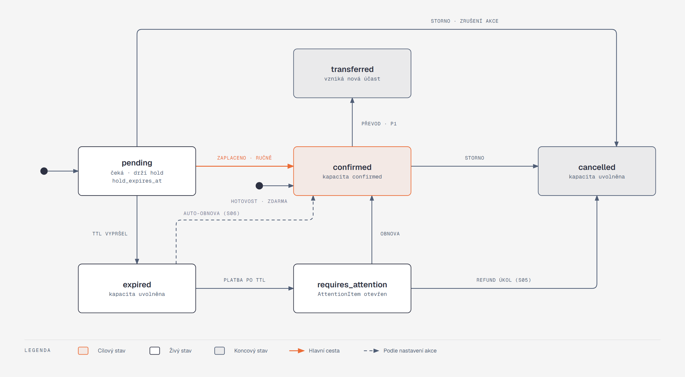
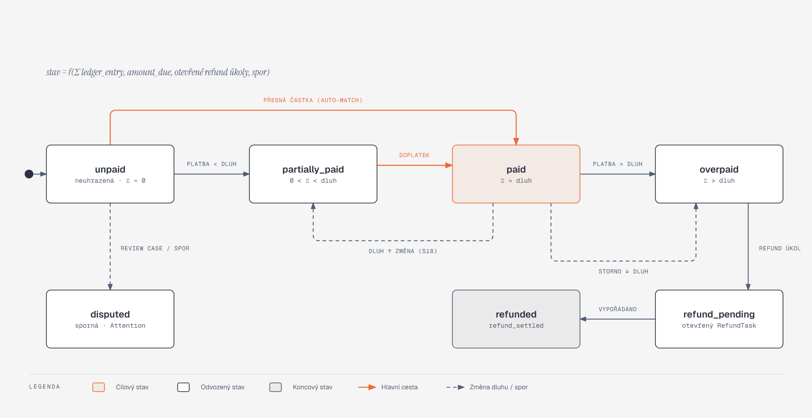

[Architektura](../README.md) · [← 04 Klíčové cesty](../04-klicove-cesty/README.md) · **05 Stavové automaty** · [06 Asynchronní svět →](../06-asynchronni-svet/README.md)

# 05 · Stavové automaty

## Co si odnést

Zadání (kap. 5) žádá, aby se stavové dimenze nesloučily do jednoho pole. Eventor má proto **osm definic Symfony Workflow** (`type: state_machine`), každou nad vlastním sloupcem: `participation`, `event_publication`, `registration_window` (událost i aktivita), `payment_request`, `delivery`, `refund_task`, `attention_item` a `waitlist_offer`. Odbavení a právní potvrzení jsou **append-only tabulky**: jejich stav je poslední platný řádek, ne přechod ve sloupci.

Výjimkou je **finanční stav objednávky**. Ten není automat s přechody, ale **odvozená hodnota**: fold append-only ledgeru proti aktuální dlužné částce. Nedá se do něj „přejít“, dá se jen přidat záznam do ledgeru.

Přechody provádí výhradně `WorkflowInterface::apply()` uvnitř command handleru. Přímý zápis do stavového sloupce zakazuje PHPStan pravidlo. Každý přechod mimo automatiku je auditovaný s aktérem a důvodem. Každý přechod, na který může reagovat jiný modul, emituje outbox událost. Příkaz bez události musí být označený `#[ReadOnlyCommand]` ([ADR 011](../../adr/011-workflow-component-state-machines.md)).

## Jak je Workflow nakonfigurované

```yaml
# backend/config/packages/workflow.yaml (výřez)
framework:
  workflows:
    participation:
      type: state_machine
      audit_trail: { enabled: true }
      marking_store: { type: method, property: state }      # enum ParticipationState
      supports: [App\Registration\Domain\Participation]
      initial_marking: pending
      places: [pending, confirmed, expired, requires_attention, cancelled, transferred]
      transitions:
        confirm:          { from: pending,                                 to: confirmed }
        confirm_on_site:  { from: pending,                                 to: confirmed }   # hotovost / ručně
        expire:           { from: pending,                                 to: expired }
        restore:          { from: [expired, requires_attention],           to: confirmed }
        flag_late_payment:{ from: expired,                                 to: requires_attention }
        cancel:           { from: [pending, confirmed, requires_attention], to: cancelled }
        transfer:         { from: confirmed,                               to: transferred }
```

Konvence platné pro všechny automaty:

| Prvek | Řešení |
|---|---|
| Marking store | `method` nad backed enum vlastností entity (`ParticipationState`). Entita nemá veřejný setter, `Workflow` volá interní `setMarking()` přes `#[Required]` přístup v doménové vrstvě. |
| Guard | `guard` výrazy se nepoužívají. Guardy jsou listenery `workflow.<name>.guard.<transition>`, které delegují na **doménové politiky** (`CapacityRestorePolicy`, `CancellationPolicy`) a na **voters** (`is_granted('PARTICIPATION_CANCEL', subject)`). Doménová pravidla tak zůstávají testovatelná bez Workflow. |
| Kontext přechodu | `apply($subject, 'cancel', ['actor' => AuditActor, 'reason' => '…'])`. `AuditActor` rozlišuje `user`, `system` a `participant_token` (AUD-03). |
| Audit | jeden obecný listener `workflow.completed` (`WorkflowAuditListener`) zapíše `AuditEntry` s `from → to`, aktérem a důvodem. U ručních zásahů je důvod povinný (AUD-02) a guard bez důvodu přechod zablokuje. |
| Události | listener `workflow.<name>.completed.<transition>` zaznamená doménovou událost; `DomainEventsMiddleware` ji ve stejné transakci pustí a modul z ní publikuje integrační událost ([katalog](../06-asynchronni-svet/katalog-udalosti.md)) |
| Ověření konfigurace | `WorkflowDefinitionPass` (compiler pass, [09](../09-symfony-v-architekture/README.md)) ověří, že každý přechod má v mapě `TransitionEvents` buď událost, nebo explicitní `internal: true` |
| Dokumentace | `bin/console workflow:dump participation \| dot` v CI. Diagramy v této kapitole jsou ručně kreslené z téže definice. |

## Oddělené dimenze účasti

Účast nese **čtyři nezávislé dimenze**. UI z nich skládá souhrnný štítek, ale v datech zůstávají oddělené:

| Dimenze | Sloupec | Hodnoty | Kdo mění |
|---|---|---|---|
| Životní cyklus | `participation.state` | `pending`, `confirmed`, `expired`, `requires_attention`, `cancelled`, `transferred` | Registration |
| Právní úplnost | `participation.legal_state` | `complete`, `incomplete`, `reconfirmation_required` | Legal (přes Registration API) |
| Úplnost odpovědí | `participation.answers_state` | `complete`, `incomplete` | Registration |
| Odbavení | odvozeno z `check_in WHERE voided_at IS NULL` | `not_checked_in`, `checked_in` | CheckIn |

Zadání v kap. 5.3 řadí „chybějící potvrzení po změně pravidel“ pod stav `vyžaduje řešení`. Eventor ho modeluje jako `legal_state = reconfirmation_required` a souhrnný štítek „vyžaduje řešení“ se zobrazí, pokud platí `state = requires_attention` **nebo** `legal_state ≠ complete` **nebo** `answers_state ≠ complete`.

Důvod: kdyby nové potvrzení měnilo `state`, nezaplacená účast s chybějícím potvrzením by ztratila informaci, že čeká na platbu a drží rezervaci. Dvě nezávislé skutečnosti by se slily do jednoho pole, což je přesně to, co zadání zakazuje.

---

## Účast (`participation.state`)



**Jak to číst.** Účast vzniká dvěma cestami:

- **při platbě převodem** jako `pending` s rezervací,
- **při hotovosti nebo zdarma** rovnou jako `confirmed` (druhý počáteční bod).

Oranžová šipka je nejčastější cesta k potvrzení. Čárkovaná šipka je automatická obnova, která proběhne, jen když ji pořadatel zapnul. Šedé stavy jsou koncové.

| Přechod | Spouštěč | Aktér | Guard | Vedlejší efekty | ID |
|---|---|---|---|---|---|
| *(vznik)* → `pending` | `PlaceOrder`, metoda převod, akce drží místo | účastník | kapacita obsazena (`held`) | `hold_expires_at`, `CapacityClaim` | REG-01, CAP-04 |
| *(vznik)* → `confirmed` | `PlaceOrder`, hotovost / zdarma | účastník | kapacita obsazena přímo jako `confirmed` | — | CAP-04 |
| `confirm` | finanční stav `paid` / `overpaid` | systém | — | bucket `held → confirmed`, `hold_expires_at = null`, e-mail | PAY-05 |
| `confirm_on_site` | ruční potvrzení pořadatelem, hotovost u odbavení | člen týmu | role, důvod | totéž | REG-13, CHK-08 |
| `expire` | plánovač `ExpireReservations` | systém | `hold_expires_at < now` a objednávka není `paid` | bucket `held −n`, `capacity_released`, e-mail, popř. nabídka z čekací listiny | CAP-04 |
| `flag_late_payment` | platba na `expired` účast, auto-obnova vypnutá nebo plno | systém | — | `AttentionItem late_payment` | CAP-05, S05 |
| `restore` (z `expired`) | auto-obnova po platbě | systém | `CapacityRestorePolicy`: akce má `auto_restore_on_late_payment`, `reclaim()` uspěl | bucket `confirmed +n`, e-mail, audit jako systémová operace | S06 |
| `restore` (z `requires_attention`) | akce „obnovit“ ve frontě | FINANCE / OWNER (EVENT_MANAGER jen označí, viz matice) | `reclaim()` uspěl | totéž, `AttentionItem` uzavřen | CAP-05 |
| `cancel` | storno účastníkem, pořadatelem, zrušení akce, refund z fronty | účastník / člen týmu / systém | `CancellationPolicy` (lhůty a povolení samoobsluhy), důvod u člena týmu | uvolnění bucketů, `qr_version++`, `amount_due` ↓ | REG-09, REG-14, EVT-12 |
| `transfer` (P1) | `TransferParticipation` | člen týmu / účastník | nová osoba vyplnila údaje a potvrzení | nová `Participation` (`confirmed`) přebírá `CapacityClaim`, původní `qr_version++` | REG-10, LEG-12 |

Rezervace (hold) **není stav**. Je to dvojice `hold_expires_at` (nenulové jen v `pending`) a `capacity_bucket.held`. Constraint `CHECK ((state = 'pending') = (hold_expires_at IS NOT NULL))` na `participation` drží obojí v souladu.

---

## Finanční stav objednávky (odvozený)



**Jak to číst.** Šipky nejsou přechody, které by někdo „spouštěl“. Popisují, jak se odvozený stav změní po novém záznamu v ledgeru nebo po změně dlužné částky:

- oranžová cesta je běžná úhrada,
- čárkované cesty ukazují změnu dluhu (storno, změna varianty) a spor.

`FinancialState::fold(LedgerEntry[] $entries, Money $amountDue, RefundTaskSummary $refunds, bool $disputed)` je čistá funkce:

```
received = Σ amount (pairrot_allocation, pairrot_revocation, cash, cash_correction, manual_correction)
refunded = Σ amount (refund_settled)          # záporné částky
net      = received + refunded

disputed                        → disputed
amount_due == 0 && net == 0     → not_required | refunded (pokud refunded ≠ 0)
net == 0                        → unpaid
0 < net < amount_due            → partially_paid
net == amount_due               → paid
net > amount_due && open refund → refund_pending
net > amount_due                → overpaid
```

| Stav (zadání 5.4) | Kód | Typická příčina |
|---|---|---|
| neuhrazená | `unpaid` | nová objednávka |
| částečně uhrazená | `partially_paid` | ruční alokace menší platby v Pairrotu (S04), zvýšení ceny (S18) |
| uhrazená | `paid` | automatické spárování přesné částky |
| přeplacená | `overpaid` | druhá platba, storno po úhradě (S07) |
| sporná | `disputed` | review case v Pairrotu (`transaction_review_required`), ruční označení financí |
| vrácení čeká | `refund_pending` | otevřený `RefundTask` |
| vráceno | `refunded` | `RefundTask` uzavřen → `LedgerEntry(refund_settled)` |
| *(nepožaduje se)* | `not_required` | zdarma, nebo celá objednávka stornována před platbou |

Výsledek se ukládá jako **cache** do `order_finance` (`state`, `received_minor`, `amount_due_minor`, `ledger_version`) ve stejné transakci jako nový záznam ledgeru. Noční job `VerifyFinancialStateCache` přepočte fold pro všechny otevřené objednávky a nesoulad hlásí jako `AttentionItem`. Je to test pravdivosti cache, ne oprava.

**Druhy `LedgerEntry`:**

| Kind | Znaménko | Zdroj | Unikátní klíč |
|---|---|---|---|
| `pairrot_allocation` | + | webhook / reconcile (delta `paid_amount`) | `(source=pairrot, external_ref=event.id)` |
| `pairrot_revocation` | − | `allocation_revoked` | `(pairrot, event.id)` |
| `cash` | + | `RecordCash` (obsluha) | `idempotency_key` |
| `cash_correction` | ± | `CorrectCashEntry`, `compensates_id` povinné | `idempotency_key` |
| `manual_correction` | ± | finance s povinným důvodem (např. platba mimo Pairrot) | `idempotency_key` |
| `refund_settled` | − | uzavření `RefundTask` | `refund_task_id` |

---

## Událost: zveřejnění (`event.publication_state`, EVT-03)

| Přechod | Z → do | Aktér | Guard | Efekty |
|---|---|---|---|---|
| `publish` | `draft → published` | OWNER, EVENT_MANAGER | `EventPublishabilityChecker` | `FormVersion v1`, buckety, `catalog.event_published` |
| `cancel` | `published → cancelled` | OWNER | důvod, potvrzení | registrace → `closed`, proces zrušení (cesta 6 v [04](../04-klicove-cesty/README.md)) |
| `complete` | `published → completed` | EVENT_MANAGER / systém den po `ends_at` | `ends_at < now` | závěrečný report je dostupný, samoobsluha se přepne do režimu „po akci“ |
| `archive` | `completed → archived` | OWNER, EVENT_MANAGER | — | veřejný archiv ukazuje jen označený obsah, nikdy osobní údaje (POST-07) |
| `unpublish` | `published → draft` | OWNER | žádné objednávky | — |

## Registrace (`event.registration_state`, `activity.registration_state`, EVT-04)

Stejný automat, dvě úrovně: `not_open → open ⇄ paused → closed`.

| Přechod | Spouštěč | Guard |
|---|---|---|
| `open` | ručně nebo plánovač `OpenScheduledRegistrations` (`opens_at`) | událost `published` |
| `pause` / `resume` | ručně | — |
| `close` | ručně, plánovač (`closes_at`), zrušení akce | — |

Registraci aktivity lze otevřít, jen když je otevřená registrace události. Veřejný endpoint ověřuje **obě** úrovně. Uzavření registrací **nezkracuje** rezervace, které už existují. `hold_expires_at` se ale při vytvoření omezí na `closes_at`.

## Odbavení (`check_in`, CHK-05 až CHK-07)

Automat nad tabulkou, ne nad sloupcem: `not_checked_in → checked_in → (corrected | voided) → not_checked_in`.

| Operace | Zápis | Aktér |
|---|---|---|
| odbavit | `INSERT check_in` | CHECK_IN, EVENT_MANAGER, OWNER |
| zrušit | `UPDATE SET voided_at, voided_by, void_reason` + audit | EVENT_MANAGER, OWNER (důvod) |
| opravit (jiné stanoviště, čas) | zneplatnění starého (`voided_*`) a `INSERT` nového v jedné transakci | EVENT_MANAGER, OWNER (důvod) |

Integritu drží `UNIQUE (participation_id) WHERE voided_at IS NULL` a trigger, který na `check_in` povolí jediný `UPDATE`: nastavení `voided_at`, `voided_by` a `void_reason` z `NULL`. Jiné sloupce měnit nelze a zneplatnění nelze vzít zpět.

## Právní potvrzení (`confirmation`, LEG-07, LEG-08)

Append-only: každé rozhodnutí je nový řádek. „Stav“ pro dvojici (požadavek, subjekt) je poslední řádek podle `recorded_at`.

| Rozhodnutí | Kdy | Pravidlo |
|---|---|---|
| `requested` | nová verze s příznakem reconfirmation, nově přidaný požadavek | mlčení ≠ souhlas |
| `granted` | registrace, samoobsluha, ručně obsluhou (`channel = staff`, poznámka povinná) | |
| `declined` | jen u volitelných (`CONSENT`, `LIKENESS`) | povinný požadavek nelze odmítnout a zároveň se registrovat |
| `withdrawn` | jen u odvolatelných, přes samoobsluhu nebo obsluhu | nezruší registraci (LEG-09) |

## Doručení zprávy (`delivery.state`, COM-06)

| Přechod | Z → do | Spouštěč |
|---|---|---|
| `schedule` | *(vznik)* → `scheduled` | rozpad kampaně / transakční trigger |
| `skip` | `scheduled → skipped` | `RecipientStillEligible` vrátí false těsně před odesláním (COM-02) |
| `send` | `scheduled → sent` | Mailer přijal zprávu (SMTP 250 / API 2xx) |
| `deliver` | `sent → delivered` | stav od poskytovatele (P1, bounce webhook) |
| `fail` | `scheduled/sent → failed` | vyčerpané retry, hard bounce |
| `retry` | `failed → scheduled` | „opakovat selhané“ v kampani (COM-06), stejný `idempotency_key` |

## Platební požadavek (`payment_request.state`, zrcadlo Pairrotu)

| Stav | Význam | Odkud |
|---|---|---|
| `requested` | lokálně vytvořen, Pairrot zatím nepotvrdil | cesta 3 |
| `issued` | Pairrot vrátil VS, IBAN a SPAYD | odpověď `201/200` |
| `open`, `partially_paid`, `paid`, `overpaid` | zrcadlo `current.status` z webhooku | `payment_request.updated` |
| `cancelled` | zrušen (změna částky bez alokací, zrušení akce) | `POST …/cancel` → webhook `request_cancelled` |
| `failed` | vyčerpané pokusy o vytvoření | outbox dead-letter |

V datech jsou to dva sloupce ([03](../03-data/README.md)): `creation_state` (`PENDING` = requested, `CREATED` = issued, `FAILED` = failed) popisuje vytvoření požadavku v Pairrotu a `status` zrcadlí jeho stav po vytvoření. Zrcadlo **neurčuje** finanční stav objednávky. Ten se počítá jen z ledgeru. Zrcadlo slouží pro platební údaje a kontrolu `sequence`.

## Refund úkol (`refund_task.state`, PAY-11)

`open → settled | cancelled`. Vzniká ze storna, přeplatku nebo zrušení akce. `settle{method, reference, note}` (FINANCE, OWNER) zapíše `LedgerEntry(refund_settled)` se zápornou částkou. EVENT_MANAGER smí úkol vytvořit, ale ne uzavřít (matice kap. 3). Vrácení peněz probíhá ručně mimo systém.

## Výjimka (`attention_item.state`, ADM-03)

`open → assigned → resolved | dismissed`. Položka má `type`, `subject` (objednávka, účast, delivery, transakce), `available_actions` (z tagované `AttentionActionProvider` podle typu) a `resolution`. Akce volá běžný příkaz příslušného modulu (`RestoreParticipation`, `AllocateTransaction`, `RetryDelivery`). Položka se uzavře reakcí na výslednou doménovou událost, ne ručně. „Vyřešeno“ tak znamená, že se stav opravdu změnil.

## Nabídka z čekací listiny (`waitlist_offer.state`, P1)

`offered → accepted | expired | declined`. Při `expired` a `declined` se kapacita uvolní a vznikne nabídka dalšímu v pořadí (cesta 11 v [04](../04-klicove-cesty/README.md)).
