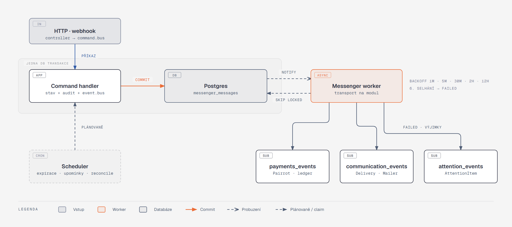

[Architektura](../README.md) · [← 05 Stavové automaty](../05-stavove-automaty/README.md) · **06 Asynchronní svět** · [07 Integrace →](../07-integrace/README.md)

# 06 · Asynchronní svět

## Co si odnést

Mimo HTTP požadavky se v Eventoru dějí tři druhy věcí:

- **doručování integračních událostí** mezi moduly,
- **zpracování příchozích webhooků** z inboxu,
- **plánované úlohy** ze Symfony Scheduleru.

Všechno obstarává **nativní Symfony Messenger**: jeden typ procesu, kontejner `worker` (`messenger:consume`), nad Doctrine transportem v Postgresu. Redis ani RabbitMQ nejsou potřeba. Vlastní outbox tabulky, relay ani vlastní transport Eventor nemá.

Spolehlivost stojí na dvou zásadách:

1. **Fronta je outbox.** Doctrine transport sedí na stejném DB spojení jako ORM. Integrační událost se proto do `messenger_messages` zapíše ve stejné transakci jako změna stavu: neztratí se a bez změny nevznikne.
2. **Každý odebírající modul má vlastní transport**, takže vlastní retry i vlastní failure záznam. Selhání e-mailu nikdy nezopakuje vytvoření platebního požadavku.

Co se nepodaří ani po šesti pokusech, nekončí v logu, ale ve frontě „vyžaduje pozornost“ s akcí ([ADR 003](../../adr/003-transactional-outbox-per-subscriber-delivery.md)).



**Jak to číst.** Vlevo jsou dva vstupy: HTTP požadavek (včetně webhooku) a plánovač. Oba končí příkazem na `command.bus`.

- Zóna „jedna DB transakce“ ukazuje, že stav, audit a zprávy ve frontě se zapisují atomicky.
- Po commitu Postgres `NOTIFY` probudí worker. Ten si zprávu vezme (`FOR UPDATE SKIP LOCKED`) a předá ji handleru modulu, kterému transport patří.
- Zpráva, která selže pošesté, skončí ve `failed` transportu a modul Attention z ní udělá výjimku.

## Outbox nad Messengerem

### Doménové a integrační události

| | Doménová událost | Integrační událost |
|---|---|---|
| Kde leží | `<Modul>\Domain\Event` | `<Modul>\Contract\Event` |
| Kdo ji zná | jen vlastní modul | kdokoli, je to veřejný kontrakt |
| Stabilita | mění se s modelem | verzovaná (`#[IntegrationEvent(name, version)]`), bez osobních údajů |
| Zpracování | synchronně, ve stejné transakci | asynchronně, přes transport odebírajícího modulu |

Agregát zaznamená doménovou událost (`$this->record(new OrderWasPlaced(…))`). Integrační událost z ní udělá synchronní handler téhož modulu. Díky tomu změna doménového modelu nerozbije ostatní moduly ([katalog](katalog-udalosti.md)).

### Zápis

```php
// command.bus: validation → doctrine_transaction → DomainEventsMiddleware → handler
final readonly class DomainEventsMiddleware implements MiddlewareInterface
{
    public function handle(Envelope $envelope, StackInterface $stack): Envelope
    {
        $envelope = $stack->next()->handle($envelope, $stack);   // handler změní agregáty
        do {
            $this->em->flush();
            foreach ($this->recorded->release() as $event) {     // události z agregátů v unit of work
                $this->eventBus->dispatch($event);               // sync handlery modulu, stále v transakci
            }
        } while ($this->recorded->hasPending());
        return $envelope;                                        // commit udělá doctrine_transaction
    }
}

// Registration: překlad doménové události na integrační
#[AsMessageHandler(bus: 'event.bus')]
final readonly class PublishOrderPlaced
{
    public function __invoke(OrderWasPlaced $e): void
    {
        $this->eventBus->dispatch(new OrderPlaced($e->orderId, $e->organizerId, $e->amountDue));
    }   // OrderPlaced je routovaná → INSERT do messenger_messages ve stejné transakci
}
```

**Proč ne `DispatchAfterCurrentBusStamp`.** Ten zprávy pustí až po doběhnutí celého middleware stacku, tedy po commitu. Pád procesu mezi commitem a odesláním by událost ztratil. Atomicitu dává jen to, že `INSERT` do fronty proběhne uvnitř transakce.

### Odběratelé a routing

Odběratel je obyčejný handler, svázaný s transportem svého modulu:

```php
#[AsMessageHandler(fromTransport: 'payments_events')]
final readonly class CreatePaymentRequestOnOrderPlaced
{
    public function __invoke(OrderPlaced $event): void
    {
        $this->commandBus->dispatch(new IssuePaymentRequest($event->orderId));   // vlastní command modulu
    }
}
```

Publikující modul neví, kdo poslouchá. Routing „událost → transporty“ proto nepíše člověk do `messenger.php`, ale sestaví ho při kompilaci kontejneru `IntegrationEventRoutingPass` z handlerů s `fromTransport` ([09](../09-symfony-v-architekture/README.md)). `OrderPlaced` tak jde do `payments_events` i `communication_events` a Doctrine transport zapíše dva řádky. Každý má vlastní počítadlo pokusů.

Pravidla:

- **Jeden transport na odebírající modul** (`payments_events`, `registration_events`, `communication_events`, `attention_events`, …).
- **Jeden handler na událost a modul.** Kdyby jich bylo víc a jeden selhal, retry by mohl zopakovat i ty, které už provedly vedlejší efekt. Modul, který potřebuje víc reakcí, si dispatchne vlastní commandy.
- **Odběratel zapisuje jen do vlastního modulu**, a to přes vlastní `command.bus` (transakce, audit, idempotence).

### Doručení

- **Probuzení:** `use_notify: true`. Doctrine transport na Postgresu poslouchá `LISTEN`, takže typická latence od commitu k handleru je pod 100 ms.
- **Souběh:** Doctrine transport bere zprávy přes `FOR UPDATE SKIP LOCKED`, takže víc workerů nevadí.
- **Lease:** `redeliver_timeout: 300`. Zprávu spadlého workeru vrátí transport po 5 minutách do fronty.
- **Idempotence odběratele:** doručení je at-least-once. Pravidla:
  - zápisy podmíněné stavem (workflow guard),
  - idempotenční klíč odvozený z ID události (`Delivery.idempotency_key`, Pairrot `external_id`),
  - nebo unikátní index (ledger).
- **Pořadí:** globální pořadí se negarantuje, ani pro jeden agregát. Odběratel, kterému na pořadí záleží, porovnává verze: Registration ignoruje `OrderPaymentChanged` se starším `ledgerVersion`, než jaké už zná.
- **Metadata:** obálka nese stampy `CorrelationStamp`, `TenantStamp` a `ActorStamp`. `TenantContextMiddleware` ve workeru podle `TenantStamp` zapne Doctrine filtr organizátora.

### Retry a failure transport

| Pokus | Odklad před dalším pokusem |
|---|---|
| 1 → 2 | 1 minuta |
| 2 → 3 | 5 minut |
| 3 → 4 | 30 minut |
| 4 → 5 | 2 hodiny |
| 5 → 6 | 12 hodin |
| 6. selhání | zpráva do transportu `failed` → `DeadLetterListener` otevře `AttentionItem outbox_dead_letter` s akcí „zkusit znovu“ (totéž co `messenger:failed:retry <id>`) |

Rozvrh drží `ScheduleRetryStrategy` (služba s `RetryStrategyInterface`, nastavená na všech `*_events` transportech) a přidává jitter ±10 %. `UnrecoverableMessageHandlingException` (neplatná data, porušený invariant) jde rovnou do `failed`. `RecoverableMessageHandlingException` s odkladem použije odběratel, když Pairrot vrátí `429` s `Retry-After`.

Úklid není potřeba: Doctrine transport po úspěšném zpracování řádek smaže. Historii nese audit, ne fronta.

## Inbox (příchozí webhooky)

```sql
inbox_message (
  id uuid PRIMARY KEY,
  provider text NOT NULL,               -- 'pairrot'
  external_event_id text NOT NULL,      -- Pairrot event.id
  type text NOT NULL,
  received_at timestamptz NOT NULL,
  payload jsonb NOT NULL,
  processed_at timestamptz,
  UNIQUE (provider, external_event_id)
)
```

Webhook controller ověří podpis a dispatchne `ReceivePairrotEvent` na `command.bus`. Handler provede `INSERT … ON CONFLICT DO NOTHING` a jen pro nový řádek pošle `ProcessPairrotEvent(inboxId)` do transportu `pairrot_inbox`, ve stejné transakci. Controller vrátí `200`. Zpracování podle typu události obstarává Payments (`PairrotEventProcessor` s locatorem podle `type`).

Oddělení příjmu od zpracování má tři důvody:

- Pairrot dostane odpověď za pár milisekund,
- duplicitní doručení (S03) se zastaví na unikátním indexu,
- chyba ve zpracování se opakuje u nás (retry strategie transportu), nezávisle na Pairrotu, který opakuje doručení jen asi hodinu.

Zprávy, které přišly z reconcile jobu (ne z webhooku), procházejí **stejným** inboxem. Pro zpracování je zdroj nerozlišitelný.

## Plánovač (Symfony Scheduler)

Rozvrhy jsou definované v `#[AsSchedule('default')]` providerech jednotlivých modulů (každý modul vlastní své úlohy). Každá položka rozvrhu je Messenger zpráva (`RecurringMessage`), tedy obyčejný příkaz na `command.bus`, který worker zpracuje z transportu `scheduler_default` jako jakýkoli jiný. Úlohy jsou **sweepery**: každý běh znovu projde aktuální stav, takže zmeškaný nebo zdvojený běh nevadí. Souběh dvou workerů řeší `FOR UPDATE SKIP LOCKED` nad zpracovávanými řádky a pro globální úlohy `Lock` (store `PostgreSqlStore`). Každý běh se zapíše do `scheduled_run` (úloha, začátek, konec, výsledek, počet zpracovaných řádků). Listener `ScheduledRunMonitor` při třech neúspěšných bězích po sobě otevře `AttentionItem scheduled_job_failing`, takže nevznikají slepé crony (bolest main-panelu).

| Úloha | Rozvrh | Modul | Co dělá | ID |
|---|---|---|---|---|
| `ExpireReservations` | každou minutu | Registration | `pending` účasti s `hold_expires_at < now` a objednávkou ne-`paid` → `expire`, uvolní kapacitu; dávky po 200 | CAP-04 |
| `ExpireWaitlistOffers` | každou minutu | Registration | propadlé nabídky → uvolnění, nabídka dalšímu | REG-12 |
| `OpenScheduledRegistrations`, `CloseScheduledRegistrations` | každou minutu | Catalog | přechody podle `opens_at` / `closes_at` | EVT-04 |
| `SendDueCampaigns` | každou minutu | Communication | naplánované kampaně → rozpad na `Delivery` | COM-03 |
| `ReconcilePairrotEvents` | každých 15 minut | Payments | `GET /v1/management/webhook-events?from=now−48h` (stránkovaně), chybějící ID → inbox | PAY-04 |
| `SyncUnmatchedTransactions` | každých 15 minut | Payments | dorovnání zrcadla nespárovaných transakcí (`attention` list Pairrotu) | PAY-06 |
| `SendPaymentReminders` | každou hodinu | Payments | podle harmonogramu akce (např. D+2, 24 h před expirací); jen `unpaid`/`partially_paid` a účast `pending` (podmínka se ověří znovu při odeslání) | PAY-09 |
| `SendPreEventReminders` | každou hodinu | Communication | připomenutí X hodin před začátkem aktivity, jen `confirmed` | COM-01 |
| `CompleteFinishedEvents` | denně 03:00 | Catalog | `published` s `ends_at < now − 1 den` → `complete` | EVT-03 |
| `VerifyCapacityCounters` | denně 03:30 | Registration | součet `CapacityClaim` podle stavu účastí vs. `held/confirmed` v bucketech; nesoulad → `AttentionItem` | CAP-02 |
| `VerifyFinancialStateCache` | denně 04:00 | Payments | fold ledgeru vs. `order_finance`; nesoulad → `AttentionItem` | PAY-13 |
| `PurgeProcessedInbox` | denně 04:30 | Payments | úklid zpracovaného inboxu staršího 90 dní | — |
| `NotifyUpcomingRetention` (P1) | denně | Privacy | 14 dní před anonymizací upozorní pořadatele | PRV-06 |
| `ApplyRetention` (P1) | denně | Privacy | anonymizace podle `RetentionClass` po uplynutí lhůty | PRV-04, PRV-05 |

**Náhledy fotografií** nejsou plánované, ale asynchronní: upload dispatchne `GenerateThumbnails` do transportu `async` a handler vytvoří varianty (400 px, 1200 px, WebP) do MinIO. Selhání jde přes retry strategii transportu.

## Retry politiky podle integrace

| Integrace | V procesu (dekorátor) | Mezi pokusy (transport) | Idempotence | Po vyčerpání |
|---|---|---|---|---|
| Pairrot: vytvoření požadavku | `RetryingGateway` 3× (200 / 800 / 2000 ms), `CircuitBreakerGateway` (5 chyb za 60 s → otevřeno 30 s) | `payments_events`: 1m … 12h | `external_id = order_<uuid>_<attempt>` | `AttentionItem payment_request_issue_failed`; otevřený circuit breaker → `integration_degraded` |
| Pairrot: alokace transakce | bez retry v procesu (operace vyvolaná člověkem) | — | `Idempotency-Key = alloc_<tx>_<req>` | chyba vrácena do UI |
| Pairrot: zpracování webhooku | — | `pairrot_inbox`: 1m … 12h | `UNIQUE (provider, external_event_id)` + `sequence` | `AttentionItem integration_inconsistency` |
| Pairrot: reconcile | Lock, stránkování | další běh za 15 min | inbox deduplikace | po 3 neúspěšných bězích `AttentionItem integration_degraded` |
| E-mail (SMTP) | Mailer transport `failover(smtp_primary smtp_backup)` v produkci | Messenger `async_mail`: 4 pokusy (1m, 5m, 30m, 2h) | `delivery.idempotency_key` | `delivery.state = failed` + `AttentionItem delivery_failed` (souhrnně za kampaň) |
| Úložiště (MinIO / S3) | Flysystem retry 2× | `async` (náhledy, snímky dokumentů) | klíč objektu = hash obsahu | `AttentionItem outbox_dead_letter` |

## Odesílání e-mailů a idempotence

Výpadek e-mailové služby (COM-07, S09) nesmí ovlivnit registraci ani vést k duplicitám:

1. Transakční zprávu nikdy neposílá command handler. Posílá ji **odběratel integrační události** v modulu Communication (`SendTransactionalMessage` na `communication_events`), takže registrace commitne bez ohledu na stav SMTP.
2. Odběratel vytvoří `Delivery` s `idempotency_key` (např. `order_placed:<orderId>:orderer`, `campaign:<id>:order:<id>`). Unikátní index brání druhému `Delivery` při opakovaném doručení události.
3. Samotné odeslání je zpráva `SendDelivery{deliveryId}` na transportu `async_mail`. Handler:
   - zamkne `Delivery`,
   - pokud už je `sent`, skončí (opakované doručení zprávy),
   - jinak ověří `RecipientStillEligible`, vyrenderuje šablonu (Twig, proměnné z read modelu), odešle přes `MailerInterface` s hlavičkou `X-Eventor-Delivery: <id>` a přejde na `sent`.
4. **S09:** smtp4dev stojí, takže `send` vyhodí `TransportException`. Messenger zprávu odloží, `Delivery` zůstává `scheduled` a pokusy se počítají. Po obnovení se odešle jednou.

Jediné okno pro duplicitu nastává, když SMTP zprávu přijme a pád procesu nastane před uložením `sent`. Okno je minimální a pro transakční e-mail přijatelné. Odesílatel je technická adresa platformy, `Reply-To` je kontaktní e-mail organizátora (COM-05).

## Typy výjimek (`AttentionItem.type`)

Fronta „vyžaduje pozornost“ (ADM-03) je jediné místo, kam asynchronní svět hlásí, co nedokázal vyřešit sám. Typ určuje dostupné akce (tagovaný `AttentionActionProvider`) a oprávnění (matice kap. 3).

| Typ | Vzniká z | Typická akce |
|---|---|---|
| `late_payment` | `registration.late_payment_received` (S05) | obnovit účast · refund úkol |
| `overpayment` | `payments.overpayment_detected` (S07) | refund úkol · ponechat jako dar |
| `unmatched_payment` | `payments.unmatched_transaction_received` (PAY-06) | přiřadit k objednávce (alokace v Pairrotu) |
| `payment_revoked` | `payments.payment_revoked` (zrušená alokace v Pairrotu) | prověřit · kontaktovat účastníka |
| `pairrot_review` | `review_case.*`, `transaction_review_required` | vyřešit v Pairrotu, sledovat stav |
| `payment_request_issue_failed` | dead-letter vytvoření požadavku (S08) | zkusit znovu |
| `integration_degraded` | otevřený circuit breaker, neúspěšný reconcile, `inbound_address.paused` | informativní, uzavře se po obnovení |
| `integration_inconsistency` | nekonzistentní webhook, nesoulad cache financí nebo kapacitních counterů | prověřit |
| `refund_task` | `payments.refund_task_opened` | vypořádat |
| `consent_withdrawn` | `legal.consent_withdrawn` (S16) | vzít na vědomí · prověřit fotografie (`LIKENESS`) |
| `missing_confirmation` | výzva k potvrzení po lhůtě, eskalace z odbavení | připomenout · potvrdit ručně |
| `cancellation_request` | žádost o storno ze samoobsluhy, pokud ji akce schvaluje ručně | schválit · zamítnout |
| `delivery_failed` | `communication.delivery_failed` (souhrnně za kampaň / trigger) | opakovat selhané |
| `outbox_dead_letter` | zpráva ve `failed` transportu (`DeadLetterListener`) | zkusit znovu |
| `scheduled_job_failing` | 3 neúspěšné běhy plánované úlohy | prověřit |

## Korelace a pozorovatelnost

- `correlation_id` vzniká na vstupu (HTTP hlavička `X-Request-Id` nebo nové UUID). Nese ho každá zpráva Messengeru (stamp `CorrelationStamp`), takže jde dohledat celý řetězec registrace → platba → e-mail.
- Monolog procesor přidává `correlation_id`, `organizer_id` a `subscriber`. Osobní údaje se do logů nedostanou: payload událostí je nemá a `PiiRedactingProcessor` maskuje e-maily a telefony v kontextu.
- Health endpoint `/api/health` hlásí délku front (`messenger:stats`), stáří nejstarší nedoručené zprávy po transportech a počet zpráv ve `failed`. Starší než 10 minut znamená degradovaný stav.
