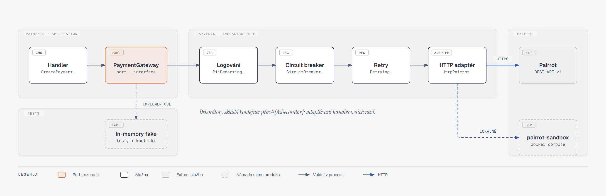
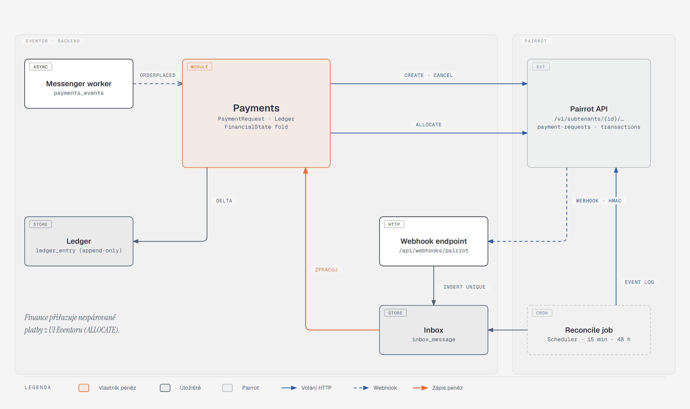

[Architektura](../README.md) · [← 06 Asynchronní svět](../06-asynchronni-svet/README.md) · **07 Integrace** · [08 Průřezové koncepty →](../08-prurezove-koncepty/README.md)

# 07 · Integrace

> **Stav W2 (25. 10. 2026).** Pairrot dekorátory mají priority retry 30 (nejvnitřnější), breaker 20 a logging 10. `PAIRROT_WEBHOOK_SECRETS` je seznam s volitelným prefixem `keyid:` a subtenant mimo produkci začíná `test_`. Reconcile provádí HTTP během command transakce; denní limit zatím není hotový.

## Co si odnést

Eventor mluví se čtyřmi vnějšími službami: **Pairrot** (bankovní převody), **e-mailová služba**, **úložiště souborů** a nepřímo **mapy** (jen odkaz). Všechny integrace mají stejný tvar: port v aplikační vrstvě modulu, adaptér v infrastruktuře a dekorátory pro odolnost a logování. Pro testy existuje in-memory fake.

Žádná integrace se nevolá uvnitř transakce, která mění doménový stav. Volání ven vždy spouští odběratel outboxu, takže výpadek služby nikdy neztratí registraci (S08, S09).

Pairrot je **zdroj pravdy o bankovních platbách**. Eventor z jeho změn odvozuje zápisy do vlastního ledgeru a finanční stav objednávky počítá sám. Peníze z Pairrotu přicházejí do ledgeru **jedinou cestou**: přes inbox, ať už jako webhook, nebo z dorovnávacího jobu. Ruční přiřazení platby z UI tedy ledger nezapisuje přímo, jen o přiřazení požádá Pairrot.

Kontrakt je popsán podle skutečného API Pairrotu (README a `docs/webhooks-receiver.md` v repozitáři Pairrotu). Lokálně místo Pairrotu běží `pairrot-sandbox`, který kontrakt simuluje. Rozhodnutí shrnuje [ADR 004](../../adr/004-pairrot-integration-contract.md).

## Společný vzor



**Jak to číst.**

- **Port:** handler zná jen rozhraní `PaymentGateway`, které leží v `Payments/Application/Port`.
- **Dekorátory:** v produkci je port aliasem na řetěz dekorátorů a na jeho konci je HTTP adaptér. Pořadí určuje priorita `#[AsDecorator]`: nejvíc vně je logování, pak circuit breaker, pak retry.
- **Testy:** v unit a integračních testech je port nahrazený in-memory fakem.
- **Lokálně:** adaptér volá `pairrot-sandbox` místo skutečného Pairrotu. Liší se jen `PAIRROT_API_URL`.

| Vrstva | Pairrot | E-mail | Úložiště |
|---|---|---|---|
| Port | `Payments\Application\Port\PaymentGateway` | `Communication\Application\Port\DeliveryChannel` | `Shared\Application\Port\FileStorage` |
| Adaptér | `HttpPairrotGateway` (Symfony HttpClient) | `MailerDeliveryChannel` (Symfony Mailer) | `FlysystemFileStorage` (league/flysystem-bundle, S3) |
| Dekorátory | `PiiRedactingLoggingGateway` → `CircuitBreakerGateway` → `RetryingGateway` | `PiiRedactingLoggingChannel` | — (retry obstarává Flysystem a AWS SDK) |
| Fake v testech | `InMemoryPaymentGateway` (umí `receivePayment()`, `revoke()`, `signWebhook()`) | `InMemoryDeliveryChannel` | `InMemoryFilesystemAdapter` |
| Lokálně | `pairrot-sandbox` | smtp4dev | MinIO |

Pravidla vzoru:

1. **Port mluví jazykem domény.** Metody `createRequest(PaymentRequestSpec)`, `cancelRequest()` a `allocate()` vracejí doménové DTO (`IssuedPaymentRequest`, `PaymentInstructions`). Wire formát Pairrotu (snake_case, haléře, ETagy) zná jen adaptér a jeho `PairrotMapper`.
2. **Chyby jsou typované.** Adaptér převádí HTTP chyby na `PaymentGatewayUnavailable` (síť, 5xx, 429: opakovatelné), `PaymentRequestConflict` (409 `external_id_conflict`, `variable_symbol_conflict`), `PaymentRequestHasAllocations` (409 při rušení) a `PaymentGatewayRejected` (ostatní 4xx: neopakovatelné, vede na výjimku). Odběratel outboxu podle typu rozhodne mezi retry a dead-letterem.
3. **Timeouty:** spojení 2 s, celý požadavek 10 s. `RetryingGateway` zopakuje opakovatelné chyby dvakrát s jitterem (200 ms a 800 ms). Delší výpadek už řeší backoff outboxu ([06](../06-asynchronni-svet/README.md)), ne blokující čekání.
4. **Circuit breaker:** po 5 po sobě jdoucích opakovatelných chybách se otevře na 60 s a volání hned končí `PaymentGatewayUnavailable`, bez síťového pokusu. Stav drží Symfony Cache (Postgres adaptér), takže je sdílený mezi `php` a `worker`. Otevření breakeru vytvoří `AttentionItem` typu `integration_degraded`.
5. **Logování bez osobních údajů:** dekorátor loguje operaci, `external_id`, HTTP status, trvání a `correlation_id`. IBAN, zpráva pro příjemce a těla odpovědí se maskují (NFR ochrana údajů, [08](../08-prurezove-koncepty/README.md#logování-a-observabilita)).
6. **Kontraktní testy.** Stejná sada testů (`PaymentGatewayContractTest`) běží proti `InMemoryPaymentGateway` i proti `HttpPairrotGateway` napojenému na `pairrot-sandbox`. Fake se tak nemůže od skutečného chování odchýlit, aniž by to test zachytil ([10](../10-kvalita-a-testovani/README.md)).

## Pairrot

### Co Pairrot je a co z toho plyne

Pairrot páruje příchozí platby čtením přeposlaných notifikačních e-mailů banky (dnes Česká spořitelna, kód 0800, jen CZK). Klienti s ním mluví REST API v1 s Bearer klíčem a změny dostávají HMAC-podepsanými webhooky a event logem.

| Vlastnost Pairrotu | Důsledek v Eventoru |
|---|---|
| automatické párování jen přesné částky na jediný otevřený požadavek se stejným VS | částečné platby a přeplatky (S04, S07) vznikají jen ručním přiřazením. Eventor musí ukazovat nespárované transakce a umět přiřazení vyvolat (PAY-06). |
| webhook nese **stav požadavku** (`previous` / `current`), ne jednotlivou platbu | zápis do ledgeru vzniká jako **delta `paid_amount`** proti poslednímu známému stavu |
| `external_id` je idempotentní klíč vytvoření | retry vytvoření požadavku je bezpečný bez vlastní deduplikace (PAY-03, S08) |
| částka požadavku je neměnná (`PATCH` jen `description`, `due_at`) | změna dlužné částky = nový pokus nebo doplatkový požadavek (viz níže) |
| `due_at` nic neexpiruje | TTL rezervace vlastní výhradně Eventor ([05](../05-stavove-automaty/README.md)) |
| retry webhooků jen 5 s, 60 s, 1 h | dorovnávací job nad event logem každých 15 minut |
| Pairrot nedělá refundace | vrácení peněz je `RefundTask` vyřizovaný ručně mimo systém (PAY-11) |
| platby nenesou jméno ani účet plátce | Eventor nemá v ledgeru žádné osobní údaje plátce |

### Tenancy a onboarding organizátora (ORG-02)

Eventor má v Pairrotu **vlastní root tenant** a jeho management klíč (`prt_…`). Každý organizátor je **subtenant** s `external_id = eventor_org_<uuid>` (mimo produkci s prefixem `staging_` nebo `test_`). Klíč subtenantu, který Pairrot vrátí při vytvoření, Eventor zahazuje. Všechny operace jdou přes management klíč na `/v1/subtenants/{sid}/…`, takže v DB není žádný klíč pro jednotlivé organizátory.

Průvodce „Platby převodem“ v nastavení organizátora (jen role `OWNER`):

| Krok | Volání Pairrotu | Co ukládá Eventor (`organizer_payment_settings`) |
|---|---|---|
| 1. Aktivace | `POST /v1/subtenants {external_id, name, contact_email}`. Při 409 si existující subtenant najde přes `GET` podle `external_id`. | `pairrot_tenant_id` |
| 2. Bankovní účet | `POST …/bank-connections {account_number \| iban, currency: CZK, label}` | `pairrot_bank_connection_id`, maskovaný IBAN. Chyba `409 account_unavailable` vede na srozumitelnou hlášku „účet je už napojen jinde“. |
| 3. Příjem notifikací | `POST …/bank-connections/{id}/inbound-address` | adresa pro přeposílání. UI ukáže návod pro nastavení přeposílání notifikací v internetovém bankovnictví. |
| 4. Stav příjmu | `GET …/bank-connections/{id}/reception` (při otevření stránky a denně Schedulerem) | `reception_state`. Událost `inbound_address.paused` z webhooku vytvoří `AttentionItem`. |

Platební metodu „převod“ jde u události zapnout až po kroku 2. Dokud příjem notifikací neběží (krok 4), editor události ukazuje varování „platby se nebudou párovat automaticky“. Onboarding vede příkaz `ConnectOrganizerToPairrot`. Volání jsou idempotentní, takže průvodce lze přerušit a opakovat.

### Platební požadavek: životní cyklus a pokusy

`payment_request` je zrcadlo požadavku v Pairrotu. Objednávka jich může mít víc (pokusy a doplatky), aktivních ale nanejvýš několik:

```
payment_request(id, organizer_id, order_id, attempt, purpose[primary|supplementary],
                external_id UNIQUE, pairrot_id, amount_minor, variable_symbol, iban, spayd_payload,
                due_at, status[pending_issue|open|partially_paid|paid|overpaid|cancelled|issue_failed],
                known_paid_amount, last_sequence, created_at, cancelled_at)
```

1. Odběratel `CreatePaymentRequestOnOrderPlaced` zareaguje na `OrderPlaced` s metodou převod. Vytvoří řádek `pending_issue` s `external_id = order_<uuid>_<attempt>` a zavolá `POST /v1/subtenants/{sid}/payment-requests` s `{bank_connection_id, external_id, amount, currency, message, description, due_at}`.
   - VS přiděluje Pairrot (`YYYYNNNNNN`).
   - `message` je číslo objednávky (`EV-2026-000123`), protože zpráva pro příjemce má nanejvýš 60 znaků a bez `*` a `%`.
2. Odpověď `201` nebo `200 replayed: true` uloží `pairrot_id`, VS, IBAN a **zmrazený `payment_instructions.payload` (SPAYD)**. Pak se emituje `PaymentRequestIssued` a Communication pošle platební údaje (REG-07).
3. Opakovatelná chyba vede na backoff outboxu. Účastník mezitím v samoobsluze vidí „platební údaje dorazí e-mailem“ (PAY-03, S08). Pět neúspěchů vede na dead-letter a na `AttentionItem` typu `payment_request_issue_failed` s akcí „zkusit znovu“.
4. `409 external_id_conflict` znamená, že stejné `external_id` už existuje s jiným tělem. To je chyba programu, ne stav domény. Vede na dead-letter a alert, nikdy na nový pokus se stejným ID.

`due_at` = splatnost podle pravidel události (EVT-10), nejpozději konec registrací nebo den akce. Je to informace pro plátce, ne mechanismus expirace.

### Změna dlužné částky

Částku požadavku v Pairrotu změnit nejde. Dlužnou částku objednávky přitom mění storno, změna varianty (S18), doplňky i slevy. **Rozhodnutí:**

| Situace | Postup |
|---|---|
| Na aktivním požadavku zatím nic nepřišlo (`known_paid_amount = 0`) | `POST …/cancel` (s `If-Match`) a nový požadavek `attempt + 1` na celou novou částku. Účastník dostane nové platební údaje a staré přestanou platit. |
| Část už přišla a dlužná částka **stoupla** | Původní požadavek zůstává. Vznikne **doplatkový** požadavek (`purpose = supplementary`, `attempt + 1`) na rozdíl `amountDue − paid`. |
| Část už přišla a dlužná částka **klesla** | Požadavek zůstává otevřený, protože zrušit ho Pairrot nedovolí (`409 payment_request_has_allocations`). Finanční stav počítá Eventor z vlastní `amountDue`. Případný přeplatek vede na `RefundTask` (PAY-10). |
| Objednávka zcela stornována nebo akce zrušena | Bez alokací se požadavek zruší. S alokacemi zůstává a refund úkol vznikne z přeplatku. |
| Účast **expirovala** (TTL) | Požadavek se **neruší**. Pozdní platba se tak dál automaticky spáruje a přijde jako webhook, který spustí cestu S05 a S06 ([05](../05-stavove-automaty/README.md)). Zrušená by skončila jako nespárovaná transakce. |

Proč doplatek, a ne vždy zrušit a vytvořit znovu: požadavek s alokacemi zrušit nejde. A i kdyby šel, plátce, který už zaplatil polovinu, by dostal nový VS i novou částku, což vede k chybám a dvojím platbám. Doplatek je pro účastníka srozumitelný („doplaťte 100 Kč, VS …“) a historie v Pairrotu zůstává čistá.

### Příjem webhooků



**Jak to číst.**

- **Ven:** Payments volá Pairrot třemi operacemi. Vytvoření a zrušení spouští outbox, přiřazení spouští člověk z rekonciliační fronty.
- **Dovnitř:** změny přicházejí podepsaným webhookem a dorovnávacím jobem. Oba zapisují do stejného inboxu s unikátním ID události.
- **Jediný zápis peněz:** teprve asynchronní zpracování inboxu (oranžově) zapisuje do ledgeru. Ledger má proto jediný vstup peněz z Pairrotu.

Endpoint `POST /api/webhooks/pairrot` je ve vlastním bezstavovém firewallu ([08](../08-prurezove-koncepty/README.md#autentizace)):

1. **`PairrotWebhookAuthenticator`** ověří podpis:
   - HMAC-SHA256 přes `"<Pairrot-Webhook-Id>.<Pairrot-Webhook-Timestamp>." + raw body`,
   - klíč je base64url část za `pwhsec_`,
   - porovnání v konstantním čase (`hash_equals`), odchylka času nanejvýš 5 minut.

   Hlavička může nést dva podpisy (rotace klíče) a stačí shoda s libovolným z nakonfigurovaných secretů. Neplatný podpis vrací `401` a Pairrot to neopakuje, což je správně.
2. **`ReceivePairrotWebhook`** udělá `INSERT INTO inbox_message (provider, message_id, type, payload, received_at) ON CONFLICT (provider, message_id) DO NOTHING` a vrátí `204`. Duplicitní doručení (S03) končí na unikátním klíči. Když neběží databáze, vrací `503` a Pairrot to zopakuje.
3. Insert vyvolá `NOTIFY inbox` a worker zpracuje zprávu handlerem podle `type`. `webhook.test` (`data.synthetic: true`) se jen potvrdí.

Zpracování `payment_request.updated` (`ApplyPairrotPaymentUpdate`, jedna transakce):

```
pr = payment_request podle (pairrot_id) FOR UPDATE           # neznámý požadavek → AttentionItem, konec
if data.sequence <= pr.last_sequence: konec                    # mimo pořadí nebo opakování
delta = data.current.paid_amount − pr.known_paid_amount
if delta > 0: ledger += LedgerEntry(kind=pairrot_allocation, amount=+delta,
                                    external_ref="pairrot:{pr.pairrot_id}:{sequence}")
if delta < 0: ledger += LedgerEntry(kind=pairrot_revocation, amount=delta, …)
pr.known_paid_amount = current.paid_amount; pr.status = current.status; pr.last_sequence = sequence
FinancialState = fold(ledger, order.amountDue) → order_finance (cache)
outbox: OrderPaymentChanged{orderId, financialState, delta}      # Registration a Communication reagují
```

Protože se pracuje se **stavem**, a ne s jednotlivými událostmi, nevadí mezery v `sequence` ani ztracený webhook: další doručená změna nese celkové `paid_amount` a delta ji dorovná. `external_ref` je unikátní, takže ani souběh dvou workerů nezapíše stejnou změnu dvakrát.

| `cause` | Typická změna | Zápis do ledgeru | Další dopad |
|---|---|---|---|
| `allocation_created` → `paid` | `paid_amount` vzroste na `expected` | `pairrot_allocation +delta` | fold = `paid` vede na potvrzení účastí (S03 jednou, i při trojím doručení) |
| `allocation_created` → `partially_paid` | vzroste pod `expected` | `pairrot_allocation +delta` | fold = `partially_paid` vede na upomínku doplatku (S04) |
| `allocation_created` → `overpaid` | vzroste nad `expected` | `pairrot_allocation +delta` | fold = `overpaid` vede na `AttentionItem` a podle nastavení na `RefundTask` (S07) |
| `allocation_revoked` | `paid_amount` klesne | `pairrot_revocation −delta` | fold se může vrátit na `partially_paid` nebo `unpaid`. Potvrzené účasti se **automaticky neruší**, vznikne `AttentionItem` `payment_revoked`. |
| `transaction_review_required` | beze změny částky | nic | `AttentionItem` `pairrot_review` s odkazem na review case |
| `request_cancelled` | stav `cancelled` | nic | když požadavek nezrušil Eventor (`cancelled_at` je u nás prázdné), vznikne `AttentionItem` |

Status Pairrotu (`paid`, `overpaid` …) Eventor **nepřebírá** jako finanční stav objednávky. Rozhoduje fold vlastního ledgeru proti vlastní `amountDue`, do které patří i hotovost a ruční opravy, o nichž Pairrot neví.

### Nespárované transakce a ruční přiřazení (PAY-06)

Webhook endpoint odebírá i `transaction.recorded`, `transaction.updated`, `review_case.opened`, `review_case.updated`, `inbound_address.paused` a `inbound_address.resumed`. Handler transakcí udržuje zrcadlo:

```
unmatched_transaction(pairrot_transaction_id UNIQUE, organizer_id, amount_minor, variable_symbol,
                      booked_on, matching_result, handling_state, last_sequence, resolved_at)
```

Řádek vzniká jen pro transakce bez alokace (`matching.result` je `missing_variable_symbol`, `request_not_found`, `amount_mismatch`, `request_already_paid` nebo `request_cancelled`). Po alokaci nebo ignorování v Pairrotu (`transaction.updated` s `allocated` nebo `ignored`) se uzavře. Každá otevřená transakce je zároveň `AttentionItem` typu `unmatched_payment` ve frontě ADM-03.

Rekonciliační obrazovka (role `FINANCE`, `OWNER`):

1. Ke transakci nabídne kandidáty: `GET …/transactions/{id}/matching-candidates` z Pairrotu a vlastní návrhy Eventoru (otevřené objednávky se shodným VS bez úvodních nul, se shodnou částkou nebo se jménem v poznámce, které eventor zná, Pairrot ne).
2. Finance zvolí objednávku. Příkaz `AllocateUnmatchedPayment` zavolá `POST …/transactions/{id}/allocations {payment_request_id}` s `Idempotency-Key = alloc_<transactionId>_<paymentRequestId>`. Transakce se přiřazuje vždy celá a dělit ji nejde.
3. Ledger se **nezapisuje hned**. Pairrot po alokaci pošle `payment_request.updated` a peníze projdou standardní cestou výše. Rozhodnutí se auditují (kdo, kdy, důvod povinný).
4. Pokud objednávka nemá otevřený požadavek (například byl zrušen), Eventor nejdřív vytvoří doplatkový požadavek na částku transakce a teprve na něj alokuje.

Review cases (podezřelé e-maily, duplicity, sporné platby) Eventor neřeší. Ukazuje je jako `AttentionItem` s odkazem „vyřešit v Pairrotu“, protože dokud je případ otevřený, alokovat nejde.

### Dorovnávací job

`ReconcilePairrotEvents` (Scheduler, každých 15 minut):

1. Projde `GET /v1/management/webhook-events?from=<now − 48 h>&cursor=…` (pro všechny subtenanty díky scope `own_and_direct_children`).
2. Každou událost vloží do `inbox_message` se stejným `message_id`, které by nesla jako webhook. Duplicity tak končí na unikátním klíči a nové se zpracují stejným handlerem.
3. Denně navíc porovná otevřené `payment_request` starší 24 hodin s `GET …/payment-requests/{id}`. Když se `payment_change_sequence` liší od `last_sequence`, vytvoří syntetickou zprávu `payment_request.snapshot`. Ta se zpracuje stejnou delta logikou.

Job je idempotentní a nepotřebuje zámek: souběžné běhy si konkurují jen o unikátní klíč inboxu.

### Selhání a jejich řešení

| Selhání | Projev | Řešení |
|---|---|---|
| Pairrot nedostupný při vytváření požadavku | `PaymentGatewayUnavailable` | objednávka i účasti už jsou uložené. Outbox opakuje 1 m, 5 m, 30 m, 2 h, 12 h, pak dead-letter a `AttentionItem` s akcí „zkusit znovu“ (S08). Rezervace má TTL od vytvoření objednávky. Když platební údaje dorazí pozdě, `PaymentRequestIssued` posune `holdExpiresAt` tak, aby účastníkovi zbyly aspoň 48 hodin. |
| Ztracený webhook (vyčerpané retry Pairrotu) | stav se nezmění | dorovnávací job do 15 minut |
| Webhooky mimo pořadí | `sequence` ≤ `last_sequence` | ignoruje se. Novější stav už obsahuje i starší změnu. |
| Duplicitní doručení | stejné `Pairrot-Webhook-Id`, popř. event `id` | `inbox_message` unique (S03) |
| Rotace webhook secretu | dva podpisy v hlavičce | `PAIRROT_WEBHOOK_SECRETS` obsahuje starý i nový secret. Starý se odebere po 24hodinovém grace Pairrotu. |
| `409 variable_symbol_conflict` | jen při ručně zadaném VS | Eventor VS nezadává, takže nenastane. Kdyby nastalo, vede na dead-letter a alert. |
| `409 payment_request_has_allocations` při rušení | mezitím přišla platba | rušení se nahradí doplatkovým postupem (tabulka výše) |
| `409 payment_instructions_not_available` | po částečné úhradě | samoobsluha ukáže zbývající částku a VS bez QR. Doplatkový požadavek má vlastní QR. |
| Pairrot vrátí neznámý `payment_request_id` | chybné prostředí nebo smazaný subtenant | `AttentionItem` `integration_inconsistency`, zpráva zůstává v inboxu jako `rejected` |
| Pozastavený příjem notifikací | `inbound_address.paused` | `AttentionItem` pro vlastníka organizace s návodem |

### Konfigurace a tajemství

| Proměnná | Příklad | Poznámka |
|---|---|---|
| `PAIRROT_API_URL` | `https://api.pairrot.chytre.digital`, lokálně `http://pairrot-sandbox:8080` | |
| `PAIRROT_MANAGEMENT_KEY` | `prt_<keyid>_<secret>` | Symfony secrets vault (`config/secrets/prod`), nikdy v `.env` v repozitáři |
| `PAIRROT_WEBHOOK_SECRETS` | `pwhsec_…,pwhsec_…` | seznam kvůli rotaci; vault |
| `PAIRROT_ENVIRONMENT` | `live` / `test` | prostředí webhook endpointu. Události `environment: test` jdou jen na testovací endpoint. |
| `PAIRROT_SUBTENANT_PREFIX` | `eventor_org_`, `staging_eventor_org_` | brání kolizi prostředí v jednom rootu |

Hodnoty se do služeb dostávají přes `bind` v `services.yaml` (`$pairrotWebhookSecrets: '%env(csv:PAIRROT_WEBHOOK_SECRETS)%'`, [09](../09-symfony-v-architekture/README.md)). Webhook endpoint v Pairrotu se zakládá jednorázovým příkazem `bin/console eventor:pairrot:webhook-endpoint:register`:

- `POST /v1/management/webhook-endpoint` s `Idempotency-Key`,
- scope `own_and_direct_children`,
- typy událostí z odstavce výše,
- po ověření testovací událostí odpauzování.

### Co Eventor záměrně nedělá

- Nepáruje platby. Nečte bankovní výpisy ani e-maily banky (zadání kap. 10).
- Neodvozuje finanční stav ze statusu Pairrotu a nepřebírá od něj „zaplaceno“ bez zápisu do ledgeru.
- Negeneruje platební QR sám, pokud Pairrot vrátil zmrazený SPAYD (ten je jediný platný pro daný požadavek).
- Neprovádí refundace. Vytváří úkoly, peníze vrací člověk mimo systém.
- Neukládá klíče jednotlivých subtenantů ani žádné údaje o plátci.
- Pro účty mimo Českou spořitelnu Pairrot zatím párovat neumí. Organizátor s jinou bankou může zapnout převod v režimu **„bez automatického párování“**: Eventor vygeneruje stateless QR (`POST …/payment-qr`) a platby páruje finance ručně jako ledger `manual_correction`. Stavová cesta (TTL, výjimky) zůstává stejná. Režim se nastavuje u organizátora.

## E-mail

E-mail posílá výhradně modul Communication, vždy z odběratele outboxu nebo z naplánovaného doručení, nikdy přímo z handleru doménového příkazu ([06](../06-asynchronni-svet/README.md)).

| Téma | Řešení |
|---|---|
| Knihovna | Symfony Mailer + Twig e-mailové šablony (`MessageTemplate` → Twig s proměnnými COM-08). Mailer se volá **synchronně** uvnitř zpracování `Delivery`. Messenger routing mailu je vypnutý, aby nevznikla druhá fronta vedle stavového automatu doručení. |
| Odesílatel (COM-05) | `From: "<Název organizátora> přes Eventor" <noreply@mail.eventor.cz>` (technická doména platformy se SPF, DKIM a DMARC), `Reply-To:` kontaktní e-mail organizátora (ORG-01) |
| Hlavičky | `X-Eventor-Delivery-Id`. Pro marketingové zprávy `List-Unsubscribe` + `List-Unsubscribe-Post: List-Unsubscribe=One-Click` (RFC 8058, COM-09 P1). Transakční zprávy odhlášení nemají. |
| Idempotence | `delivery` má unikátní `(trigger_key, recipient_key)`, např. `order:<id>:payment_instructions:<attempt>`. Opakované zpracování stejné události nevytvoří druhé doručení (COM-06). |
| Podmínka v okamžiku odeslání (COM-02) | před odesláním se zavolá `RecipientEligibility` pro daný typ zprávy (upomínka: objednávka stále `unpaid` nebo `partially_paid` a nestornovaná). Pokud podmínka neplatí, doručení přejde do `skipped`. |
| Výpadek (COM-07, S09) | výjimka transportu vede na `failed_attempt`, backoff a nový pokus. Po vyčerpání nastane `failed` a `AttentionItem` `delivery_failed` s hromadnou akcí „opakovat selhané“. Registrace ani platby na mailu nezávisí. |
| Lokálně | smtp4dev (`MAILER_DSN=smtp://smtp4dev:25`), UI a REST API slouží i pro e2e testy. S09 se testuje zastavením kontejneru. |
| Produkce | libovolný SMTP nebo API provider přes DSN (`MAILER_DSN`). Kód na konkrétním providerovi nezávisí. |
| Stavy doručení (P1) | Symfony **Webhook** + **RemoteEvent** komponenta. Mailer bridge providera převádí jeho webhook na `MailerDeliveryEvent` nebo `MailerEngagementEvent` a `#[AsRemoteEventConsumer]` je mapuje na přechody `Delivery` (`delivered`, `bounced` → `failed`). Tvrdý bounce označí adresu `undeliverable` a další transakční zprávy se jí nepokoušejí doručit. |

## Úložiště souborů

Flysystem (`league/flysystem-bundle`) nad S3 API. Lokálně MinIO, produkčně libovolné S3.

| Storage (služba) | Bucket | Obsah | Klíče | Přístup |
|---|---|---|---|---|
| `legal.storage` | `eventor-legal` | verze právních dokumentů (PDF, snímky externích odkazů) | `sha256/<ab>/<cd>/<hash>.<ext>`, obsahově adresované a neměnné ([ADR 012](../../adr/012-legal-documents-content-addressed-versions.md)) | privátní. Čtení přes presigned URL (5 min) po autorizaci, veřejné dokumenty přes proxy route s cache. |
| `media.storage` | `eventor-media` | fotografie, náhledy, obrázky událostí a log | `org/<orgId>/event/<eventId>/photo/<photoId>/{original,w480,w1600}.<ext>` | privátní. Veřejné kolekce mají presigned URL s delší platností a CDN cache, kolekce „jen přes odkaz“ podepsaný odkaz kolekce. |
| `exports.storage` | `eventor-exports` | CSV a JSON exporty (ADM-07, PRV-02) | `org/<orgId>/export/<exportId>.csv` | privátní, presigned URL. Lifecycle pravidlo maže po 24 hodinách. Vytvoření exportu se audituje (AUD-01). |

- **Nahrávání fotografií (POST-01).**
  1. API vydá presigned `PUT` (limit 15 MB, `image/jpeg|png|webp|heic`).
  2. Prohlížeč nahraje soubor přímo do S3.
  3. Příkaz `ConfirmPhotoUpload` ověří existenci objektu a typ podle magic bytes.
  4. Outbox `PhotoUploaded` spustí asynchronní `GeneratePhotoVariants`: odstraní EXIF včetně GPS (ochrana údajů), vytvoří náhledy (WebP, 480 a 1600 px) a extrahuje rozměry.
- **Snímek externího dokumentu (LEG-01).** Při publikaci verze stáhne `ExternalDocumentSnapshotter` obsah přes HttpClient s ochranou proti SSRF: jen `https`, blokované privátní a link-local adresy, nanejvýš 3 přesměrování, limit 5 MB, timeout 10 s. Uloží bajty do `legal.storage` s hashem a `fetched_at`. Pokud stažení selže, verzi nelze publikovat.
- **Výmaz (POST-06, PRV-04).** Odstranění fotografie maže originál i varianty. Právní dokumenty se nemažou nikdy, protože patří do retenční třídy `CONFIRMATION`.

## QR kódy

Generuje je `endroid/qr-code` za portem `QrCodeRenderer` (SVG pro web, PNG pro e-mail).

| QR | Obsah | Kdy a kde |
|---|---|---|
| Platební | **zmrazený SPAYD `payload` z Pairrotu** (`SPD*1.0*ACC:…*AM:…*CC:CZK*X-VS:…*MSG:…`) | e-mail s platebními údaji, samoobsluha. Eventor ho nikdy neskládá znovu ani neupravuje. Bez úspěšně vytvořeného požadavku žádný QR neexistuje. |
| Účast (CHK-03) | podepsaný token `qr1.<payload>.<sig>` (ne surové ID, [08](../08-prurezove-koncepty/README.md#qr-token-účasti)) | samoobsluha, potvrzovací e-mail. Při zrušení nebo převodu účasti se zvýší `qr_version` a starý kód přestane platit. |
| Stránka události (PUB-01) | veřejná URL `https://eventor.cz/<orgSlug>/<eventSlug>` | ke stažení v administraci (SVG, PNG) pro plakáty |

V e-mailu je QR účasti vložený jako inline příloha (CID), aby fungoval i bez načítání vzdálených obrázků.

## Mapy

Jen odkaz (zadání kap. 9). `Venue` má adresu, volitelné souřadnice a `mapUrl`. Když `mapUrl` chybí, sestaví se odkaz na mapy.cz z adresy. URL se validuje (jen `https`). Žádné API ani klíče, nic se nevolá ze serveru.
