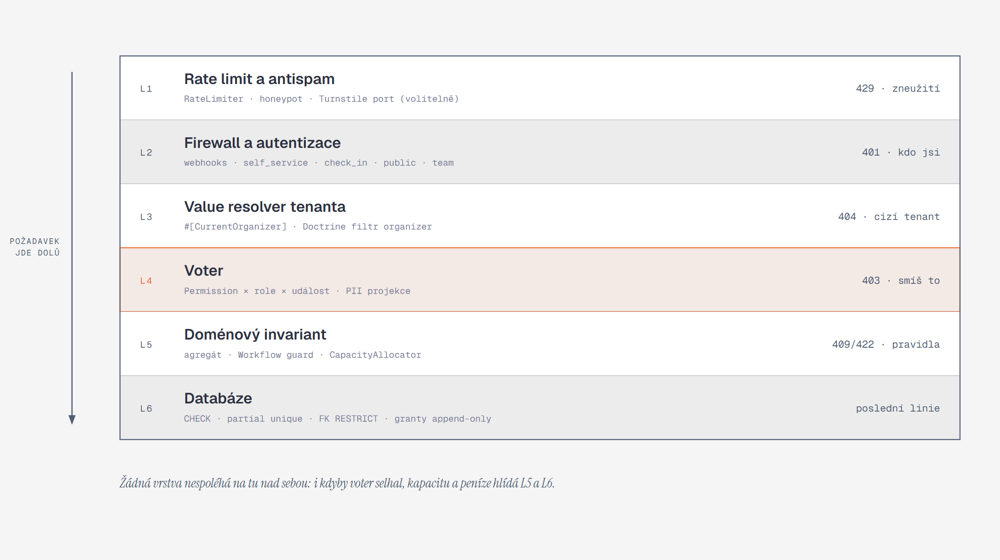

[Architektura](../README.md) · [← 07 Integrace](../07-integrace/README.md) · **08 Průřezové koncepty** · [09 Symfony v architektuře →](../09-symfony-v-architekture/README.md)

# 08 · Průřezové koncepty

> **Stav W0–W2 (25. 10. 2026).** Problem details serializují `nextSteps` jako seznam. Money má API tvar `{minor, currency, formatted}`. CSRF vyžaduje same-origin `Origin` a hlavičku `csrf-token` s libovolnou hodnotou délky nejméně 24. `TenantContext` je v `Shared\Application`. Pozvánkový token je HMAC-odvozený a v databázi se drží jen jeho SHA-256; `acceptToken` se vrací jen v dev/test.

Samoobslužný odkaz vytváří `SelfServiceLinks::urlFor()` z odvoditelného tokenu. Kontrola scope události je databázová (`AccessPolicy::isAllowedForEvent` / `eventScope`); opakované odvolání pozvánky vrací 404. Sign-up i pozvánky sdílejí v produkci limit 20/h.

## Co si odnést

Průřezové koncepty jsou pravidla, která platí ve všech modulech: kdo je kdo, kdo smí co, čí data to jsou, jak se počítají peníze a čas, jak se opakuje bez duplicit, jak vypadají tokeny, jak se chrání osobní údaje a jak se hlásí chyby.

Každé z nich má **jedno místo v kódu**, nejčastěji ve `Shared` nebo v infrastruktuře Symfony (firewall, value resolver, voter, middleware busu). Moduly je tedy jen používají a nikdy si je neimplementují znovu.

Ochrana je vrstvená a žádná vrstva nespoléhá na tu nad sebou. I kdyby selhala autorizace v aplikaci, kapacitu, peníze a odbavení hlídají doménové invarianty a databázové constrainty.



**Jak to číst.** Požadavek prochází shora dolů a každá vrstva zastaví jinou třídu chyb s jiným HTTP statusem:

| Vrstva | Co dělá | Chyba |
|---|---|---|
| L1 | odfiltruje zneužití | 429 |
| L2 | zjistí, kdo volá | 401 |
| L3 | ověří, že tenant v URL patří volajícímu | 404 |
| L4 | rozhodne o oprávnění a zvolí projekci osobních údajů | 403 |
| L5 | hlídá pravidla domény | 409/422 |
| L6 | drží invarianty i proti chybě v kódu | poslední linie |

Voter je zvýrazněný, protože tam se překládá matice oprávnění ze zadání (kap. 3) do kódu.

## Autentizace

Rozhodnutí a zamítnuté alternativy (JWT) shrnuje [ADR 006](../../adr/006-authentication-session-tokens-no-jwt.md). Pořadí firewallů v `security.yaml` (první shoda vyhrává):

| Firewall | Cesta | Aktér | Mechanismus | Stav |
|---|---|---|---|---|
| `webhook_pairrot` | `^/api/webhooks/pairrot` | Pairrot | `PairrotWebhookAuthenticator` (HMAC, [07](../07-integrace/README.md#příjem-webhooků)) | bezstavový |
| `self_service` | `^/api/self-service` | účastník / objednávající | `SelfServiceTokenAuthenticator` (hlavička `Authorization: SelfService …`) | bezstavový |
| `check_in` | `^/api/check-in` | odbavovací zařízení **nebo** člen týmu | `access_token` + `DeviceAccessTokenHandler`, sdílený kontext session s `team` | bezstavový pro zařízení |
| `public` | `^/api/public` | kdokoli | žádná autentizace, jen L1 | bezstavový |
| `team` | `^/api` | člen týmu | `json_login` (`/api/auth/login`), `logout` (`/api/auth/logout`) | session |

### Session týmu

- **Cookie:**
  - `EVENTOR_SESSID` s příznaky `HttpOnly`, `Secure` a `SameSite=Lax`, cesta `/`,
  - session handler v Postgresu (`PdoSessionHandler`), takže ji `php` i budoucí repliky sdílí,
  - nečinnost 8 hodin, absolutní limit 7 dní, `migrate` session ID při přihlášení.
- **Stejná doména:** Next.js přepisuje `/api/*` na backend (`rewrites` v `next.config.ts`), takže prohlížeč vidí jeden origin. Server Components volají backend uvnitř Docker sítě (`http://php`) a cookie přeposílají.
- **CSRF:** cookie API potřebuje ochranu i přes `SameSite=Lax`. Zápisové metody (`POST`, `PUT`, `PATCH`, `DELETE`) musí splnit dvě podmínky:
  - hlavička `Origin` (případně `Sec-Fetch-Site: same-origin`) odpovídá doméně aplikace,
  - je přítomná vlastní hlavička `X-Eventor-Client`, kterou cross-site formulář poslat neumí bez CORS preflightu, a ten backend nepovolí.

  Kontrolu dělá `SameOriginWriteGuard` (listener na `kernel.request` s prioritou před firewallem). Těla zápisů jsou jen `application/json`.
- **Throttling přihlášení:** `login_throttling` (RateLimiter), 5 pokusů za minutu na kombinaci uživatel + IP a 50 za hodinu na IP. Hesla hashuje `auto` (Argon2id). Odpověď na neúspěch je vždy stejná, takže nevyzrazuje, zda účet existuje.
- **Pozvánka (ORG-03):** e-mail s jednorázovým tokenem (hash v `membership_invitation`, platnost 7 dní). Přijetí buď založí `UserAccount` s heslem, nebo připojí membership k existujícímu účtu (ORG-04). Reset hesla funguje stejným mechanismem s platností 1 hodina.

### Účastník a zařízení

Účastník nemá účet (REG-02). Autentizuje se tokenem samoobsluhy, odbavovací zařízení tokenem zařízení. Obojí popisuje kapitola [Tokeny](#tokeny). `SelfServiceTokenAuthenticator` vytváří uživatele `SelfServicePrincipal` (objednávka, rozsah, ID tokenu). `DeviceAccessTokenHandler` vrací `UserBadge` pro `CheckInDevicePrincipal` (organizátor, události, odbavovací seznamy). Audit oba rozliší jako `actor_type = participant_token` a `device` ([AUD-02](#auditní-stopa-aktéra)).

## Autorizace

### Od matice k voterům

Matice ze zadání (kap. 3.2) je v kódu **jednou**, jako mapa `RolePermissionMap::MATRIX` (role → seznam `Permission`). Unit test ji porovnává se zadáním řádek po řádku.

```php
enum Permission: string {
    case OrganizerSettingsManage = 'organizer.settings.manage';     // nastavení, účet, Pairrot
    case TeamManage = 'team.manage';
    case OrganizerLegalPublish = 'legal.organizer.publish';
    case EventEdit = 'event.edit';                                   // vytvořit, upravit, publikovat
    case EventLegalManage = 'legal.event.manage';
    case EventConfigure = 'event.configure';                         // formulář, aktivity, kapacity, ceny
    case ParticipantsViewFull = 'participants.view.full';
    case ParticipantsViewCheckIn = 'participants.view.checkin';
    case PersonalDataExport = 'personal_data.export';
    case RegistrationEdit = 'registration.edit';                     // údaje, storno, převod
    case PaymentExceptionAssign = 'payment.exception.assign';
    case PaymentExceptionResolve = 'payment.exception.resolve';      // finální finanční rozhodnutí
    case CashRecord = 'cash.record';
    case CashCorrect = 'cash.correct';
    case RefundCreate = 'refund.create';
    case RefundClose = 'refund.close';
    case CheckInPerform = 'checkin.perform';
    case CheckInCorrect = 'checkin.correct';
    case MessageSend = 'message.send';
    case ProgramManage = 'program.manage';
    case ContentManage = 'content.manage';
    case DataSubjectRequestManage = 'dsr.manage';
    case AuditViewAll = 'audit.view.all';
    case AuditViewOwnEvents = 'audit.view.own_events';
    case AuditViewFinance = 'audit.view.finance';
    case EventCancel = 'event.cancel';
}
```

Konfigurovatelné výjimky z matice nastavuje organizátor v `organizer_policy`:

- `checkInMayRecordCash`: obsluha odbavení smí evidovat hotovost (CHK-08),
- `eventManagerMayResolvePayments`: zjednodušení z poznámky * u matice.

`RolePermissionMap` je čte přes `OrganizerPolicyProvider`.

| Voter | Subjekt | Rozhoduje |
|---|---|---|
| `OrganizerPermissionVoter` | `Organizer` (nebo nic, pak aktuální tenant) | má membership v organizátorovi roli, které matice dává `Permission`? |
| `EventPermissionVoter` | `Event` nebo cokoli s `BelongsToEvent` (`Order`, `Participation`, `Campaign`…) | totéž a navíc: je membership omezený na události (`membership_event`), a pokud ano, patří subjekt do nich? |
| `SelfServiceVoter` | `Order`, `Participation`, `Person` | patří subjekt k objednávce tokenu, dovoluje to rozsah tokenu a pravidla události (REG-09)? |
| `CheckInDeviceVoter` | `CheckInList`, `Participation` | je seznam přidělený zařízení? |

Controllery deklarují oprávnění atributem, takže kontrola je vidět v kódu i v OpenAPI:

```php
#[Route('/api/admin/org/{orgSlug}/orders/{order}/cancel', methods: ['POST'])]
#[IsGranted(Permission::RegistrationEdit->value, subject: 'order')]
public function __invoke(#[CurrentOrganizer] Organizer $org, Order $order,
                         #[MapRequestPayload] CancelOrderRequest $req): Response
```

Seznamy (tabulka registrací, dashboard) neověřují oprávnění řádek po řádku. Query handler dostane `AccessScope` (organizátor a povolené události) a aplikuje ho přímo v SQL. Pro membership bez omezení je seznam událostí prázdný a znamená „všechny“.

### Projekce osobních údajů

Odbavovací role nesmí vidět plné osobní údaje (NFR autorizace). Řeší se to **na úrovni dotazu**, ne skrýváním polí při serializaci. Query handlery berou `PersonalDataScope`:

| Scope | Kdo | Co dotaz vybere |
|---|---|---|
| `FULL` | `ParticipantsViewFull` | vše včetně kontaktů, data narození a odpovědí |
| `CHECK_IN` | `ParticipantsViewCheckIn` bez `Full` | jméno, registrační kód, aktivita, varianta, vlna, stavy účasti, platby a potvrzení, kategorie, poznámka pro odbavení (CHK-04) |
| `PUBLIC_LIST` | veřejnost, P1 startovka (PUB-05) | jen jméno a kategorie osob s uděleným opt-in souhlasem |

Scope vybírá `PersonalDataScopeResolver` podle výsledku voteru. Osobní údaje, které se nenačtou, nemůžou uniknout ani chybou v serializaci. DTO se pro každý scope liší typem (`ParticipantCheckInView` vs. `ParticipantFullView`), takže je OpenAPI dokumentuje zvlášť.

## Multitenance

Rozhodnutí: [ADR 005](../../adr/005-tenant-from-url-doctrine-filter-voters.md). Sdílená databáze, `organizer_id` na každé tenant-scoped tabulce (entity implementují `TenantScoped`).

1. **Tenant se bere vždy z URL**, nikdy ze session ani z cookie: `/api/admin/org/{orgSlug}/…`, veřejně `/api/public/orgs/{orgSlug}/events/{eventSlug}`. Přepnutí mezi organizátory (ORG-04) je jen jiné URL.
2. **`CurrentOrganizerValueResolver`** (atribut `#[CurrentOrganizer]`) načte organizátora podle slugu, ověří membership přihlášeného uživatele a nastaví request-scoped `TenantContext`. Zároveň zapne Doctrine filtr `organizer` (`OrganizerFilter extends SQLFilter`, přidává `t.organizer_id = :organizer` ke každé `TenantScoped` entitě).
3. **Pořadí chyb je 401 → 404 → 403**:
   - nepřihlášený dostane 401 od firewallu,
   - neexistující slug **nebo** organizátor, kde volající nemá membership, dostane 404, aby se nevyzradilo, které organizátory systém zná,
   - membership bez oprávnění dostane 403 od voteru.
4. **Async svět:** každá outbox událost a každá Messenger zpráva nese `organizer_id`. `TenantContextMiddleware` na busu ho před zpracováním nastaví a filtr zapne. Odběratel tedy nemůže omylem číst cizí data.
5. **Vědomé výjimky:** některé operace musí jít napříč tenanty, například vyhledání `payment_request` podle `pairrot_id` z webhooku nebo sweeper expirací. Používají `TenantFilterGuard::crossTenant(string $reason, callable $fn)`. Ten filtr dočasně vypne a volání zaloguje. Seznam míst, kde se volá, hlídá architektonický test, takže nové místo neprojde review bez povšimnutí.
6. **Test pokrytí:** integrační test projde metadata Doctrine a ověří, že každá entita s `organizer_id` implementuje `TenantScoped`, má index začínající `organizer_id` a že dotaz bez nastaveného tenanta skončí výjimkou `TenantNotSet`, ne prázdným ani cizím výsledkem.
7. **Druhá linie (P1, hardening): Postgres RLS.**
   - politiky `USING (organizer_id = current_setting('app.organizer_id')::uuid)` na tenant-scoped tabulkách,
   - transakční middleware volá `SET LOCAL app.organizer_id`,
   - aplikační role není vlastník tabulek,
   - systémové joby napříč tenanty běží pod rolí `eventor_system` s `BYPASSRLS`.

   RLS chrání i proti chybě, kdy někdo napíše nativní SQL bez filtru.

## Peníze

- **`Money`** (`Shared\Domain\Money`): `final readonly class Money { int $minor; Currency $currency }`.
  - Operace: `add`, `subtract`, `multiply(int)`, `percentage(int $basisPoints)` a `allocate(array $ratios)` (metoda největšího zbytku, rozdělí slevu objednávky mezi účasti beze ztráty haléře).
  - Porovnání vyhazuje výjimku, když se liší měna.
  - Žádný `float` nikde v doménových jmenných prostorech. Hlídá to PHPStan pravidlo `NoFloatInDomainRule`.
- **Doctrine:** embeddable `Money` → sloupce `<name>_minor bigint` + `<name>_currency char(3)`. `CHECK (<name>_minor >= 0)` všude, kde záporná hodnota nedává smysl. Ledger záporné hodnoty má (`pairrot_revocation`, `cash_correction`).
- **Zaokrouhlení:** procentní slevy (EVT-15, P1) se počítají v basis points a zaokrouhlují na celé haléře half-up **na řádku**, nikdy na součtu. Hotovost se zapisuje přesně tak, jak byla přijata. Rozdíl proti dlužné částce se neschovává zaokrouhlením a zůstane jako nedoplatek nebo přeplatek.
- **Cenový snapshot:** při vytvoření objednávky vznikají `order_line` pro každou účast a položku. Každý řádek drží jednotkovou cenu, použité modifikátory (sleva, promo kód), výslednou částku a odkaz na verzi ceníku. Pozdější změna ceny v katalogu existující objednávky nemění (EVT-06 vs. REG-05). `amountDue` = součet aktivních řádků. Storno nebo změna (PAY-10) vytvoří nové řádky nebo storno řádky a audit `AmountDueChanged`.
- **Formátování:** jediná služba `MoneyFormatter` (`NumberFormatter` cs_CZ, „1 200 Kč“). API vrací `{ "minor": 120000, "currency": "CZK" }` a frontend formátuje sám.

## Čas

- **`ClockInterface`** (`symfony/clock`) se injektuje všude, kde se pracuje s „teď“. V testech `MockClock`, takže TTL, upomínky a expirace jdou testovat deterministicky.
- **Ukládání:** okamžiky jako `timestamptz` (Doctrine `datetimetz_immutable`), interně UTC. Kalendářní data bez času (datum narození, referenční datum kategorií EVT-08) jako `date` + VO `LocalDate`, bez časové zóny.
- **Časová zóna:** každá `Event` má `timezone` (výchozí `Europe/Prague`). Lokální vstupy organizátora („registrace se uzavírají 20. 11. v 18:00“) se převádějí na okamžik v zóně události **v okamžiku uložení**. Konce intervalů jsou výlučné (`closes_at`, porovnání `now < closes_at`), takže otázka „platí ještě 18:00:00?“ nevzniká.
- **Výpočet věku** (`AgeCalculator`): podle data narození a referenčního data z pravidla kategorie (den akce nebo 31. 12. roku). Výsledná kategorie se ukládá na účast spolu s pravidlem, podle kterého vznikla, a lze ji ručně opravit (EVT-08, auditováno).
- **Zakázané API:** PHPStan pravidlo `NoAmbientTimeRule` zakazuje `new \DateTime*()`, `time()`, `date()`, `strtotime()` a `DateTimeImmutable('now')` mimo `Shared\Infrastructure\Clock`.
- **Formátování:** jediná služba `DateFormatter` (`IntlDateFormatter`, cs_CZ, zóna události) pro e-maily a PDF. API vrací ISO 8601 s offsetem.

## Idempotence

Každá opakovatelná operace má **vlastní klíč a vlastní místo deduplikace** (NFR konzistence, zadání §4 „idempotenční klíč“).

| Cesta | Klíč | Kde se deduplikuje | Při opakování |
|---|---|---|---|
| Vytvoření objednávky (`POST /api/public/orgs/{orgSlug}/events/{eventSlug}/orders`) | hlavička `Idempotency-Key` (UUID generovaný frontendem pro každé odeslání formuláře) + SHA-256 kanonického těla (bez honeypotu a captcha tokenu) | `idempotency_record(scope, key, request_hash, status, response, expires_at)` přes `IdempotencyMiddleware` a `#[IdempotencyKey]` resolver | stejné tělo vrátí uloženou odpověď. Jiné tělo vrátí `409 idempotency_key_reused`, probíhající požadavek `409 request_in_progress`. |
| Administrační zápisy s finančním dopadem (hotovost PAY-07, oprava PAY-08, uzavření refundu) | `Idempotency-Key` | totéž | totéž |
| Webhook a dorovnání Pairrotu | ID doručení / události | `inbox_message UNIQUE (provider, message_id)` | `204`, nic se nestane (S03) |
| Zápis do ledgeru z Pairrotu | `pairrot:<requestId>:<sequence>` | `ledger_entry UNIQUE (external_ref)` | výjimka zachycená handlerem jako „už zpracováno“ |
| Vytvoření požadavku v Pairrotu | `external_id = order_<uuid>_<attempt>` | Pairrot | `200 replayed` |
| Ruční alokace v Pairrotu | `Idempotency-Key = alloc_<txId>_<requestId>` | Pairrot | stejná odpověď |
| Odbavení (`POST /api/check-in/scan`, CHK-05, S10) | `clientOperationId` (UUID z odbavovacího klienta) + partial unique index `check_in (participation_id) WHERE valid` | DB | stejné `clientOperationId` vrátí původní výsledek. Jiná obsluha dostane `409 already_checked_in` s časem a jménem toho, kdo odbavil. |
| Doručení zprávy | `(trigger_key, recipient_key)` | `delivery UNIQUE` | druhé doručení nevznikne (COM-06) |
| Odběratel integrační události | `eventId` + jméno handleru | `processed_event` UNIQUE | Messenger doručuje at-least-once. Handlery, které zapisují, si navíc ve stejné transakci ukládají `processed_event` ([06](../06-asynchronni-svet/README.md)). |
| Sweepery (expirace, upomínky) | — | hlídané přechody Workflow (`can()` + zámek řádku) | druhý běh už nemá co měnit |

## Tokeny

Všechny tokeny jsou nepředvídatelné (CSPRNG, nejméně 128 bitů entropie), v DB jen jako hash nebo s podpisem a jdou odvolat (NFR bezpečnost). Každý má **prefix s verzí formátu**, takže ho detekuje skener tajemství i log processor.

### Token samoobsluhy

- **Tvar:** `ss1_<id>_<secret>`, kde `id` je UUIDv7 pro vyhledání a `secret` 32 náhodných bajtů v base64url.
- **Úložiště:** `self_service_token(id, organizer_id, order_id, secret_hash, scope, issued_at, expires_at, last_used_at, revoked_at, issued_reason)`. `secret_hash` = SHA-256, ověření přes `hash_equals`. Samotný secret se nikde neukládá ani neloguje.
- **Rozsah (`scope`):** `order` (vše v objednávce, výchozí), P1 `person:<id>` (člen týmu doplňuje vlastní údaje, REG-04) a `transfer:<participationId>` (převod, REG-10).
- **Co token dovolí** (REG-08, REG-09): zobrazit objednávku, platební údaje, QR kódy, dokumenty a aktuality, opravit údaje, stornovat účast a odvolat odvolatelný souhlas. Všechno podle pravidel události, která vyhodnocuje `SelfServiceVoter`.
- **Platnost:** do konce události + 90 dní (kvůli materiálům po akci). Pak je token neplatný a cestou je obnova odkazu.
- **Přenos tokenu:** backend přijímá token **jen v hlavičce** `Authorization: SelfService ss1_<id>_<secret>`. Odkaz v e-mailu (`https://eventor.cz/s/<token>`) zpracuje route handler Next.js 16:
  1. token si uloží do vlastní cookie frontendu (`HttpOnly`, `Secure`, `SameSite=Strict`, nedostupná pro JavaScript),
  2. přesměruje na `/self-service`, takže token nezůstane v historii prohlížeče ani v `Referer` (stránky mají `Referrer-Policy: no-referrer`),
  3. při každém volání `/api/self-service/*` (Server Components a route handlery) ho převede do hlavičky.

  Frontend ani backend token nikdy nelogují.
- **Obnova odkazu (REG-11):** `POST /api/public/self-service/recover {email, orgSlug, eventSlug?}` vrací **vždy `202` se stejným tělem**, bez ohledu na to, zda e-mail existuje. Asynchronně se pro každou objednávku s tímto e-mailem objednávajícího u daného organizátora vydá nový token a pošle e-mail. Starší tokeny zůstávají platné. Rate limit je 3 za hodinu na e-mail a 10 za hodinu na IP.
- **Odvolání:** organizátor může zneplatnit všechny tokeny objednávky (`RevokeSelfServiceTokens`, například při podezření na únik) a vydat nový. Audit zapíše `actor_type = participant_token` s `token_id`.

### QR token účasti

- **Tvar:** `qr1.<payload>.<sig>`.
  - `payload` = base64url kompaktního binárního záznamu `{participationId (16 B), qrVersion (u16), keyId (u8)}`,
  - `sig` = HMAC-SHA256 zkrácený na 128 bitů, klíč `QR_SIGNING_KEYS[keyId]` (vault, rotace přes `keyId`).
- **Obsah:** žádné osobní údaje ani ID objednávky, jen identifikace účasti a verze. QR vyfocený z cizího telefonu tak nic neprozradí.
- **Ověření při odbavení:**
  1. podpis,
  2. existence účasti v odbavovacím seznamu zařízení nebo obsluhy (jinak výsledek „špatná aktivita“, CHK-09),
  3. shoda `qr_version` s aktuální verzí účasti,
  4. stav účasti.
- **Zneplatnění (CHK-03):** storno, převod (REG-10) nebo ruční „vydat nový QR“ zvýší `participation.qr_version` a starý kód okamžitě přestane platit. Seznam odvolaných tokenů není potřeba.
- **Připravenost na offline (CHK-12, P2):** zařízení si stáhne odbavovací seznam s dvojicemi `(participationId, qrVersion)`. Platnost QR pak ověří lokálně bez sdílení podpisového klíče. Synchronizace po připojení použije `clientOperationId` (idempotence výše).

### Token zařízení

- **Tvar:** `dev1_<id>_<secret>`. Hash je v `device_token(id, organizer_id, secret_hash, event_ids, check_in_list_ids, label, expires_at, revoked_at)`.
- **Vznik:** správce akce ho vytvoří pro konkrétní seznamy nebo stanoviště (CHK-01, CHK-11). Ukáže se jednou jako QR pro spárování zařízení. Platnost končí den po konci události.
- **Ověření:** `DeviceAccessTokenHandler` (Symfony `access_token`) přijímá `Authorization: Bearer dev1_…`.
- **Jméno obsluhy:** zařízení může nést jméno obsluhy zadané na začátku směny (`X-Operator-Name`). Audit ho uloží vedle ID zařízení (CHK-05 „kdo“).
- **Člen týmu s rolí `CHECK_IN`** může odbavovat i ze svého přihlášení. Token zařízení je pro sdílené tablety u vstupu.

## Ochrana osobních údajů a retence

- **Minimalizace:** formulář obsahuje jen to, co organizátor nastaví. Sémantická pole (jméno, datum narození, e-mail, telefon, zákonný zástupce) jsou typované sloupce `person` a ostatní odpovědi jdou do `answer_set`. Odbavovací projekce osobní údaje nenačítá vůbec (viz výše).
- **Zvláštní kategorie (FRM-10, P1):** pole označené `specialCategory` (zdravotní stav, alergie) nejde publikovat bez `legalBasis` a `retentionClass`. Editor při vytváření pole nabízí upozornění podle klíčových slov. Hodnoty se ukládají šifrovaně do `answer_set.sensitive_payload` (libsodium `secretbox`, klíč z vaultu) a do exportů jdou jen s oprávněním `PersonalDataExport`.
- **Retenční třídy (PRV-05, P1):** výchozí lhůty nastavuje organizátor, systém je jen vynucuje.

| Třída | Tabulky | Výchozí pravidlo | Po uplynutí |
|---|---|---|---|
| `REGISTRATION` | `person`, `answer_set`, `orderer` kontakt, `self_service_token`, `audit_pii` | 12 měsíců po skončení události | anonymizace |
| `FINANCIAL` | `ledger_entry`, `payment_request`, `order_line`, `order_finance`, `refund_task` | 5 let | zachovat bez osobních údajů (ledger je nemá, objednávka zůstane s číslem a částkami) |
| `CONFIRMATION` | `confirmation`, `document_version` | 3 roky po skončení události (promlčecí lhůta) | zachovat s anonymizovanou osobou (potvrzení dokládá, *že* souhlas byl dán a ke které verzi) |
| `MEDIA` | `photo`, varianty | do smazání organizátorem, nejvýš 24 měsíců | smazat soubory i řádky |

- **Anonymizace (PRV-04):** `AnonymizePerson` nahradí jméno textem „Anonymizovaná osoba #<registrační kód>“, smaže kontakty, datum narození a odpovědi včetně `sensitive_payload` a zneplatní tokeny. Finanční záznamy a potvrzení zůstávají ve svých retenčních třídách. Operace se audituje. P2 (PRV-06) ji spouští Scheduler s předchozím upozorněním.
- **Audit bez osobních údajů:** `audit_entry.before/after` obsahuje jen neosobní pole a reference. Změna osobního pole se v `audit_entry` zapíše jménem pole a hodnoty jdou do `audit_pii` (třída `REGISTRATION`, maže se dřív). Audit tak může být neměnný a přitom anonymizace funguje.
- **Komunikace (PRV-07):** `Campaign.purpose` je `ORGANIZATIONAL` (smlouva, oprávněný zájem) nebo `MARKETING`. U marketingu se cílení vždy omezí na osoby s uděleným a neodvolaným souhlasem pro účel marketing. Omezení se nedá vypnout v UI, je v query handleru cílení.
- **Logy:** `PiiRedactionProcessor` (Monolog) maskuje e-maily, telefony, IBAN a všechny tokeny podle prefixu (`ss1_`, `dev1_`, `qr1.`, `prt_`, `pwhsec_`). Těla požadavků a odpovědí se nelogují.

## Ochrana proti zneužití

Rate limiter používá Symfony RateLimiter se storage přes cache pool nad Postgresem (sdílený mezi kontejnery). Při větším provozu jde vyměnit za Redis jen konfigurací.

| Politika | Na co | Limit | Odpověď |
|---|---|---|---|
| `public_order_create` | vytvoření objednávky | sliding window 10 za 10 min na IP a 3 za minutu na IP a událost | `429` + `Retry-After` |
| `self_service_recover` | obnova odkazu | 3 za hodinu na e-mail, 10 za hodinu na IP | vždy `202` (limit se neprozrazuje) |
| `login` | přihlášení týmu | 5 za minutu na uživatele a IP | `429` |
| `check_in_scan` | odbavení | token bucket 120 za minutu na zařízení | `429` |
| `public_read` | veřejná stránka a dostupnost | bez limitu, HTTP cache (`s-maxage=10`) + `CachedAvailabilityReader` | — |

Veřejný formulář má navíc **honeypot pole** a **minimální dobu vyplnění** (podepsaný `formIssuedAt` vydaný při načtení formuláře, odeslání pod 3 s se odmítne). Pro případ útoku existuje port `HumanVerification` s výchozím `NullHumanVerification` a adaptérem pro Cloudflare Turnstile, který se zapne konfigurací bez změny kódu.

## Chyby

API vrací chyby jako **RFC 9457 `application/problem+json`** se strojovým kódem a návrhem dalšího kroku (NFR srozumitelnost chyb):

```json
{
  "type": "https://eventor.cz/problems/capacity-exhausted",
  "title": "Místo bylo mezitím obsazeno",
  "status": 409,
  "code": "capacity_exhausted",
  "detail": "Aktivita „Trail 10 km“ je plná.",
  "context": { "activityId": "0199…", "level": "activity" },
  "nextSteps": [{ "action": "join_waitlist", "href": "/api/public/orgs/…/events/…/waitlist" }]
}
```

Doménové výjimky nesou atribut `#[AsProblem(code: 'capacity_exhausted', status: 409)]`. `ProblemDetailsListener` (`kernel.exception`) je mapuje a titulky překládá podle klíče `problem.<code>.title`. Neznámá výjimka vrací `500` s kódem `internal_error` a `correlation_id`, nikdy stack trace.

| Kód | Status | Kdy | Další krok |
|---|---|---|---|
| `validation_failed` | 422 | odpovědi neodpovídají schématu formuláře (FRM-07) | `violations[]` s cestami polí podle schématu |
| `capacity_exhausted` | 409 | S01, S02 | čekací listina (P1) |
| `registration_closed` | 409 | registrace aktivity nebo události nejsou otevřené | — |
| `idempotency_key_reused` / `request_in_progress` | 409 / 409 | viz idempotence | — |
| `already_checked_in` | 409 | S10 | `context.checkedInAt`, `context.checkedInBy` |
| `check_in_blocked` | 422 | matice výjimek CHK-09 (nezaplaceno, chybí potvrzení, stornováno, špatná aktivita) | `context.reason` a zda obsluha smí pokračovat, nebo musí eskalovat |
| `token_expired` / `token_revoked` | 401 | samoobsluha | odkaz na obnovu (REG-11) |
| `forbidden` / `not_found` | 403 / 404 | viz pořadí 401 → 404 → 403 | — |
| `rate_limited` | 429 | L1 | `Retry-After` |

## Auditní stopa aktéra

Každý zápis zná svého aktéra přes `ActorResolver`. Ten ho zjistí z bezpečnostního tokenu (`user`, `participant_token`, `device`), z Messenger stampu (`system` + jméno jobu nebo odběratele) nebo z webhooku (`integration:pairrot`). `AuditMiddleware` na `command.bus` ho předává do `AuditEntry` (AUD-02, AUD-03). U ručních zásahů je `reason` povinný: příkazy implementující `RequiresReason` bez důvodu neprojdou validací.

## Databázové role

Migrace spouští role `eventor_owner`, která vlastní schéma. Aplikace (`php` i `worker`) běží pod rolí `eventor_app` s omezenými granty. Ty jsou poslední linií pro neměnnost historie (L6) a hlídá je test migrací ([10](../10-kvalita-a-testovani/README.md)):

| Tabulka | `eventor_app` smí | Proč |
|---|---|---|
| `ledger_entry`, `audit_entry`, `confirmation` | jen `SELECT`, `INSERT` (`UPDATE`, `DELETE`, `TRUNCATE` odebrány) | peníze, audit a právní potvrzení se nepřepisují, jen přibývají |
| `check_in` | `SELECT`, `INSERT` a `UPDATE` jen sloupců `voided_at`, `voided_by`, `voided_reason` | oprava odbavení = zneplatnění + nový záznam (CHK-07), původní údaje zůstávají |
| ostatní tabulky | `SELECT`, `INSERT`, `UPDATE`, `DELETE` | stavová data |

Anonymizace (PRV-04) se těchto tabulek nedotýká: ledger osobní údaje nemá, `audit_pii` je samostatná tabulka s kratší retencí a potvrzení odkazují na osobu, která se anonymizuje v `person`.

## Logování a observabilita

- **Logy:** Monolog jako JSON na stdout. Kanály `app`, `security`, `integration`, `outbox`, `audit_ops`.
- **Pole každého záznamu:** `correlation_id`, `organizer_id`, `actor_type`, `route` nebo `message`, `duration_ms`.
- **Correlation ID:** přebírá se z `X-Request-Id`, jinak se vygeneruje. Vrací se v odpovědi a jako Messenger stamp `CorrelationStamp` se propisuje do všech asynchronních kroků. Registraci jde tak dohledat od HTTP požadavku po odeslaný e-mail.
- **Health:**
  - `/api/health/live` hlásí, že proces běží,
  - `/api/health/ready` kontroluje DB, aktuálnost migrací, heartbeat workeru (< 2 min), stáří nejstarší čekající outbox delivery (< 10 min) a stav circuit breakeru Pairrotu.

  Používá je healthcheck v Compose a Caddy.
- **Provozní přehled:** stránka „Provoz“ v administraci (role `OWNER`) ukazuje lag outboxu, počet mrtvých doručení, otevřené výjimky podle typu a čas posledního úspěšného dorovnání s Pairrotem.
- **Sentry (volitelně):** `sentry/sentry-symfony` se scrubbingem osobních údajů v `before_send` a stejnými regexy jako `PiiRedactionProcessor`.

## Lokalizace

- **P0 je čeština a CZK.** Kód je ale připravený na další jazyk (P2):
  - všechny texty pro uživatele jdou přes překladové klíče (Symfony Translation pro e-maily, PDF a titulky chyb, `next-intl` ve frontendu),
  - `Money` nese měnu,
  - data se formátují podle locale a zóny události.
- **Obsah zadaný organizátorem** (názvy, popisy, dokumenty) je v P0 jednojazyčný. P2 počítá s tabulkami `*_translation` pro katalog a s jazykem příjemce na `Person` pro komunikaci.
