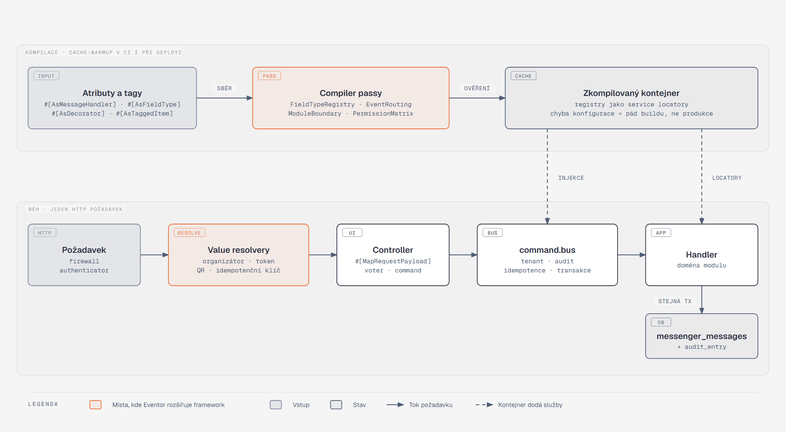

[Architektura](../README.md) · [← 08 Průřezové koncepty](../08-prurezove-koncepty/README.md) · **09 Symfony v architektuře** · [10 Kvalita a testování →](../10-kvalita-a-testovani/README.md)

# 09 · Symfony v architektuře

## Co si odnést

Symfony v Eventoru neslouží jen k routování a ORM. Jeho DI kontejner je nástroj, který vynucuje architekturu: hranice modulů, registry typů polí, routing integračních událostí a matici oprávnění ověřují compiler passy při `cache:warmup`, takže chyba konfigurace shodí build, a ne produkci. Odolnost a logování bez osobních údajů se k Pairrot klientovi přidávají dekorací, ne úpravou adaptéru. Tenant, tokeny samoobsluhy a QR se dekódují ve value resolverech dřív, než se spustí controller, takže controllery zůstávají na pár řádcích. Každý mechanismus v této kapitole má doménový důvod. Kapitola končí maticí „požadavek z inzerátu → kde ho Eventor ukazuje“.



**Jak to číst.** Horní pás běží jednou, při kompilaci kontejneru v CI i při deployi. Atributy a tagy, které moduly deklarují u svých služeb, posbírají compiler passy, ověří je a z výsledku postaví service locatory. Dolní pás je jeden HTTP požadavek. Firewall ověří identitu, value resolvery z URL a hlaviček sestaví doménové argumenty, controller zavolá voter a odešle command. Command bus obalí handler middlewary a handler ve stejné transakci zapíše stav, audit i outbox. Oranžová jsou dvě místa, kde Eventor framework rozšiřuje nejvýrazněji.

## Moduly v kernelu: žádné bundly, jeden `ModuleInterface`

Moduly **nejsou bundly**. Bundle je jednotka znovupoužitelného balíčku se sémantickou konfigurací a tu modul aplikace nepotřebuje. Každý modul místo toho dodává třídu `<Modul>Module`, která implementuje malé rozhraní ze `Shared` a registruje vlastní compiler passy. Služby si modul deklaruje v `src/<Modul>/Infrastructure/Symfony/services.php`.

```php
// backend/src/Kernel.php
final class Kernel extends BaseKernel
{
    use MicroKernelTrait;

    /** @return iterable<ModuleInterface> */
    private function modules(): iterable
    {
        yield new IdentityModule(); yield new CatalogModule(); yield new LegalModule();
        yield new RegistrationModule(); yield new PaymentsModule(); /* … */
    }

    protected function build(ContainerBuilder $container): void
    {
        foreach ($this->modules() as $module) {
            $module->build($container);           // modulové compiler passy a autokonfigurace atributů
        }
        $container->addCompilerPass(new IntegrationEventRoutingPass());
        $container->addCompilerPass(new ModuleBoundaryPass(), PassConfig::TYPE_AFTER_REMOVING);
    }

    private function configureContainer(ContainerConfigurator $c): void
    {
        $c->import('../config/{packages}/*.php');
        $c->import('../config/{packages}/'.$this->environment.'/*.php');
        $c->import('../src/*/Infrastructure/Symfony/services.php');   // jeden soubor na modul
    }
}
```

Výsledek: modul je složka, kterou jde přesunout nebo vyjmout (Payments jako první kandidát, viz [ADR 001](../../adr/001-modular-monolith-with-event-sourced-ledger.md)). Kernel přitom zůstává jediný a konfigurace frameworku (`config/packages`) je sdílená.

## Vlastní atributy a autokonfigurace

Kde Symfony atribut má, Eventor ho používá: handler integrační události je obyčejný `#[AsMessageHandler(fromTransport: …)]`, plánovač `#[AsSchedule]`, dekorátor `#[AsDecorator]`. Vlastní atributy vznikají jen pro doménové registry, které framework nezná. Atribut nese metadata a `registerAttributeForAutoconfiguration` z něj udělá tag, který pak čte compiler pass.

```php
#[\Attribute(\Attribute::TARGET_CLASS)]
final readonly class AsFieldType
{
    public function __construct(public string $name) {}   // 'date', 'single_choice', …
}

// CatalogModule::build()
$container->registerAttributeForAutoconfiguration(
    AsFieldType::class,
    static function (ChildDefinition $def, AsFieldType $attr): void {
        $def->addTag('eventor.field_type', ['name' => $attr->name]);
    },
);
```

Stejným vzorem vznikají `#[AsCheckInRule]` (CheckIn), `#[AsPriceModifier(priority: …)]` (Registration, P1), `#[AsAttentionHandler('late_payment')]` (Attention) a `#[AsRetentionPolicy(RetentionClass::FINANCIAL)]` (Privacy, P1). `#[IntegrationEvent(name, version)]` na třídách událostí není tag, ale metadata, která čte `IntegrationEventRoutingPass`.

## Compiler passy

Compiler pass Eventor používá ve třech rolích: **sběr** (postavit registr z tagů), **ověření** (selhat při kompilaci, když registr neodpovídá pravidlům) a **vynucení architektury** (hranice modulů). Všechny passy jsou v `Shared/Infrastructure/Symfony/DependencyInjection` nebo v modulu, kterému registr patří.

| Pass | Modul | Sbírá | Ověřuje při kompilaci |
|---|---|---|---|
| `FieldTypeRegistryPass` | Catalog | `#[AsFieldType]` | každý typ pole implementuje `ConstraintFactory`, `AnswerNormalizer` a `JsonSchemaFragment`; jména typů jsou unikátní; každá hodnota `FieldTypeName` enumu má implementaci |
| `IntegrationEventRoutingPass` | Shared | `messenger.message_handler` s `from_transport` | z handlerů integračních událostí sestaví routing Messengeru; událost má `#[IntegrationEvent(name, version)]`; každá má odběratele, nebo je `#[NoSubscribers]`; modul má na událost jen jeden handler; transport existuje |
| `ModuleBoundaryPass` | Shared | všechny definice | služba modulu A nesmí přes konstruktor dostat neveřejnou službu modulu B (jen `B\Contract\*`) |
| `PermissionMatrixPass` | Identity | `#[RequiresPermission]` na controllerech a `Permission` enum | každá administrační akce má oprávnění; každé oprávnění je v matici rolí (zadání kap. 3.2); žádné oprávnění „navíc“ |
| `WorkflowAuditPass` | Shared | definice `workflow.*` | každý state machine má marking store na sloupci `state` dané dimenze a registrovaný auditní listener |

### `FieldTypeRegistryPass` — typy polí formuláře (FRM-01, FRM-07)

Formulář je jediný zdroj pravdy pro validaci na serveru i pro vykreslení na frontendu ([ADR 007](../../adr/007-dynamic-form-schema-jsonb-snapshots.md)). Typ pole, kterému by chyběl validátor, by znamenal, že server přijme cokoli. Tuhle chybu má zachytit build, ne až první registrace.

```php
final class FieldTypeRegistryPass implements CompilerPassInterface
{
    private const array REQUIRED = [ConstraintFactory::class, AnswerNormalizer::class, JsonSchemaFragment::class];

    public function process(ContainerBuilder $container): void
    {
        $map = [];
        foreach ($container->findTaggedServiceIds('eventor.field_type') as $id => $tags) {
            $class = $container->getParameterBag()->resolveValue($container->getDefinition($id)->getClass());
            foreach (self::REQUIRED as $interface) {
                if (!is_subclass_of($class, $interface)) {
                    throw new LogicException(sprintf('Field type "%s" must implement %s.', $class, $interface));
                }
            }
            $name = $tags[0]['name'];
            if (isset($map[$name])) {
                throw new LogicException("Duplicate field type \"$name\".");
            }
            $map[$name] = new Reference($id);
        }
        $missing = array_diff(array_map(fn (FieldTypeName $n) => $n->value, FieldTypeName::cases()), array_keys($map));
        if ($missing !== []) {
            throw new LogicException('Field types without implementation: '.implode(', ', $missing));
        }

        $container->getDefinition(FieldTypeRegistry::class)
            ->setArgument('$types', ServiceLocatorTagPass::register($container, $map));
    }
}
```

### `IntegrationEventRoutingPass` — routing odvozený z odběratelů

Outbox stojí na nativním Messengeru ([06](../06-asynchronni-svet/README.md), [ADR 003](../../adr/003-transactional-outbox-per-subscriber-delivery.md)): integrační událost se pošle do transportu každého modulu, který ji odebírá. Ruční routing v `messenger.php` by ale znamenal, že o odběratelích ví centrální konfigurace a že nový odběratel bez řádku v routingu tiše nic nedostane. Pass proto routing sestaví z handlerů a zároveň brání driftu katalogu, který main-panel znal jako „manifest, který nikdo nehlídá“.

```php
public function process(ContainerBuilder $container): void
{
    $routing = [];
    foreach ($container->findTaggedServiceIds('messenger.message_handler') as $id => $tags) {
        foreach ($tags as $tag) {
            $event = $tag['handles'] ?? self::invokedType($container, $id);
            if (!IntegrationEvent::isIntegrationEvent($event)) {
                continue;                                              // commandy a doménové události se neroutují
            }
            $transport = $tag['from_transport'] ?? throw new LogicException("$id: integration event $event needs fromTransport.");
            isset($routing[$event][$transport]) and throw new LogicException("$transport has two handlers of $event.");
            $routing[$event][$transport] = true;
        }
    }
    foreach (IntegrationEvent::classesIn($container, 'Eventor\\*\\Contract\\Event') as $event) {
        isset($routing[$event]) || IntegrationEvent::hasNoSubscribers($event)
            or throw new LogicException("$event has no subscriber. Add one or mark it #[NoSubscribers].");
    }

    $senders = $container->getDefinition('messenger.senders_locator');
    $map = $senders->getArgument(0);                                 // [class => [transport, …]] z framework.messenger.routing
    foreach ($routing as $event => $transports) {
        $map[$event] = array_values(array_unique([...$map[$event] ?? [], ...array_keys($transports)]));
    }
    $senders->replaceArgument(0, $map);
}
```

`messenger.senders_locator` je interní služba FrameworkBundle, proto ji hlídá kontejnerový test (`IntegrationEventRoutingTest`: `OrderPlaced` → `payments_events` a `communication_events`). Při upgradu Symfony spadne test, ne produkce.

### `ModuleBoundaryPass` — hranice modulů i v DI

Deptrac hlídá importy ve zdrojovém kódu. Kontejner ale umí hranici obejít, třeba když `services.php` jednoho modulu ručně předá službu jiného modulu. Pass běží po odstranění nepoužitých služeb a projde argumenty všech definic.

```php
foreach ($container->getDefinitions() as $id => $def) {
    $from = Module::ofClass($def->getClass());            // 'Registration' | null pro vendor
    if ($from === null) continue;
    foreach (self::references($def) as $ref) {
        $target = $container->findDefinition((string) $ref)->getClass();
        $to = Module::ofClass($target);
        if ($to !== null && $to !== $from && $to !== 'Shared' && !str_contains($target, "\\$to\\Contract\\")) {
            throw new LogicException("$id ($from) depends on non-public $target ($to). Use $to\\Contract.");
        }
    }
}
```

## Dekorace služeb

Dekorace je správná odpověď, když se má **chování obalit, ale ne změnit**: odolnost, cache, logování a měření. Adaptér zůstává čistý překlad API Pairrotu a testuje se samostatně.

### Řetězec kolem `PaymentGateway`

```
PaymentGateway (port v Payments\Domain)
 └─ PiiRedactingLoggingGateway    priority 30  (vnější: loguje vše včetně retry, bez IBAN/VS jmen)
     └─ CircuitBreakerGateway      priority 20  (po 5 selháních za 60 s otevře na 30 s → PairrotUnavailable)
         └─ RetryingGateway         priority 10  (jen idempotentní operace, 3 pokusy, jitter)
             └─ HttpPairrotGateway                (Symfony HttpClient, scoped client pairrot.client)
```

```php
#[AsAlias(PaymentGateway::class)]
final readonly class HttpPairrotGateway implements PaymentGateway { /* … */ }

#[AsDecorator(decorates: PaymentGateway::class, priority: 10)]
final readonly class RetryingGateway implements PaymentGateway
{
    public function __construct(
        #[AutowireDecorated] private PaymentGateway $inner,
        private RetryPolicy $policy,
    ) {}

    public function createRequest(CreatePaymentRequest $cmd): IssuedPaymentRequest
    {
        // bezpečné opakovat: Pairrot je idempotentní podle external_id (stejné tělo → 200 replayed)
        return $this->policy->run(fn () => $this->inner->createRequest($cmd), retryOn: [TransportError::class, ServerError::class]);
    }
}
```

Proč to má doménový smysl:

- `createRequest` se smí opakovat, protože `external_id = order_<uuid>_<attempt>` je idempotenční klíč Pairrotu.
- Circuit breaker zajistí, že výpadek Pairrotu (S08) nezahltí outbox desítkami čekajících timeoutů. Odběratel dostane rychlou výjimku `PairrotUnavailable` a outbox naplánuje další pokus podle backoffu.
- Logovací dekorátor je vnější, takže zaznamená i jednotlivé pokusy. Redakci osobních údajů dělá jednou pro celý port (NFR „logy neobsahují osobní údaje nad nezbytnou míru“).
- V testech se alias `PaymentGateway` přepne na `InMemoryPaymentGateway` (`when@test`) a dekorátory zůstanou. Testuje se tak i jejich chování.

### Další dekorace

| Dekorovaná služba | Dekorátor | Důvod |
|---|---|---|
| `Registration\Contract\AvailabilityReader` | `CachedAvailabilityReader` (tag-aware cache, tag `availability.event.<id>`) | veřejná stránka při náporu otevření registrací (NFR výkon). Invalidaci spouští odběratel `CapacityChanged`. Zápisová cesta cache nikdy nečte. |
| `Communication\Domain\MessageSender` | `SuppressingMessageSender` | před odesláním znovu ověří, že příjemce splňuje podmínku (COM-02), jinak doručení `skipped` |
| `Symfony\Component\Mailer\MailerInterface` (jen `dev`/`test`) | `RecordingMailer` | scénářové testy čtou odeslané zprávy bez smtp4dev |
| `serializer.normalizer.object` není dekorován | — | projekce osobních údajů jdou přes skupiny, ne přes dekoraci serializeru (viz níže) |

### Co přináší Symfony 8.1 a kde to Eventor využije

Eventor cílí na Symfony 8.1, protože 8.0 už nemá podporu. Verze 8.1 přidala do DI několik věcí, které přesně sedí na vzory výše. Zdroj: [New in Symfony 8.1: DI improvements](https://symfony.com/blog/new-in-symfony-8-1-dependency-injection-improvements).

| Novinka 8.1 | Použití v Eventoru |
|---|---|
| **Service stack může dekorovat** (`decorates` + `stack`) | Celý řetězec kolem `PaymentGateway` lze deklarovat jako jeden stack, kde pořadí čte člověk shora dolů místo počítání `priority`. Kniha zatím drží atributy `#[AsDecorator]` (dekorátor je vidět u třídy). Stack je zdokumentovaná alternativa pro `config/services/payments.php`. |
| **`#[AsTagDecorator]` / `decorates_tag`** | `MeasuredCheckInRule` obalí **každou** službu s tagem `eventor.check_in_rule`: měření doby a log rozhodnutí u odbavení. Dřív by to vyžadovalo další compiler pass. Handlery zpráv se neobalují, na to má Messenger middleware. |
| **`#[AsAlias(target: …)]` + `#[Target]`** | Dvě úložiště za jedním rozhraním: `#[AsAlias(FileStorage::class, target: 'media')]` (fotky, materiály) a `target: 'legal'` (neměnné verze dokumentů, jiný bucket a retence). Injekce vždy explicitně přes `#[Target('legal')]`, protože porovnání podle jména parametru je deprecated. |
| **Env proměnné jako `\Closure` / `\Stringable`** | FrankenPHP worker a Messenger worker běží dlouho. `#[Autowire(env: 'PAIRROT_WEBHOOK_SECRETS')] \Closure $secrets` vrátí aktuální hodnotu po rotaci klíče bez restartu workeru (s `Container::resetEnvCache()`). |
| **`#[AsTaggedItem(priority:)]` u voterů** | Pořadí voterů (`TenantBoundaryVoter` jako první s nejvyšší prioritou, pak doménové voters) bez duplicitního tagu `security.voter`. |
| **`#[AsTaggedItem(index:, priority:)]` místo `getDefaultPriority()`** | Všechny tagované registry (`FieldType`, `PriceModifier`, `CheckInRule`, `PaymentMethodStrategy`) používají jen atribut. Staré statické metody jsou deprecated a v 9.0 zmizí. |

## Value resolvery

Value resolver mění surový HTTP vstup na **doménový argument controlleru**. V Eventoru odpovídá za tenancy, tokeny a idempotenci. Controller pak nikdy nepracuje se `slug` nebo `token` jako se stringem.

| Resolver | Argument | Zdroj | Co dělá navíc |
|---|---|---|---|
| `CurrentOrganizerResolver` | `#[CurrentOrganizer] Organizer $org` | route `{orgSlug}` | ověří membership přihlášeného účtu (jinak 404, ne 403, aby neprozradil existenci). Zapne Doctrine filtr `organizer` a nastaví `TenantContext`. |
| `CurrentMembershipResolver` | `Membership $me` | session + `TenantContext` | role a omezení na události pro voters |
| `SelfServiceOrderResolver` | `#[SelfService] Order $order` | token ověřený authenticatorem | načte objednávku z `SelfServiceTokenBadge` a zkontroluje rozsah (`scope`: read / cancel / edit) |
| `CheckInParticipationResolver` | `#[FromQr] Participation $p` | tělo `{ "qr": "qr1.…" }` | ověří HMAC podpis a `qr_version` (CHK-03). Vrátí účast, nebo vyhodí `InvalidQrToken` (422 s důvodem). |
| `IdempotencyKeyResolver` | `IdempotencyKey $key` | hlavička `Idempotency-Key` | validace formátu. Povinná u `POST /api/public/orgs/{orgSlug}/events/{eventSlug}/orders` a u příkazů odbavení a hotovosti. |

```php
#[AsTargetedValueResolver('current_organizer')]
final readonly class CurrentOrganizerResolver implements ValueResolverInterface
{
    public function __construct(
        private OrganizerDirectory $organizers,
        private Security $security,
        private TenantContext $tenant,
        private EntityManagerInterface $em,
    ) {}

    /** @return iterable<Organizer> */
    public function resolve(Request $request, ArgumentMetadata $argument): iterable
    {
        $slug = $request->attributes->getString('orgSlug');
        $account = $this->security->getUser() ?? throw new AccessDeniedHttpException();
        $org = $this->organizers->findForMember($slug, $account) ?? throw new NotFoundHttpException();

        $this->tenant->enter($org->id());
        $this->em->getFilters()->enable('organizer')->setParameter('organizerId', $org->id()->toRfc4122());

        return [$org];
    }
}

// Použití — atribut je #[ValueResolver('current_organizer')] zabalený do vlastního atributu
#[Route('/api/admin/org/{orgSlug}/events/{eventId}/capacity', methods: ['PATCH'])]
#[RequiresPermission(Permission::EVENT_CONFIGURE)]
public function __invoke(#[CurrentOrganizer] Organizer $org, Uuid $eventId, #[MapRequestPayload] ChangeCapacity $body): JsonResponse
```

**Souhra se Security.** Autentizaci (kdo jsi) dělá firewall a authenticator. Resolver dělá **kontextovou autorizaci** (patříš k tomuto organizátorovi). Jemná autorizace (smíš tuto akci nad touto událostí) zůstává ve voteru, který controller volá přes `#[IsGranted]` nebo explicitně. Pořadí 401 → 404 → 403 je stejné jako v main-panelu ([ADR 005](../../adr/005-tenant-from-url-doctrine-filter-voters.md)). Resolvery jsou **targeted** (`#[AsTargetedValueResolver]`), takže se nespouštějí na každý argument každého controlleru a nekolidují s vestavěným `EntityValueResolver`.

## Tagované iterátory a lokátory

| Registr | Injekce | Pořadí / klíč | Doménový důvod |
|---|---|---|---|
| `PriceModifier` (P1: promo kód, multiaktivitní sleva, early bird) | `#[AutowireIterator('eventor.price_modifier')]` | `#[AsTaggedItem(priority: …)]`, nejdřív procentní, pak absolutní, nakonec zaokrouhlení | REG-05 rekapitulace musí být deterministická a vysvětlitelná: každý modifier vrací řádek rozpisu |
| `CheckInRule` (CHK-09 matice výjimek) | `#[AutowireIterator('eventor.check_in_rule')]` | priorita podle závažnosti | `AlreadyCheckedIn`, `Unpaid`, `IncompleteRegistration`, `MissingConfirmation`, `Cancelled`, `WrongActivity`. Každé pravidlo vrací `Allow`, `Warn`, `Escalate` nebo `Block`. |
| `PaymentMethodStrategy` | `#[AutowireLocator('eventor.payment_method', indexAttribute: 'key')]` | klíč `bank_transfer` / `cash` / `free` | PAY-01. Převod drží rezervaci a vytváří požadavek v Pairrotu, hotovost a zdarma potvrzují ihned (kap. 5.5). Žádný `switch` v `PlaceOrderHandler`. |
| `FieldType` | locator z `FieldTypeRegistryPass` | jméno typu | FRM-01 |
| `AttentionHandler` | `#[AutowireLocator]` podle typu výjimky | `late_payment`, `overpayment`, `unmatched_transaction`, `delivery_failed`, `consent_withdrawn`, `dead_letter` | ADM-03: „každá položka má akci“. Handler nabízí akce a provádí je přes command bus. |

```php
final readonly class PriceCalculator
{
    /** @param iterable<PriceModifier> $modifiers */
    public function __construct(#[AutowireIterator('eventor.price_modifier')] private iterable $modifiers) {}

    public function quote(PriceQuoteInput $in): PriceQuote
    {
        $quote = PriceQuote::fromBasePrices($in);           // varianty × osoby + doplňky
        foreach ($this->modifiers as $m) {
            $quote = $m->apply($quote, $in);                // každý přidá řádek rozpisu, nikdy nesníží pod 0
        }
        return $quote;
    }
}
```

## Bindings, aliasy, `#[Target]`, env

```php
// config/services.php (výřez)
$services->defaults()
    ->autowire()->autoconfigure()
    ->bind('string $publicBaseUrl', env('EVENTOR_PUBLIC_URL'))
    ->bind('array $pairrotWebhookKeys', env('pairrot_keys:PAIRROT_WEBHOOK_SECRETS'))
    ->bind(ClockInterface::class.' $clock', service('clock'));

// Busy jsou dva, rozlišené pojmenovaným autowiringem; čtení jde přes query služby, ne přes bus
public function __construct(
    #[Target('command.bus')] private MessageBusInterface $commands,
    #[Target('event.bus')] private MessageBusInterface $events,
) {}

// Jednorázová hodnota bez bindu
public function __construct(#[Autowire(env: 'int:RESERVATION_SWEEP_BATCH')] private int $batch) {}
```

Pravidlo: **globální bind** jen pro hodnoty, které potřebuje víc modulů (`$publicBaseUrl`, `$clock`). Modulově specifická konfigurace patří do `services.php` modulu nebo do `#[Autowire]` u konkrétní služby. Alias portu (`PaymentGateway` → HTTP adaptér) je jediné místo, kde se mění implementace podle prostředí.

### Vlastní `EnvVarProcessor`

Pairrot při rotaci podepisuje webhooky dvěma klíči. Seznam klíčů je v jedné proměnné jako `keyid:pwhsec_…,keyid2:pwhsec_…` a procesor ho převede na typovaný seznam už při kompilaci, takže authenticator nic neparsuje.

```php
final class PairrotKeysEnvVarProcessor implements EnvVarProcessorInterface
{
    public function getEnv(string $prefix, string $name, \Closure $getEnv): array
    {
        $keys = [];
        foreach (array_filter(explode(',', (string) $getEnv($name))) as $pair) {
            [$id, $secret] = explode(':', trim($pair), 2) + [1 => ''];
            str_starts_with($secret, 'pwhsec_') or throw new EnvNotFoundException("Invalid Pairrot key \"$id\".");
            $keys[$id] = sodium_base642bin(substr($secret, 7), SODIUM_BASE64_VARIANT_URLSAFE_NO_PADDING);
        }
        return $keys;
    }

    public static function getProvidedTypes(): array { return ['pairrot_keys' => 'array']; }
}
```

Tajemství (management klíč Pairrotu, HMAC klíč QR tokenů, klíč pro šifrování údajů organizátora) žijí v **Symfony Secrets vaultu** (`config/secrets/prod`) a lokálně v `.env.local`.

## Messenger

Messenger hraje v Eventoru dvě role. **Command bus** je obdoba MediatR: jeden command, jeden handler, pipeline z middleware. **Transporty** jsou databázová fronta a zároveň transakční outbox. Busy jsou jen dva, protože jen dva potřebují odlišné chování. Čtení přes bus nejde vůbec, controller volá query službu.

| Bus / transport | Konfigurace | Účel |
|---|---|---|
| `command.bus` | `validation` → `TenantContextMiddleware` → `IdempotencyMiddleware` → `doctrine_transaction` → `AuditContextMiddleware` → `DomainEventsMiddleware` → handler | jeden command = jedna transakce, včetně zápisu integračních událostí do fronty ([ADR 008](../../adr/008-command-oriented-http-api.md)) |
| `event.bus` | výchozí middleware, `allow_no_handlers` | doménové události (synchronně, bez routingu) a integrační události (routované do transportů) |
| transporty `<modul>_events` | Doctrine transport (`doctrine://default?queue_name=…`, `use_notify`, `redeliver_timeout: 300`), `ScheduleRetryStrategy` | jeden na odebírající modul, outbox ([06](../06-asynchronni-svet/README.md)) |
| `pairrot_inbox`, `async`, `async_mail` | Doctrine transport | zpracování webhooků, odložená práce (náhledy, exporty), odesílání e-mailů |
| `scheduler_default` | Scheduler | plánované úlohy |
| `failure_transport` | `failed` (Doctrine) | společný pro všechny. `DeadLetterListener` z každé zprávy udělá `AttentionItem`. |

```php
final readonly class IdempotencyMiddleware implements MiddlewareInterface
{
    public function handle(Envelope $envelope, StackInterface $stack): Envelope
    {
        $stamp = $envelope->last(IdempotencyStamp::class);
        if ($stamp === null) {
            return $stack->next()->handle($envelope, $stack);
        }
        // idempotency_key(key, scope, request_hash, response) — stejný klíč + stejný hash → uložená odpověď,
        // stejný klíč + jiný hash → 409 IdempotencyConflict
        return $this->store->replayOrRun($stamp, fn () => $stack->next()->handle($envelope, $stack));
    }
}
```

**Proč žádný vlastní transport ani outbox tabulky.** Doctrine transport na spojení ORM už je transakční outbox: `INSERT` do `messenger_messages` proběhne v transakci, kterou otevřel `doctrine_transaction`. Doručení N odběratelům s odděleným retry zajistí routing do N transportů. Worker, `messenger:consume`, limity paměti a času, signály, `messenger:stats` i `messenger:failed:*` jsou nativní. Vlastní kód zbývá jen tam, kde je doménový: middleware pro tenant, idempotenci a doménové události, retry rozvrh a routing pass. Symfony 8.2 přidá do transportů volbu `outbox:` pro relay do externího brokeru. Eventor ji zatím nepotřebuje, ale je to připravená cesta, kdyby se Payments osamostatnily ([ADR 003](../../adr/003-transactional-outbox-per-subscriber-delivery.md)).

## Workflow

Každá stavová dimenze ze zadání (kap. 5) je jeden `state_machine` ([05](../05-stavove-automaty/README.md), [ADR 011](../../adr/011-workflow-component-state-machines.md)): `participation`, `event_publication`, `registration_window` (událost i aktivita), `payment_request`, `delivery`, `refund_task`, `attention_item`, `waitlist_offer` (P1). Odbavení a právní potvrzení nejsou workflow, ale append-only tabulky.

```php
// config/packages/workflow.php (výřez)
$framework->workflows()->workflows('participation')
    ->type('state_machine')
    ->supports([Participation::class])
    ->markingStore()->type('method')->property('state');
// přechody: confirm, expire, cancel, require_attention, resolve, restore, transfer
```

```php
#[AsGuardListener(workflow: 'participation', transition: 'restore')]
public function guardRestore(GuardEvent $e): void
{
    // obnova po opožděné platbě (S05/S06) jen při volné kapacitě a jen s oprávněním nebo jako systém
    if (!$this->capacity->canReclaim($e->getSubject())) {
        $e->setBlocked(true, 'capacity_exhausted');
    }
}

#[AsCompletedListener(workflow: 'participation')]
public function record(CompletedEvent $e): void
{
    $this->audit->record($e->getSubject(), $e->getTransition()->getName(), $e->getMarking(), $e->getContext());
    $this->recorded->add(ParticipationStateChanged::from($e));      // doménová událost, DomainEventsMiddleware ji pustí v téže transakci
}
```

Guardy, které rozhodují podle role, volají voter (`$this->security->isGranted(...)`), nikdy samy nečtou role. Přechody, které spouští systém (expirace, auto-obnova), nesou v kontextu `actor: system`. Audit je tak rozliší (AUD-03). V CI běží `workflow:dump --dump-format=mermaid` a výsledek se porovná s kapitolou 05. Rozjetý diagram shodí build.

## Scheduler

Každý modul vlastní svůj `#[AsSchedule]` provider. Položky jsou `RecurringMessage::every()` nebo `::cron()` s obyčejným commandem, rozvrh je `stateful` (po restartu nedohání zmeškané běhy) a chráněný `Lock`. Všechny úlohy jsou **idempotentní sweepery**: projdou stav, změní jen to, co odpovídá podmínce, a běží v dávkách se `SKIP LOCKED`, takže druhý souběžný běh nevadí. Na rozdíl od main-panelu (crony bez zpětné vazby) každý běh zapíše `scheduled_run` a opakovaný neúspěch vytvoří `AttentionItem`. Seznam úloh je v [06](../06-asynchronni-svet/README.md).

## Security

| Firewall | Cesty | Autentizace | Poznámka |
|---|---|---|---|
| `webhooks` | `^/api/webhooks` | `PairrotSignatureAuthenticator` (stateless) | HMAC nad `"<id>.<ts>." + body`, ±5 min, `hash_equals`, více klíčů |
| `self_service` | `^/api/self-service` | `SelfServiceTokenAuthenticator` (stateless) | `ss1_<id>_<secret>` → lookup podle `id`, porovnání SHA-256 hashe, kontrola expirace a revokace |
| `check_in` | `^/api/check-in` | `access_token` + `DeviceTokenHandler`, fallback na session | token zařízení je opaque a jde odvolat |
| `public` | `^/api/public` | žádná (anonymní, bezstavový firewall) | `RateLimiterFactory` `public_order` (sliding window, IP + e-mail), honeypot a časová past |
| `admin` | `^/api` | `json_login` + session, `login_throttling` | `remember_me` ne, `SameSite=Lax`, CSRF token pro mutace |

```php
final class DeviceTokenHandler implements AccessTokenHandlerInterface
{
    public function getUserBadgeFrom(#[\SensitiveParameter] string $accessToken): UserBadge
    {
        $token = $this->devices->findActive(DeviceToken::parse($accessToken)) ?? throw new BadCredentialsException();
        return new UserBadge($token->deviceId(), fn () => new CheckInDeviceUser($token));   // role ROLE_CHECK_IN_DEVICE + organizer + list
    }
}
```

**Voters** mapují matici z kap. 3.2 zadání: `EventVoter` (configure, publish, cancel), `ParticipantDataVoter` (`VIEW_FULL` × `VIEW_CHECK_IN`), `PaymentVoter` (record cash, correct cash, resolve exception, close refund), `CheckInVoter` (check in, correct), `AuditVoter`. Matici drží `PermissionMatrix` (jedna třída, data jako konstanta), ze které čtou voters i `PermissionMatrixPass`. Omezení správce akce a obsluhy na konkrétní události řeší voter přes `Membership::eventScope()`.

## Serializer a projekce osobních údajů

Odbavovací role nesmí vidět plné osobní údaje (NFR, kap. 3.2). Řeší se to **serializačními skupinami vybranými podle oprávnění**, ne dvěma sadami DTO:

```php
final class ParticipantView
{
    #[Groups(['pii:check_in', 'pii:full'])] public string $displayName;
    #[Groups(['pii:check_in', 'pii:full'])] public string $activity;
    #[Groups(['pii:check_in', 'pii:full'])] public ?string $checkInNote;
    #[Groups(['pii:full'])] public string $email;
    #[Groups(['pii:full'])] public ?string $phone;
    #[Groups(['pii:full'])] public ?\DateTimeImmutable $birthDate;
}

// controller
$groups = $this->isGranted(ParticipantDataVoter::VIEW_FULL, $event) ? ['pii:full'] : ['pii:check_in'];
return $this->json($view, context: ['groups' => $groups]);
```

Vlastní normalizery: `MoneyNormalizer` (`{ "amount": 30000, "currency": "CZK", "formatted": "300 Kč" }`), `UuidNormalizer`, `ProblemNormalizer` (RFC 9457 pro chyby s polem `nextStep`, NFR „srozumitelnost chyb“).

## Validator: dynamická omezení z `FormSchema`

Statické DTO (`PlaceOrderRequest`) validují atributy. Odpovědi dynamického formuláře validuje strom omezení **postavený z verze formuláře** (FRM-07). Validace tak jde podle schématu, ne podle toho, co frontend zobrazil.

```php
final readonly class AnswerConstraintBuilder
{
    public function __construct(private FieldTypeRegistry $types) {}

    public function forScope(FormSchema $schema, AnswerScope $scope, SelectionContext $ctx): Constraint
    {
        $fields = [];
        foreach ($schema->fieldsFor($scope) as $field) {
            if (!$field->condition()->isSatisfiedBy($ctx)) {           // FRM-05/06: aktivita, varianta, odpověď
                continue;                                            // neviditelné pole se nesmí poslat ani vyžadovat
            }
            $constraints = $this->types->get($field->type())->constraints($field);
            $fields[$field->key()] = $field->required() ? new Required($constraints) : new Optional($constraints);
        }
        return new Collection(fields: $fields, allowExtraFields: false);
    }
}
```

Vlastní omezení: `#[ValidCzechPhone]`, `#[MinimumAge(years: 15, referenceDate: 'activity.startsOn')]` (EVT-06, Trail 10 km), `#[NoPrecheckedConsent]` (LEG-06: dobrovolný souhlas nesmí být předzaškrtnutý ani povinný). Poslední jmenované validuje konfiguraci právního požadavku v editoru, ne odpověď.

## Doctrine

- **Mapping atributy na agregátech** (`#[ORM\Entity]`, `#[ORM\Column]`), jak to Symfony doporučuje. Doména atributy nese jako metadata, ale nikdy nevolá `EntityManager`. Repozitáře jsou rozhraní v `Domain` s implementací v `Infrastructure`. Mezi moduly žádné asociace, jen ID.
- **Embeddables:** `Money` (`amount_minor` bigint + `currency` char(3)), `Orderer`, `DateRange`.
- **Vlastní DBAL typy:** `uuid` (Symfony bridge), `registration_code`, `form_schema` (JSONB ↔ `FormSchema`), `encrypted_string` (sodium secretbox pro citlivé údaje organizátora, NFR šifrování konfigurací).
- **SQL filter `organizer`:** `OrganizerFilter::addFilterConstraint()` přidá `organizer_id = :organizerId` ke každé entitě s rozhraním `TenantScoped`. Zapíná ho resolver, ve workeru `TenantContextMiddleware` podle `organizer_id` v obálce zprávy.
- **Lifecycle listenery minimálně.** Doménová logika nikdy neběží v `prePersist`/`postUpdate`, protože by obcházela command bus, audit i outbox a nebyla by vidět v handleru. Jediný listener je technický: `TimestampableListener` pro `created_at`/`updated_at`.
- **Invarianty v DB** jsou poslední linie: `CHECK (held + confirmed <= "limit")` jen pro navýšení obsazenosti (viz [03](../03-data/README.md)), částečný unique index na platné odbavení, `RESTRICT` na finančních cizích klíčích a granty bez `UPDATE`/`DELETE` na `ledger_entry` a `audit_entry`.

## Konzole a Twig

- **Console commands:** `eventor:demo:seed` (demo událost „Borský podzimní víkend 2026“), `eventor:pairrot:provision <organizer>` (subtenant a bank connection), `eventor:capacity:verify`, `eventor:retention:run --dry-run` (P1). Všechny volají command bus, nikdy repozitáře napřímo. Opakování nedoručených zpráv obstarávají nativní `messenger:failed:show|retry`.
- **Twig** se používá jen pro e-maily (`templates/email/*.html.twig` + textová verze). Šablony pořadatele (COM-08) jsou uživatelský obsah, ne Twig. Renderuje je `SandboxedTemplateRenderer` nad Twig sandboxem s whitelistem proměnných (`participant.firstName`, `order.amountDue`, `selfServiceUrl`, `qrImage`), takže pořadatel nemůže spustit nic jiného.

## Inzerát → kde to Eventor ukazuje

| Požadavek z inzerátu / znalost | Kde v Eventoru | Kapitola |
|---|---|---|
| **Compiler Pass** | `FieldTypeRegistryPass`, `IntegrationEventRoutingPass`, `ModuleBoundaryPass`, `PermissionMatrixPass`, `WorkflowAuditPass` | tato |
| **Service Decoration** | řetězec `PaymentGateway` (retry → circuit breaker → logování bez osobních údajů), `CachedAvailabilityReader`, `SuppressingMessageSender` | tato, [07](../07-integrace/README.md) |
| **Value Resolver** | `CurrentOrganizer`, `CurrentMembership`, `SelfServiceOrder`, `CheckInParticipation` (QR), `IdempotencyKey` | tato, [08](../08-prurezove-koncepty/README.md) |
| Tagged services, locators, priority | `PriceModifier`, `CheckInRule`, `PaymentMethodStrategy`, `FieldType`, `AttentionHandler` | tato |
| Autokonfigurace vlastních atributů | `#[AsFieldType]`, `#[AsAttentionHandler]`, `#[AsCheckInRule]`, `#[AsPriceModifier]` | tato |
| Bindings, aliasy, `#[Target]`, env processor | busy, port `PaymentGateway`, `pairrot_keys:` | tato |
| Messenger do hloubky | outbox nad Doctrine transportem, transport na modul, routing z compiler passu, vlastní middleware, retry strategie, failure transport | tato, [06](../06-asynchronni-svet/README.md) |
| Workflow | 8 state machines, guardy přes voters, audit a outbox listenery | [05](../05-stavove-automaty/README.md) |
| Scheduler | expirace, reconcile, upomínky, kontrola counterů | [06](../06-asynchronni-svet/README.md) |
| Security | 4 firewally, 3 vlastní authenticatory/handlery, voters nad maticí, rate limiting | [08](../08-prurezove-koncepty/README.md) |
| Serializer, Validator | PII skupiny, problem details, dynamické constraints z JSON schématu | tato |
| Doctrine | embeddables, DBAL typy, SQL filter, invarianty v DB | [03](../03-data/README.md) |
| Architektura | modulární monolit, outbox, ledger, deptrac, ADR | [02](../02-moduly-a-hranice/README.md), [ADR](../../adr/) |
