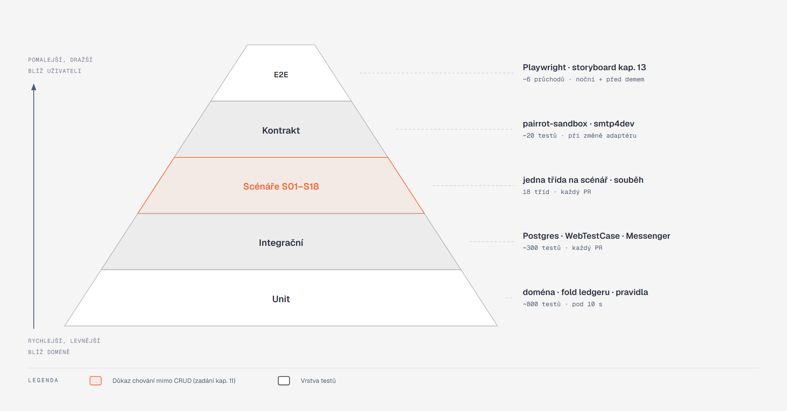

[Architektura](../README.md) · [← 09 Symfony v architektuře](../09-symfony-v-architekture/README.md) · **10 Kvalita a testování** · [11 Rizika a kompromisy →](../11-rizika-a-kompromisy/README.md)

# 10 · Kvalita a testování

## Co si odnést

Zadání nežádá testy jako formalitu. Chce **důkaz chování mimo CRUD**: osmnáct akceptačních scénářů S01–S18 (kap. 11) je proto osmnáct testovacích tříd se stejným jménem. Spouštějí se v každém PR nad skutečným Postgresem. Souběh (S01, S10) se testuje skutečnými paralelními procesy, ne mockem zámku. Pod scénáři leží rychlé unit testy domény a integrační testy modulů. Nad nimi jsou kontraktní testy proti `pairrot-sandbox` a několik end-to-end průchodů storyboardem dema. Architekturu hlídá deptrac a PHPStan s vlastními pravidly, a kdo je poruší, nedostane zelený build.



**Jak to číst.** Šířka vrstvy odpovídá počtu testů, výška pozici vůči uživateli. Vpravo je nástroj, orientační počet a kdy se vrstva spouští. Oranžová vrstva scénářů je to, čím Eventor prokazuje zadání. Ostatní vrstvy ji podpírají (unit, integrační) nebo potvrzují proti skutečnému okolí (kontrakt, E2E).

## Vrstvy testů

| Vrstva | Co testuje | Nástroj | Prostředí | Kdy |
|---|---|---|---|---|
| **Unit** | doménové objekty a politiky bez frameworku: `FinancialState` fold, `PriceCalculator` a modifiery, `CapacityPolicy`, `CategoryRule`, `LegalRequirementResolver`, `FormSchema` podmínky, `CheckInRule` matice, parsování a podpis tokenů | PHPUnit 12 | bez DB, bez kontejneru | každý commit, < 10 s |
| **Integrační** | handler + repozitář + DB constrainty + workflow + outbox zápis jednoho modulu; HTTP vrstva přes `WebTestCase` (status kódy, problem details, oprávnění, tenancy) | PHPUnit + `KernelTestCase`/`WebTestCase`, `dama/doctrine-test-bundle` | Postgres 17 v Dockeru, transakce na test s rollbackem | každý PR |
| **Scénáře S01–S18** | celé chování napříč moduly včetně outboxu a plánovače | PHPUnit, vlastní `ScenarioTestCase` | Postgres, `InMemoryPaymentGateway`, `RecordingMailer`, `MockClock`, transporty `in-memory://` | každý PR |
| **Kontrakt** | adaptér `HttpPairrotGateway` a webhook authenticator proti skutečnému tvaru API; e-mail přes SMTP | PHPUnit `@group contract` | `pairrot-sandbox` + smtp4dev v compose | při změně `Payments/Infrastructure/Pairrot`, nočně |
| **E2E** | storyboard dema (zadání kap. 13) v prohlížeči: Next.js → API → DB → worker | Playwright | celý `compose.yaml` + `pairrot-sandbox` | nočně a před každým demem |

### Konvence

- **Jeden test = jeden důvod selhání.** Jméno testu je věta: `test_late_payment_with_full_capacity_creates_exception_and_refund_task`.
- **Čas je vždy `MockClock`.** Žádné `sleep()`. Expirace rezervace se testuje posunem hodin a spuštěním `ExpireReservations`.
- **Fronty v testech:** transporty jsou v `when@test` `in-memory://` a `ScenarioTestCase::drainQueues()` je zpracuje workerem ve stejném procesu (`messenger:consume --limit`), dokud fronta není prázdná (s limitem iterací proti zacyklení). Ověřuje se tak skutečná cesta přes odběratele, ne volání handleru napřímo.
- **Každý command emituje událost.** Generický test `CommandEmitsEventTest` projde všechny handlery z `command.bus` (přes kontejner) a pro každý ověří, že zaznamená aspoň jednu doménovou událost, nebo nese `#[NoDomainEvent]` se zdůvodněním. Tím se hlídá pravidlo z [ADR 001](../../adr/001-modular-monolith-with-event-sourced-ledger.md).
- **Tenancy:** sada `TenantIsolationTest` vytvoří dva organizátory a pro každý administrační endpoint (získaný z routeru) ověří, že cizí data vrátí 404.

## Scénáře S01–S18

| # | Scénář (zkráceně) | Testovací třída | Úroveň | Klíčové ověření |
|---|---|---|---|---|
| S01 | dva lidé na poslední místo | `S01_LastSeatRaceTest` | souběh (procesy) | právě 1 objednávka, druhá dostane `409 capacity_exhausted` s `nextStep: waitlist`; `held + confirmed = limit` |
| S02 | objednávka přes volnou i plnou aktivitu | `S02_AtomicMultiLevelCapacityTest` | scénář | žádná objednávka, žádný claim, buckety beze změny |
| S03 | Pairrot doručí stejnou platbu 3× | `S03_DuplicateWebhookTest` | scénář + HTTP | 1 `inbox_message`, 1 `ledger_entry`, 1 potvrzovací e-mail; 2× `200` |
| S04 | částečná úhrada | `S04_PartialPaymentTest` | scénář | stav `partially_paid`, účasti `pending` s drženou rezervací, naplánovaná upomínka na doplatek |
| S05 | platba po expiraci, kapacita plná | `S05_LatePaymentCapacityFullTest` | scénář | účast `expired`, `AttentionItem(late_payment)`, `RefundTask` |
| S06 | platba po expiraci, auto-obnova zapnutá | `S06_LatePaymentAutoRestoreTest` | scénář | účast `confirmed`, audit `actor=system`, e-mail odeslán |
| S07 | přeplatek | `S07_OverpaymentTest` | scénář | `overpaid`, výjimka, refund úkol dle nastavení |
| S08 | Pairrot nedostupný při registraci | `S08_PairrotOutageTest` | scénář | objednávka uložena (`201`), delivery `pending` s backoffem, po obnově požadavek vznikne s `attempt=1`, e-mail s údaji |
| S09 | e-mail nedostupný | `S09_MailOutageTest` | scénář | delivery ve frontě, po obnově právě jedno odeslání na příjemce |
| S10 | dvě obsluhy odbaví stejný QR | `S10_ConcurrentCheckInTest` | souběh (procesy) | 1 platný `check_in`, druhá odpověď `409` s časem a jménem obsluhy |
| S11 | oprava hotovosti | `S11_CashCorrectionTest` | scénář | 2 záznamy v ledgeru (`cash`, `cash_correction`), přepočtený stav, audit s důvodem |
| S12 | změna času nedělního závodu | `S12_TargetedRescheduleNoticeTest` | scénář | doručení jen účastem nedělní aktivity |
| S13 | rodič + 2 děti, různé dny | `S13_FamilyOrderTest` | scénář | 1 objednávka, 3 osoby, 3 účasti, potvrzení zákonného zástupce jen u dětí, 1 platební požadavek |
| S14 | nová verze GDPR bez reconfirm | `S14_DocumentVersionInformativeTest` | scénář | staré potvrzení míří na v1, nová registrace na v2 |
| S15 | nová verze podmínek s reconfirm | `S15_DocumentVersionReconfirmTest` | scénář | dotčené účasti `requires_attention`, výzvy odeslány, nic automaticky uděleno |
| S16 | odvolání svolení k fotkám | `S16_LikenessConsentWithdrawalTest` | scénář | potvrzení `withdrawn`, registrace trvá, `AttentionItem(consent_withdrawn)` |
| S17 | nové povinné pole po 50 registracích | `S17_FormFieldAddedAfterRegistrationsTest` | scénář | staré `AnswerSet` na v1, výzva k doplnění, žádná fiktivní odpověď |
| S18 | přechod z 5 km na 10 km | `S18_VariantChangeTest` | scénář | claim 10 km, release 5 km, věková podmínka, doplatek a nový požadavek (`attempt+1` nebo doplňkový), notifikace |

Doplňkové P1 scénáře mají stejnou konvenci s prefixem `P1_`: `P1_TransferRequiresNewConfirmationsTest`, `P1_WaitlistOfferExpiresToNextTest`, `P1_ReminderNotSentAfterPaymentTest` (negativní test), `P1_EventCancellationRefundsOnlyPaidTest`.

### Souběh skutečnými procesy (S01, S10)

Transakce v jednom PHP procesu souběh neprokážou. `ConcurrencyHarness` proto spustí N podprocesů (`Symfony\Component\Process`). Všechny čekají na bariéru, tedy na Postgres advisory lock, který test uvolní najednou, a pak provedou stejný command.

```php
final class S01_LastSeatRaceTest extends ScenarioTestCase
{
    public function test_exactly_one_order_wins_the_last_seat(): void
    {
        $event = $this->demo()->activityWithCapacity(limit: 1);

        $results = ConcurrencyHarness::run(processes: 8, command: 'eventor:test:place-order', args: ['--activity' => $event->activityId]);

        self::assertCount(1, $results->succeeded());
        self::assertCount(7, $results->failedWith('capacity_exhausted'));
        self::assertBucket($event->activityBucket, limit: 1, held: 1, confirmed: 0);
    }
}
```

Testy souběhu běží **bez** `dama/doctrine-test-bundle`, protože podprocesy potřebují vidět commitnutá data. Po testu se databáze uklidí přes `TRUNCATE` v `tearDown`.

## Kontraktní testy proti `pairrot-sandbox`

`pairrot-sandbox` (samostatná služba autora) simuluje Pairrot včetně příchozích plateb. Eventor proti němu ověřuje:

1. `createRequest` s novým a s opakovaným `external_id`: `201` → `200 replayed` → `409` při jiném těle.
2. Mapování odpovědi: IBAN, VS, SPAYD, `due_at`, `payment_change_sequence`.
3. Webhook podepsaný sandboxem projde `PairrotSignatureAuthenticator` a webhook s posunutým časem nebo jiným klíčem ne.
4. Rotace klíče: dva podpisy v hlavičce, platný kterýkoli z nich.
5. Manuální alokace (`POST transactions/{id}/allocations`) s `Idempotency-Key`.
6. Event log `GET /v1/management/webhook-events` s kurzorem (reconcile).

Pokud se sandbox od skutečného Pairrotu odchýlí, je to riziko R2 ([11](../11-rizika-a-kompromisy/README.md)). Kontraktní testy proto používají **zaznamenané odpovědi skutečného Pairrotu** z jeho repozitáře (`Pairrot.Contract.http`, `docs/webhooks-receiver.md` včetně testovacího vektoru podpisu) jako druhý zdroj pravdy: podpisový test běží i proti vektoru z dokumentace Pairrotu.

## Frontend

- **Typová bezpečnost hranice:** TS klient se generuje z OpenAPI (`openapi-typescript` + `openapi-fetch`). CI spustí generování a `git diff --exit-code`, takže změna API bez přegenerování klienta neprojde.
- **Komponenty:** Vitest + Testing Library pro editor formuláře (FRM-11 náhled) a registrační průchod.
- **E2E (Playwright):** šest průchodů podle storyboardu (zadání kap. 13): hlavní průchod 1–6 a odbočky B (hotovost), C (částečná úhrada), duplicitní platba, odvolání svolení, nová verze podmínek. Platby se v E2E vyvolávají přes ovládací API `pairrot-sandbox`. E-maily se čtou z API smtp4dev (odkaz na samoobsluhu, QR).
- **Přístupnost:** `@axe-core/playwright` na veřejné stránce a v registračním průchodu (PUB-04).

## Statická analýza a architektonické hlídky

| Nástroj | Nastavení | Co hlídá |
|---|---|---|
| **PHPStan** | level `max`, `phpstan-symfony`, `phpstan-doctrine`, `phpstan-phpunit`, strict rules | typy, Doctrine mapping, kontejner |
| Vlastní pravidla PHPStanu | `NoNativeDateTimeRule` | zakazuje `new \DateTime*()`, `time()`, `date()` mimo `Shared\Clock` (čas jen přes `ClockInterface`) |
| | `NoFloatMoneyRule` | zakazuje `float` u parametrů, vlastností a návratových typů nazvaných `*amount*`, `*price*` a v `Money` |
| | `NoCrossModuleEntityRule` | entita modulu A se nesmí objevit v signatuře veřejné metody modulu B (do `Contract` jen DTO a ID) |
| | `HandlerOpensNoTransactionRule` | handler nesmí volat `beginTransaction()`/`flush()` (transakci vlastní middleware) |
| | `NoPersonalDataInEventRule` | integrační události (`#[IntegrationEvent]`) nesmí mít vlastnosti typu `Email`, `PersonName`, `Phone`, `BirthDate` |
| **deptrac** | vrstvy `Domain`/`Application`/`Infrastructure`/`UserInterface` + moduly + `Contract` | zadní dvířka mezi moduly; žádné výjimky v baseline |
| Testy schémat ([ADR 013](../../adr/013-postgres-schema-per-module.md)) | `TableOwnershipTest`, `CrossSchemaSqlTest`, `SchemaGrantsTest` | entita leží ve schématu svého modulu; SQL modulu nejmenuje cizí schéma; granty po schématech a append-only |
| **Rector** | sada Symfony 8, PHP 8.4, `--dry-run` v CI | zastaralé API |
| **PHP CS Fixer** | `@Symfony`, `@PER-CS2.0`, `declare_strict_types` | styl |
| **Infection** | jen `src/*/Domain`, MSI ≥ 80 % | jestli testy domény opravdu něco ověřují (fold ledgeru, kapacitní politika) |
| `composer audit`, `npm audit` | | zranitelné závislosti |
| Migrační test | `MigrationsGrantTest` | po `doctrine:migrations:migrate` má role `eventor_app` na `ledger_entry` a `audit_entry` jen `INSERT` a `SELECT`; migrace jdou dolů i nahoru |
| Workflow dump | `workflow:dump` → porovnání s kap. 05 | dokumentace stavových automatů neujede |
| Odkazy dokumentace | `check-links.mjs` | rozbité odkazy v knize |

## CI pipeline (GitHub Actions)

```
on: pull_request, push(main), schedule(nightly)

 ┌ lint        php-cs-fixer · rector --dry-run · eslint · tsc --noEmit · check-links      (~1 min)
 ├ static      phpstan max · deptrac · composer audit                                     (~2 min)
 ├ unit        phpunit --testsuite unit · infection (jen změněné Domain soubory v PR)      (~1 min)
 ├ integration services: postgres:17 → migrate · MigrationsGrantTest · integration ·
 │             scenarios S01–S18 + P1_* · TenantIsolationTest · CommandEmitsEventTest      (~6 min)
 ├ api-contract openapi export → generate TS client → git diff --exit-code                (~1 min)
 ├ frontend    vitest · next build                                                         (~3 min)
 ├ image       docker build (FrankenPHP prod target) · cache:warmup = compiler passy       (~3 min)
 └ nightly     compose up (+ pairrot-sandbox, smtp4dev) → contract → Playwright E2E → axe
```

`cache:warmup` v jobu `image` je zároveň architektonický test: `FieldTypeRegistryPass`, `IntegrationEventRoutingPass`, `ModuleBoundaryPass` a `PermissionMatrixPass` při porušení pravidel shodí build ([09](../09-symfony-v-architekture/README.md)).

## Testovací data a demo

- **Foundry** (`zenstruck/foundry`) factories pro každou entitu. Stories pro opakované situace: `OrganizerWithTeamStory`, `PublishedSimpleEventStory`.
- **`BorskyPodzimniVikendStory`:** demo událost ze zadání kap. 13. Obsahuje organizátora, tým se čtyřmi rolemi, událost 21.–22. 11. 2026 v Plzni a těchto pět aktivit:

  | Aktivita | Varianta a cena | Kapacita | Zvláštnosti |
  |---|---|---|---|
  | Trail 5 km | 300 Kč | 100 | kategorie |
  | Trail 10 km | 400 Kč | 150 | min. věk 15, prohlášení o zdravotní způsobilosti |
  | Týmová štafeta | 4 osoby, 1 200 Kč | 20 týmů | |
  | Dětský závod | 100 Kč | 80 | zákonný zástupce, svolení k fotkám dětí |
  | Canicross | 350 Kč | 40 | „jméno psa“, prohlášení o očkování |

  K tomu doplňky (tričko s velikostí, oběd), program po dnech, dokumenty na úrovni organizátora a aktivit a ukázkové objednávky ve všech stavech.
- `eventor:demo:seed` story spustí nad čistou DB a v `pairrot-sandbox` vytvoří subtenanta a bank connection. Story je zároveň fixture pro scénářové testy, takže demo a testy sdílejí jeden zdroj.

## Definice hotového (pro každou feature)

1. Feature ID ze zadání je v názvu PR a v testu (`#[Covers('REG-06')]` vlastním atributem, report pokrytí feature ID se generuje v CI).
2. Doménová pravidla mají unit testy. Command má integrační test včetně emitované události.
3. Pokud feature mění chování ze scénářů S01–S18, příslušný scénářový test je zelený a nebyl oslaben.
4. Endpoint má OpenAPI popis, voter, test 404 pro cizího organizátora a test 403 pro nedostatečnou roli.
5. Nové osobní údaje mají retenční třídu a nejsou v logu ani v doménové události.
6. Kniha (kapitola modulu, katalog událostí, stavový automat) odpovídá kódu. Workflow dump a check-links jsou zelené.
