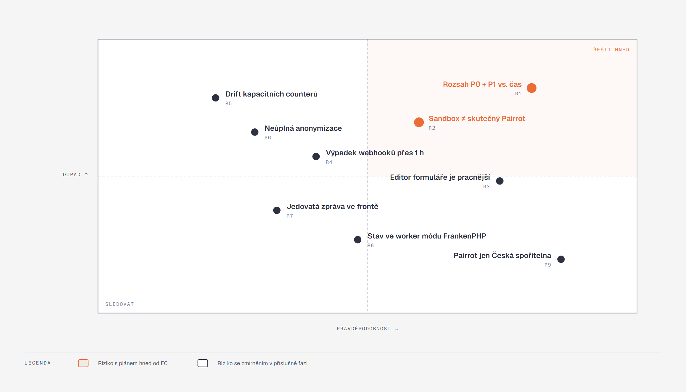

[Architektura](../README.md) · [← 10 Kvalita a testování](../10-kvalita-a-testovani/README.md) · **11 Rizika a kompromisy** · [12 Plán implementace →](../12-plan-implementace/README.md)

# 11 · Rizika a kompromisy

## Co si odnést

Každá architektura je soubor vědomých kompromisů. Eventor jich dělá osm a u každého ví, co za něj platí a kdy by ho přehodnotil. Největší rizika nejsou technická: je to **rozsah P0 + P1 vůči času** (R1) a **odchylka `pairrot-sandbox` od skutečného Pairrotu** (R2). Obě mají plán hned od fáze F0. Kapitola zároveň slouží jako místo, kam se zapisují rozpory mezi knihou a kódem, jakmile kód vznikne. Poslední část shrnuje, co si Eventor vzal z bolestí main-panelu.

**Jak to číst.** Vodorovně je pravděpodobnost, svisle dopad na demo a produkt. Pravý horní kvadrant znamená řešit hned. Oranžová rizika mají zmírnění naplánované od F0, ostatní v té fázi, kde vznikají ([12](../12-plan-implementace/README.md)). Pozice jsou odhad architekta k 24. 10. 2026 a mění se s každou dokončenou fází.

## Vědomé kompromisy

| # | Kompromis | Co tím Eventor získá | Co za to platí | Kdy přehodnotit |
|---|---|---|---|---|
| K1 | **Žádný event sourcing objednávky a účasti**, jen ledger plateb ([ADR 001](../../adr/001-modular-monolith-with-event-sourced-ledger.md)) | atomická kapacita v jedné transakci, jednoduchý GDPR výmaz, silná konzistence čtení | stav objednávky k libovolnému datu se skládá z auditu, ne přehráním | až budou potřeba temporal queries nad objednávkou (P2 porovnání ročníků); cesta B+ je popsaná v [navrhy/01](../navrhy/01-smer-b-vs-c.md) |
| K2 | **Jeden Postgres pro vše** včetně outboxu a front ([ADR 009](../../adr/009-postgresql.md)) | žádný broker, outbox ve stejné transakci, jednodušší provoz a zálohy | DB je single point of failure; worker a web soutěží o spojení | nárazové otevření registrací přes ~500 souběžných zápisů, nebo potřeba nezávislého škálování workerů → Redis/RabbitMQ transport (doména se nemění) |
| K3 | **Worker ve stejném image** jako web (FrankenPHP; `messenger:consume outbox async scheduler_default`) | jedna build pipeline, stejný kód a konfigurace | dlouhý požadavek nemůže zablokovat worker, ale nasazení restartuje oba | při nasazení na více strojů → samostatný deployment workeru (image zůstává) |
| K4 | **Pairrot dnes umí jen Českou spořitelnu a CZK** | žádné vlastní bankovní párování (zadání: mimo rozsah) | organizátor s jinou bankou má jen ruční evidenci plateb; demo musí použít ČS profil | až Pairrot přidá banky (bez změny Eventoru, jde o konfiguraci bank connection) |
| K5 | **Retry budget webhooků Pairrotu je asi hodina** | Eventor se nespoléhá jen na push | potřeba reconcile jobu (každých 15 min, okno 48 h) a zrcadla `payment_request.last_sequence` | nikdy úplně; reconcile zůstane jako pojistka i při delším retry |
| K6 | **Refundace jsou ruční** (`RefundTask`, PAY-11) | žádná platební brána, žádné bankovní API | finance musí peníze vrátit mimo systém a úkol uzavřít ručně | P2+ s platební bránou nebo bankovním API |
| K7 | **Odbavení je jen online** (CHK-12 je P2) | žádná synchronizace a konflikty | výpadek sítě na místě zastaví odbavení | P2: QR token je podepsaný a verzovaný už teď, takže offline ověření podpisu jde doplnit bez změny formátu |
| K8 | **Kapacita jako denormalizované countery** (`capacity_bucket.held/confirmed`) místo počítání účastí ([ADR 002](../../adr/002-capacity-buckets-conditional-update.md)) | jedna podmíněná operace na úroveň, krátké zámky, S01/S02 v jedné transakci | counter může teoreticky ujet od skutečnosti (chyba v kódu, ruční zásah v DB) | nikdy; drift hlídá `VerifyCapacityCounters` (noční dotaz součet claimů vs. bucket → `AttentionItem`) a scénářové testy |

## Rizika

| # | Riziko | Pravd. | Dopad | Zmírnění | Fáze |
|---|---|:-:|:-:|---|---|
| R1 | **Rozsah P0 + P1 se nevejde do 8–10 týdnů** | vysoká | vysoký | P0 je hotové v M2 (T7) dřív, než začne P1. P1 je seřazené podle hodnoty pro demo: čekací listina → slevy → kategorie a vlny → převod → PRV → týmová varianta. Co se nevejde, zůstane navržené (architektura už počítá s místem). Každá fáze končí zelenými scénáři, ne „skoro hotovo“. | F0–F8 |
| R2 | **`pairrot-sandbox` se chová jinak než skutečný Pairrot** | střední | vysoký | Kontrakt se píše podle skutečného Pairrotu (README, `webhooks-receiver.md`, testovací vektor podpisu). Kontraktní testy běží proti sandboxu i proti vektorům z dokumentace. Seznam otevřených otázek (níže) se uzavře v F3. Adaptér je jediné místo, které zná tvar API. | F0, F3 |
| R3 | **Editor formuláře je pracnější, než se zdá** (FRM-01–11, podmínky, scope, náhled) | vysoká | střední | Server je jediný zdroj pravdy (schéma + validace). Frontend editor začne jako formulář nad JSON schématem s náhledem a drag & drop až nakonec. Typ pole se přidává jako tagovaná služba, takže jádro se nemění. | F1 |
| R4 | **Webhooky z Pairrotu nedorazí déle než hodinu** (výpadek Eventoru, síť) | střední | střední | reconcile každých 15 min přes event log (48 h okno), idempotentní aplikace (inbox + `sequence`); delší výpadek → ruční `eventor:pairrot:reconcile --since=` | F3 |
| R5 | **Drift kapacitních counterů** | nízká | vysoký | CHECK constraint, jediná cesta zápisu přes `CapacityAllocator`, noční `VerifyCapacityCounters`, scénáře S01/S02/S05/S06/S18 | F2 |
| R6 | **Neúplná anonymizace** (osobní údaj zůstane v JSONB odpovědích, logu nebo auditu) | nízká–střední | vysoký | osobní údaje jen v `person` a `answer_set`, audit drží osobní diffy v `audit_pii` s vlastní retencí, PHPStan `NoPersonalDataInEventRule`, Monolog procesor redakce, test „po anonymizaci nenajdeš e-mail v žádné tabulce“ | F7 |
| R7 | **Jedovatá zpráva v outboxu** (odběratel padá pořád) | nízká | střední | per-subscriber delivery: padá jen jeden odběratel, ostatní pokračují; po 6. pokusu `dead` → `AttentionItem(dead_letter)` s akcí replay | F0 |
| R8 | **Sdílený stav v worker módu FrankenPHP** (služba drží stav mezi požadavky: tenant, Doctrine filtr) | střední | nízký–střední | `TenantContext` implementuje `ResetInterface`, `kernel.reset` mezi požadavky, test „dva požadavky dvou tenantů za sebou v jednom procesu“; EM se resetuje | F0 |
| R9 | **Pairrot jen Česká spořitelna** | vysoká | nízký | pro demo stačí; organizátor bez ČS má hotovost a ruční evidenci (K4) | — |

## Otevřené otázky k ověření proti `pairrot-sandbox` (uzavřít v F3)

1. Simuluje sandbox i **manuální alokaci** (částečná úhrada S04, přeplatek S07) a události `transaction.recorded` s `matching.result`, nebo jen přesně spárované platby?
2. Odpovídá **tvar webhooku** včetně `previous`/`current` a monotónní `sequence` a posílá sandbox i **mimo pořadí a duplicitně** (S03), jak to dovoluje kontrakt?
3. Podporuje sandbox **rotaci webhook klíče** (dva podpisy v hlavičce)?
4. Je k dispozici **event log** `GET /v1/management/webhook-events` s kurzorem pro reconcile?
5. Vrací sandbox `200 replayed` / `409 external_id_conflict` podle skutečného chování idempotence?
6. Jak sandbox reprezentuje **subtenanty a bank connections** (provisioning organizátora v ORG-02)?
7. Jaký je chování **`allocation_revoked`**? Eventor z něj tvoří kompenzační `ledger_entry` se zápornou deltou.
8. Je možné simulovat **výpadek** (503, timeout) pro S08 a retry dekorátor?

Odpovědi se zapíší do [07 · Integrace](../07-integrace/README.md) a [ADR 004](../../adr/004-pairrot-integration-contract.md). Co sandbox neumí, se pokryje `InMemoryPaymentGateway` ve scénářových testech a v sandboxu se označí jako mezera.

## Co si Eventor vzal z bolestí main-panelu

Main-panel (NaLekci) prošel cestou k modulárnímu monolitu zpětně. Jeho kapitola „Kde to bolí“ je pro Eventor kontrolní seznam toho, co nedělat.

| Bolest v main-panelu | Odpověď Eventoru |
|---|---|
| privilegovaná operace zapisovala částky tak, jak je poslal volající | server vždy přepočítá cenu i finanční stav; částky z klienta se jen porovnají (rekapitulace REG-05 je výsledek serveru) |
| „append-only“ tabulky šly mazat (`DELETE`, `TRUNCATE`) | append-only se vynucuje granty DB role, ne triggery, a hlídá ho migrační test |
| kaskády mazaly finanční historii | `RESTRICT` na všech cizích klíčích do ledgeru, plateb a auditu; objednávka se nikdy nemaže, jen anonymizuje |
| refund mohl spustit kdokoli přihlášený | matice oprávnění ze zadání (kap. 3.2) jako `PermissionMatrix` + voters, ověřená compiler passem |
| cykly mezi moduly, které nikdo nehlídal | deptrac bez baseline a `ModuleBoundaryPass` od prvního commitu |
| stejné pravidlo v SQL i v aplikaci, které se rozjelo | pravidla jsou jen v PHP doméně; DB drží jen invarianty (CHECK, unique), ne logiku |
| „upovídané“ zápisové cesty s desítkami round-tripů | jeden command, jedna transakce, jedna podmíněná SQL operace na kapacitní úroveň |
| e-maily posílané mimo outbox se ztrácely | e-mail odchází výhradně jako odběratel outboxu (COM-07, S09) |
| crony bez zpětné vazby | Scheduler zapisuje `scheduled_run`, neúspěch tvoří `AttentionItem` |
| manifest událostí neodpovídal realitě | katalog událostí ověřuje `IntegrationEventRoutingPass` při kompilaci |
| tajemství porovnávané `===`, fallback na jiný klíč | `hash_equals` všude, žádné fallbacky klíčů, tajemství ve Symfony Secrets |
| dokumentace se rozcházela s kódem | definice hotového zahrnuje knihu; workflow dump a check-links v CI |

## Rozpory mezi knihou a kódem

Zatím žádné. Kód ještě neexistuje. Jakmile vznikne, každý zjištěný rozpor se zapíše sem s datem, místem v kódu a rozhodnutím, zda se upraví kód, nebo kniha.

| Datum | Kapitola | Rozpor | Rozhodnutí |
|---|---|---|---|
| — | — | — | — |
