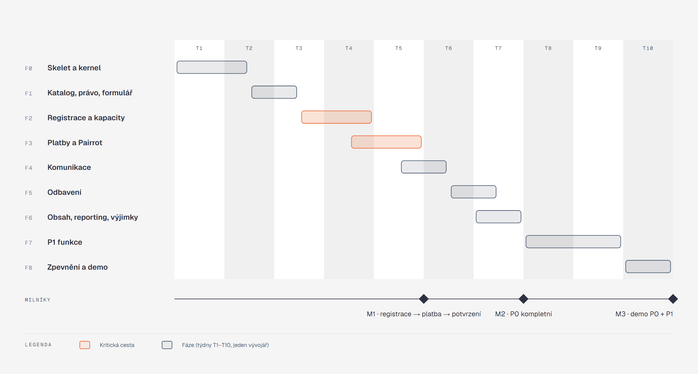

[Architektura](../README.md) · [← 11 Rizika a kompromisy](../11-rizika-a-kompromisy/README.md) · **12 Plán implementace**

# 12 · Plán implementace

## Co si odnést

Implementace má devět fází za zhruba deset týdnů práce jednoho vývojáře, v souladu s odhadem v [ADR 001](../../adr/001-modular-monolith-with-event-sourced-ledger.md). Pořadí řídí dvě věci: **kritická cesta** registrace → kapacita → platba → potvrzení (F2 a F3) a pravidlo, že **každá fáze končí zelenými scénáři**, ne rozpracovaným kódem. P0 je kompletní v milníku M2 (T7), teprve pak začíná P1. Skelet v F0 je investice do všeho, co se opakuje: outbox, busy, tenancy, autentizace, CI. Ty pak už žádný modul nestaví znovu.

**Jak to číst.** Řádky jsou fáze, sloupce týdny T1–T10. Oranžové pruhy tvoří kritickou cestu: zpoždění F2 nebo F3 posouvá všechno za nimi. F3 začíná v půlce F2, protože port `PaymentGateway`, adaptér a webhook lze stavět proti `pairrot-sandbox` nezávisle na registraci. Milníky dole jsou body, kdy se dá ukázat funkční celek.

## Fáze

### F0 · Skelet a kernel (T1–T1,5)

**Rozsah:**

- monorepo (`backend/`, `frontend/`, `docs/`) a `compose.yaml`: `php` (FrankenPHP), `worker`, `frontend`, `postgres`, `smtp4dev`, `minio`, napojení na `pairrot-sandbox`,
- Symfony 8 skelet s `Kernel` a `ModuleInterface`,
- Databáze: schéma na modul + `shared`, granty a `search_path` v první migraci ([ADR 013](../../adr/013-postgres-schema-per-module.md)),
- `Shared`: `Money`, `Clock`, UUIDv7, `TenantContext` (`ResetInterface`), Messenger (Doctrine transporty na modul, `ScheduleRetryStrategy`, `DeadLetterListener`, `IntegrationEventRoutingPass`), `command.bus` a `event.bus` s middleware (`DomainEventsMiddleware`), `audit_entry`, `idempotency_key`, `AttentionItem` základ,
- Identity minimum: účet, organizátor, membership, `json_login`, voters + `PermissionMatrix` + `PermissionMatrixPass`, `CurrentOrganizerResolver` a Doctrine filtr,
- DB role `eventor_app` s granty, `MigrationsGrantTest`,
- CI (lint, PHPStan max + vlastní pravidla, deptrac, unit, integration, image build),
- Next.js skelet s rewrite `/api/*`, generovaný TS klient, přihlášení,
- kniha a ADR v repozitáři.

**Výstupní kritéria:** přihlášení a přepnutí organizátora ve frontendu; testovací command zapíše stav, audit a outbox v jedné transakci a odběratel ho doručí (včetně retry a dead-letteru); `TenantIsolationTest` a `CommandEmitsEventTest` existují a jsou zelené; `cache:warmup` shodí build při porušení hranice modulu (ověřeno záměrně rozbitým testem).

**Zmírňuje:** R7, R8, z části R2 (adaptér skeleton + podpisový test proti vektoru z dokumentace Pairrotu).

### F1 · Katalog, právo, formulář (T1,5–T2,5)

**Rozsah:**

| Modul | Feature ID |
|---|---|
| Identity | ORG-01, ORG-03 (pozvánky, role, omezení na události), ORG-06 |
| Catalog | EVT-01–06, EVT-10, EVT-11, EVT-03 a EVT-04 jako workflow, PRG-01–04 |
| Catalog / formulář | FRM-01–09, FRM-11 (`FieldTypeRegistryPass`, `FormVersion`, `AnswerConstraintBuilder`, náhled) |
| Legal | LEG-01–07, LEG-11 (dokumenty, verze s content-addressed úložištěm v MinIO, požadavky, `LegalRequirementResolver`) |

Frontend: průvodce jednoduchou akcí, správa aktivit a variant, editor formuláře (nejdřív nad schématem), dokumenty.

**Výstupní kritéria:** demo událost „Borský podzimní víkend 2026“ jde založit přes UI i přes `BorskyPodzimniVikendStory`. Publikace vytvoří `FormVersion`. Náhled formuláře pro kombinaci aktivit a variant ukazuje správná pole i dokumenty (dědičnost organizátor / událost / aktivita).

**Zmírňuje:** R3.

### F2 · Registrace a kapacity (T2,5–T4) — kritická cesta

**Rozsah:**

- REG-01–03, REG-05, REG-06, REG-08 (samoobsluha, čtení), REG-09 (storno a oprava údajů), REG-11, REG-14,
- CAP-01 (bez vln) až CAP-06,
- PUB-01–04 (veřejná stránka, dostupnost, QR stránky),
- API-03 (rate limit, honeypot), API-04 (`SelfServiceTokenAuthenticator`).

Technika: `capacity_bucket` + `CapacityAllocator`, `PlaceOrderHandler`, `PaymentMethodStrategy` (převod, hotovost, zdarma), `ExpireReservations` ve Scheduleru, `CachedAvailabilityReader`, `IdempotencyMiddleware` na veřejném vytvoření objednávky.

Frontend: veřejná stránka (SSR), registrační průchod na mobilu, samoobsluha.

**Výstupní kritéria:** zelené scénáře S01, S02 a S13 a expirace rezervace (část S05/S06 bez plateb); souběh ověřený `ConcurrencyHarness`; veřejná stránka zvládne zátěžový test `k6` se 300 souběžnými uživateli a registrační vlnou na poslední místa bez překročení kapacity.

### F3 · Platby a Pairrot (T3,5–T5) — kritická cesta

**Rozsah:**

- ORG-02 (provisioning subtenanta a bank connection přes `eventor:pairrot:provision` a UI),
- PAY-01–11, PAY-13,
- API-02 (webhook: `PairrotSignatureAuthenticator`, `inbox_message`, `ApplyPairrotPaymentUpdate`),
- reconcile přes event log, rekonciliační fronta nespárovaných transakcí a manuální alokace,
- ledger + `FinancialState` fold, hotovost a opravy,
- `RefundTask`, dekorátory `PaymentGateway` (retry, circuit breaker, logování bez osobních údajů).

**Výstupní kritéria:** zelené S03–S08 a S11; kontraktní testy proti `pairrot-sandbox` zelené; otevřené otázky z [11](../11-rizika-a-kompromisy/README.md#otevřené-otázky-k-ověření-proti-pairrot-sandbox-uzavřít-v-f3) zodpovězené a zapsané do [07](../07-integrace/README.md) a [ADR 004](../../adr/004-pairrot-integration-contract.md).

**Milník M1 (konec T5):** účastník se zaregistruje, dostane platební údaje se SPAYD QR, sandbox pošle platbu, účasti se potvrdí. Konec kritické cesty.

**Zmírňuje:** R2, R4.

### F4 · Komunikace (T4,5–T5,5)

**Rozsah:** COM-01–08 a PRV-07 (`MessageTemplate` se sandboxovaným Twigem, `Campaign`, cílení, `Delivery` state machine, `SuppressingMessageSender`, historie a opakování jen selhaných). Navazující transakční zprávy pro všechny události z F2 a F3. REG-07 (potvrzení s platebními údaji) a PAY-09 (upomínky řízené stavem).

**Výstupní kritéria:** zelené S09 a S12 a negativní test „upomínka neodejde po úhradě“; smtp4dev ukazuje všechny transakční zprávy demo storyboardu.

### F5 · Odbavení (T5,5–T6,5)

**Rozsah:**

- CHK-01–10: `CheckInList`, `ParticipationQrToken` (podpis + verze), `CheckInParticipationResolver`, `CheckInRule` matice, partial unique index na platné odbavení, hotovost při odbavení, provozní přehled,
- tokeny zařízení (`DeviceTokenHandler`),
- mobilní odbavovací obrazovka v Next.js se čtením QR kamerou.

**Výstupní kritéria:** zelený S10 (souběh procesů); obsluha na mobilu odbaví rodiče z dema a vidí, že děti jsou na jiný den; druhý pokus ukáže „již odbaven v HH:MM kým“.

### F6 · Obsah, reporting, výjimky, audit (T6–T7)

**Rozsah:**

- POST-01–05 a POST-07: galerie v MinIO s náhledy přes `async` transport, externí kolekce, materiály, závěrečná zpráva odbaveným, archivace,
- PUB-06,
- ADM-01–04, ADM-06 (zpráva), ADM-07, ADM-08: dashboardy, fronta „vyžaduje pozornost“ s `AttentionHandler`, správa registrací, CSV exporty respektující oprávnění, report po akci,
- AUD-01–04: historie v detailu,
- EVT-12 lite (zrušení události jako proces).

**Výstupní kritéria:** zelené S14–S17 (pokud nebyly zelené už v F1 a F4); celý storyboard dema (kap. 13, kroky 1–6 a všechny odbočky) projde v Playwrightu.

**Milník M2 (konec T7):** P0 kompletní.

### F7 · P1 funkce (T7–T9)

Pořadí podle hodnoty pro demo. Co se nevejde, zůstane navržené.

1. **Čekací listina** REG-12 (`WaitlistEntry`, `WaitlistOffer` state machine s TTL, nabídka po uvolnění, P1 scénář „nabídka vyprší a jde dalšímu“). Navazuje na `capacity_exhausted.nextStep`.
2. **Slevy** EVT-15 (`PriceModifier` pipeline: promo kód, multiaktivitní, early bird) a **doplňky** EVT-09 (scope objednávka / osoba, limity).
3. **Kategorie** EVT-08 a **vlny** EVT-07 + CAP-01 vlna (další úroveň `capacity_bucket`; architektura ji počítá od F2).
4. **Změna varianty a převod účasti** S18 a REG-09 (plná), REG-10, LEG-12 (nová potvrzení od nové osoby).
5. **Osobní údaje** PRV-01–05 (vyhledání osoby, export, žádosti subjektů, anonymizace, retenční třídy). FRM-10 (varování u zvláštních kategorií).
6. **Týmová varianta** REG-04, CAP-07. Dále ORG-04 (přepínání organizátorů), ORG-05, PUB-05 (startovka s opt-in), PUB-07, REG-13 (ruční registrace pořadatelem), PAY-12 (potvrzení o platbě PDF), CHK-11 (více stanovišť), POST-03 (jen registrovaní), POST-06, COM-09 (odhlášení marketingu), LEG-13, ADM-05, ADM-06 (plné), API-05.

**Výstupní kritéria:** zelené S18 a všechny `P1_*` scénáře; anonymizační test „po výmazu nenajdeš e-mail v žádné tabulce“.

**Zmírňuje:** R6.

### F8 · Zpevnění, demo, dokumentace (T9–T10)

**Rozsah:**

- výkonnostní test veřejné stránky a registrace (`k6`), indexy podle `EXPLAIN`,
- produkční image a `compose.prod.yaml` za Caddy (připraveno pro VPS, bez nasazení), zálohy Postgresu, health endpointy, Monolog JSON s redakcí,
- security review (rate limity, CSRF, hlavičky, tajemství ve vaultu), `Infection` na doménu,
- finální `eventor:demo:seed`,
- synchronizace knihy s kódem: rozpory do [11](../11-rizika-a-kompromisy/README.md#rozpory-mezi-knihou-a-kódem), regenerace diagramů a PDF.

**Výstupní kritéria:** celé CI zelené včetně nočního E2E proti `pairrot-sandbox`; demo storyboard projde od čisté databáze za méně než 15 minut; PDF knihy odpovídá kódu.

**Milník M3 (konec T10):** demo P0 + P1.

## Shrnutí

| Fáze | Týdny | Moduly | Scénáře, které musí být zelené |
|---|---|---|---|
| F0 | 1,5 | Shared, Identity (min.), Audit, Attention (základ) | infrastrukturní testy (outbox, tenancy, granty) |
| F1 | 1 | Catalog, Legal, Identity | — (příprava S13–S17) |
| F2 | 1,5 | Registration | S01, S02, S13 |
| F3 | 1,5 (souběžně s F2) | Payments | S03–S08, S11 |
| F4 | 1 | Communication | S09, S12 |
| F5 | 1 | CheckIn | S10 |
| F6 | 1 | Content, Reporting, Attention, Audit | S14–S17, storyboard E2E |
| F7 | 2 | napříč (P1) | S18, `P1_*` |
| F8 | 1 | — | celé CI + noční E2E |
| **Celkem** | **~10 týdnů** | | |

## Pravidla průběhu

- **Vertikální řezy:** každá fáze dodává backend (doména, API, testy) i frontend pro své feature ID. Modul se nestaví „nejdřív celý backend“.
- **Žádná fáze nezačíná, dokud předchozí nemá zelené výstupní scénáře.** Výjimkou je souběh F2/F3, kde F3 začíná portem a adaptérem.
- **Každé architektonické rozhodnutí během implementace = nové ADR** (anglicky, `docs/adr/NNN-*.md`) a zápis do knihy.
- **Rozsah se škrtá v P1, nikdy v P0 a nikdy ve scénářích.**
