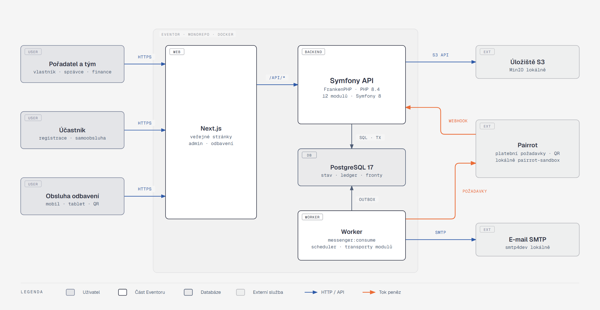

# Architektura Eventoru

Tato kniha popisuje **cílovou solution architecture** Eventoru, webové platformy pro pořadatele akcí: registrace, platby převodem přes Pairrot a hotově, komunikace, program, odbavení, právní dokumenty a souhlasy a obsah po akci. Popisuje moduly, data, toky, rozhodnutí a invarianty. Jména tříd a tabulek uvádí jen jako vstupní body do budoucího kódu.

> **Zdroj pravdy.** Chování systému určuje [zadání V3](../initial-idea/zadani-event-platforma.md) (feature ID typu `REG-01` a scénáře `S01–S18` odkazují tam). Rozhodnutí zaznamenávají [ADR](../adr/) (anglicky). Tato kniha je mapou nad oběma. Jak se ke směru došlo, popisují [podklady k rozhodnutí](navrhy/00-architektonicke-smery.md).
> **Stav:** návrh průběžně srovnaný s implementací W0–W2, 25. 10. 2026. Když se kód a kniha rozejdou, platí kód a rozpor se zapíše do kapitoly [11](11-rizika-a-kompromisy/README.md).

## Co si odnést

Eventor je **modulární monolit**: jedna Symfony aplikace nad jedním Postgresem, s Next.js frontendem, který mluví výhradně přes HTTP API. Uvnitř backendu je dvanáct modulů. Hranici každého hlídá deptrac i DI kontejner.

Synchronně, v jedné databázové transakci, spolupracují jen tři moduly: **registrace, kapacity a právní potvrzení**. Všechno ostatní na sebe reaguje přes integrační události v **transakčním outboxu nad Symfony Messengerem** (Doctrine transport, žádný broker). Peníze jsou **append-only ledger** a finanční stav objednávky se z něj odvozuje. Platby převodem obstarává existující služba **Pairrot**. Eventor ji nikdy neobchází a nic z ní neduplikuje.

## Systém na jedné stránce



**Jak to číst.** Požadavek prochází diagramem zleva doprava:

- **Lidé** (pořadatel a jeho tým, účastník, obsluha odbavení) přicházejí přes Next.js.
- **Pairrot** přichází přes podepsaný webhook.
- **Backend** zpracuje požadavek v jednom modulu a ve stejné transakci zapíše doménovou událost do outboxu.
- **Worker** událost doručí odběratelům: e-mailům, Pairrotu, frontě výjimek a auditu.

Oranžově je vyznačen tok peněz.

## Deset vět, které je třeba znát

1. **Jedna aplikace, jedna databáze, jasné hranice.** Backend tvoří Symfony 8.1 (aktuální minor řady 8.x) na PHP 8.4 (FrankenPHP) a PostgreSQL 17. Moduly jsou v `backend/src/<Modul>/`, každý má vlastní Postgres schéma a cizí modul smí sahat jen do jeho `Contract/` ([02](02-moduly-a-hranice/README.md), [ADR 001](../adr/001-modular-monolith-with-event-sourced-ledger.md)).
2. **Účast je jediný nositel kapacity a odbavení.** Objednávka je jednotka platby a komunikace. Kapacita je `capacity_bucket` pro každou úroveň (událost, aktivita, varianta, vlna) a obsazuje se podmíněným `UPDATE` ve stejné transakci jako vznik objednávky ([03](03-data/README.md), [04](04-klicove-cesty/README.md)).
3. **Peníze se nikdy nepřepisují.** `ledger_entry` je append-only. Finanční stav objednávky je fold ledgeru a ruční zásah je nový kompenzační zápis ([05](05-stavove-automaty/README.md)).
4. **Každá stavová dimenze má vlastní state machine.** Účast, zveřejnění, registrace, odbavení, potvrzení i doručení zprávy se řídí přes Symfony Workflow. Žádné společné pole `status` ([05](05-stavove-automaty/README.md)).
5. **Outbox je nativní Messenger.** Příkaz běží na `command.bus` v jedné transakci. Integrační událost se ve stejné transakci zapíše do Doctrine transportu, do jednoho transportu na každý odebírající modul, s vlastní retry strategií a failure transportem, který končí ve frontě výjimek ([06](06-asynchronni-svet/README.md)).
6. **Pairrot je zdroj pravdy o bankovních platbách.** Eventor vytváří platební požadavky (idempotentně podle `external_id`), přijímá podepsané webhooky (deduplikace podle ID, pořadí podle `sequence`) a každých 15 minut se dorovnává přes event log Pairrotu ([07](07-integrace/README.md)).
7. **Tenant se bere vždy z URL.** Každá administrační cesta začíná `/api/admin/org/{orgSlug}`. Value resolver ověří členství, zapne Doctrine filtr organizátora a voters rozhodnou podle matice role × událost ([08](08-prurezove-koncepty/README.md)).
8. **Tři způsoby autentizace, žádné JWT.**
   - tým: session cookie (`json_login`),
   - účastník: vlastní authenticator nad tokenem samoobsluhy,
   - odbavovací zařízení: `access_token` s vlastním handlerem,
   - Pairrot: HMAC podpis webhooku ([08](08-prurezove-koncepty/README.md)).
9. **Historie se nepřepisuje.** Formulář, právní dokumenty i potvrzení jsou verzované a odpovědi nesou verzi formuláře. Audit je append-only a DB role aplikace na něm nemá `UPDATE` ani `DELETE` ([03](03-data/README.md), [08](08-prurezove-koncepty/README.md)).
10. **Symfony je architektonický nástroj, ne jen framework.**
    - compiler passy ověřují registry a hranice modulů při kompilaci kontejneru,
    - dekorátory obalují Pairrot klienta odolností a logováním bez osobních údajů,
    - value resolvery dekódují tenanta a tokeny dřív, než se controller vůbec spustí ([09](09-symfony-v-architekture/README.md)).

## Moduly

| Modul | Odpovídá za | Feature ID |
|---|---|---|
| `Identity` | organizátor, členové týmu, role, pozvánky, přihlášení | ORG |
| `Catalog` | událost, aktivita, varianta, vlna, kategorie, doplňky, program, aktuality, schéma formuláře | EVT, PRG, FRM (editor) |
| `Legal` | právní dokumenty a verze, požadavky, potvrzení a odvolání | LEG |
| `Registration` | objednávka, osoba, účast, odpovědi, kapacity, rezervace, čekací listina, slevy, samoobsluha | REG, CAP, FRM (odpovědi) |
| `Payments` | ledger, platební požadavky, Pairrot, hotovost, refund úkoly, rekonciliace | PAY |
| `CheckIn` | odbavovací seznamy, QR tokeny, odbavení, stanoviště | CHK |
| `Communication` | šablony, transakční zprávy, kampaně, doručení | COM |
| `Content` | galerie, fotografie, externí kolekce, materiály | POST |
| `Privacy` | retenční třídy, žádosti subjektů, anonymizace | PRV |
| `Audit` | append-only auditní záznamy | AUD |
| `Attention` | fronta „vyžaduje pozornost“ (výjimky s akcí) | ADM-03 |
| `Reporting` | dashboardy, přehledy, exporty, report po akci | ADM |

Pod moduly leží `Shared` (kernel): `Money`, `Clock`, identifikátory, outbox, busy a tenant kontext.

## Pořadí čtení

| # | Kapitola | O čem |
|---|---|---|
| 00 | [Slovník](00-slovnik.md) | pojmy zadání a jejich jména v kódu |
| 01 | [Kontext a nasazení](01-kontext-a-nasazeni/README.md) | aktéři, externí systémy, kontejnery, prostředí |
| 02 | [Moduly a hranice](02-moduly-a-hranice/README.md) | bounded contexty, vrstvy, API modulů, deptrac |
| 03 | [Data](03-data/README.md) | datový model po modulech, invarianty v DB, tenancy |
| 04 | [Klíčové cesty](04-klicove-cesty/README.md) | registrace, platba, odbavení, storno, změny |
| 05 | [Stavové automaty](05-stavove-automaty/README.md) | účast, finance, události, potvrzení, doručení |
| 06 | [Asynchronní svět](06-asynchronni-svet/README.md) | outbox, plánovač, retry, webhooky, [katalog událostí](06-asynchronni-svet/katalog-udalosti.md) |
| 07 | [Integrace](07-integrace/README.md) | Pairrot, e-mail, úložiště, QR |
| 08 | [Průřezové koncepty](08-prurezove-koncepty/README.md) | autentizace, oprávnění, tenancy, peníze, čas, idempotence, tokeny, GDPR |
| 09 | [Symfony v architektuře](09-symfony-v-architekture/README.md) | DI kontejner, compiler passy, dekorace, value resolvery, Messenger, Workflow |
| 10 | [Kvalita a testování](10-kvalita-a-testovani/README.md) | testovací pyramida, scénáře S01–S18, statická analýza, CI |
| 11 | [Rizika a kompromisy](11-rizika-a-kompromisy/README.md) | vědomé kompromisy, rizika, otevřené body |
| 12 | [Plán implementace](12-plan-implementace/README.md) | fáze, pořadí modulů, definice hotového |

Pro rychlé pochopení (45 minut) stačí přečíst tento přehled a pak kapitoly [04](04-klicove-cesty/README.md), [06](06-asynchronni-svet/README.md) a [09](09-symfony-v-architekture/README.md).

## Údržba

Diagramy jsou kód. Ručně se upravuje text knihy a popisy diagramů v [`_diagrams/`](_diagrams/build.py), vygenerované `img/*.html` a `img/*.png` nikdy.

```bash
cd docs
npm install && npx playwright install chromium   # jednou
python architecture/_diagrams/build.py           # HTML zdroje diagramů do */img/*.html
node   architecture/_diagrams/export.mjs         # PNG vedle každého HTML
node   architecture/_diagrams/check-links.mjs    # relativní odkazy a kotvy
node   architecture/_export/book.mjs             # celá kniha (bez ADR) jako HTML a PDF do _export/out/
```
